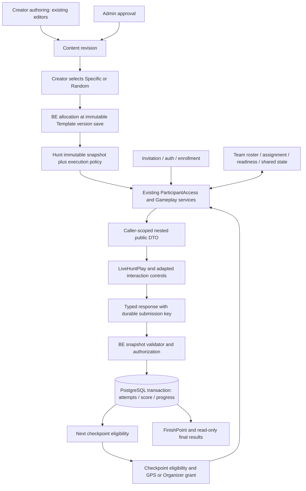

# C3 — Participant Gameplay Execution: Developer Implementation Specification

## 1. Purpose, scope and evidence

This is the implementation handoff for React/TypeScript FE, Node.js BE and PostgreSQL developers. Extend the existing participant runtime to execute approved, frozen Content securely. Preserve C1/C2 authoring, Admin approval, Specific/Random allocation, immutable Template versions and Hunt snapshots. This document proposes development work; it does not implement C3 or authorize publication of unsupported Hunts.

**Review boundary:** documentation only, one FE branch and one Draft PR. Only this document changes. Stop for ChatGPT review; do not merge or deploy.

### 1.1 Evidence labels and baselines

- **Verified fact (FE):** GitHub `main` resolved to `d23850976de016800e19f61709755e3e19732827` (merged #176) during this specification. The attached checkout is `ccaaaf22040a50192b17b919f5ac1e755db8153d` (#175). Current pinned FE runtime, renderer, Team canvas, API, admission, auth, types and adapters were fetched and inspected through GitHub. The four runtime/renderer/API blobs also match the attached checkout. Current allocation, Template exercise and persistence files were inspected remotely because #176 changes them. No claim that the older checkout is latest main.
- **Verified fact (BE at the audit pin):** `a0826e88ecf80fad5dd52097b9843eb4f1755448` (#121). Public GitHub access succeeded for the runtime, admission, routes, projection, schemas, allocation, readiness, Team model and migrations listed in §3. These key audit findings were independently checked at that pin. This is not a claim about later BE commits or deployed service behavior.
- **Audit-reported:** C3-00A (BE) and C3-00B (FE), supplied with this task, are primary references. Statements outside the source inspections above remain audit-derived. C3-00B reports 139 passing tests on the parent FE checkout; C3-00A inspected tests without running them. Neither proves canonical HTTP→database execution.
- **Proposed implementation:** all new DTOs, fields, routes, table additions, policies and work estimates below. Existing methods/routes are explicitly marked. Payload examples are proposed unless marked existing.
- **Open product decision:** §10 recommendations require approval before enabling affected behavior. Engineering may build policy seams and tests while that decision is pending.

Source references `[F…]` and `[B…]` resolve to exact repository paths and pinned source links in §13. The evidence date is 5 November 2026. No runtime tests, live Hunt or production operation were performed for this documentation task.

### 1.2 Baseline and gaps

| Capability | Verified baseline and required change |
| --- | --- |
| Admission/authentication | Real invitation lookup, guest/account authentication, enrollment and durable Hunt membership exist. Retain them [F1–F3, B2]. Guest expiry/recovery remains a limitation; no new identity system. |
| Navigation/GPS | Live navigation shows authorized destination/clue/distance and a walking link. Browser GPS posts an observation; BE decides proximity. Grants persist and GPS is spoofable. Embedded Participant map is optional [F1, F4, B2–B3]. |
| Content lifecycle | Approval and exact revision selection are implemented. FE #176 persists frozen allocations; BE resolves Random at Template save. Frozen payloads live in `customExercises`, provenance in `libraryAllocations`; runtime must never reroll or fetch latest Content [F7–F8, B7–B8]. |
| Existing gameplay | Legacy Signal Solo validates strings on BE, records attempts/score and advances checkpoints. A legacy stage called Team is still executed per individual. It does not prove real collaboration [F1, F4, B1, B4]. |
| Canonical Personal | All 15 have interactive author previews. Live page has no canonical dispatch and uses one string/first legacy answer key. Canonical participant execution is absent [F1, F5–F6, B1, B4]. |
| Canonical Team | All seven have local preview controls. `TeamChallengeCanvas` explicitly labels itself Creator-only simulation; full information and perspective switching are local. Membership/assignment/readiness/shared execution are missing [F5, F9, B9]. |
| Publication/delivery | Readiness rejects custom Hunts; `playableEntry` rejects custom checkpoints; answer returns `422 challenge_unsupported`. Non-Organizer projection nulls custom snapshots. Keep these protections until supported configurations pass integrated tests [B1, B4–B6]. |
| Security blocker | Legacy snapshots remain intact in `projectHuntForReader`. Hunt list/detail are accessible through supervisor roles; Participant+supervisor can obtain legacy `correctAnswers`, `teamAnswer`, hints/solutions outside staged delivery. Ordinary Participant-only detail access is denied. Fix server projections before expanding execution [B5, B10]. |
| Persistence/security debt | Wrong-answer retries are new attempts; no durable request identity. Scoring reads live settings. Attempts lack canonical/policy identity. Rate limits are process-local. Team gameplay ignores roster [B1–B2, B4, B11]. |
| Finish/results | Legacy terminal detection and participant finish exist. Executor assumes Personal first; canonical/Team FinishPoint missing. `/play` admission excludes finished Hunts. Existing leaderboard separately checks membership/staff and can read independently; a complete post-closure result API is missing [B1–B3]. |
| FE debt | Polling only during wait/navigation; no active-team/lifecycle refresh. Error says “Refreshing…” without reloading. Reads lack ordering/cancellation. Attempt reset is checkpoint/stage-based. Enrollment types still hardcode false/unresolved access fields; reconcile with actual BE values. Live dialogs need focus handling [F1–F4]. |

No audited core finding was contradicted by inspected source. Qualify “secure legacy gameplay”: staged `/play` DTOs are safer than raw Hunt reads, but supervisor disclosure remains. Qualify “results unavailable”: `/play` after closure fails, while the existing leaderboard has its own authorization path. Preview tests and allocation browser evidence are not gameplay execution evidence. Remaining unverified areas include production behavior, later BE changes, end-to-end concurrency, multi-session Team play and product policy choices.

## 2. Architecture and execution invariants



Authoring owns full interaction and answer data; Admin approval authorizes a particular revision. Template allocation freezes the selected revision and provenance (including terminal slots) once per immutable version. A Hunt pins its execution snapshot and geographic/radius configuration. Gameplay reads that snapshot, not live Library heads, current previews or participant-supplied exercise definitions.

Participant FE owns transient interaction drafts, network status and the latest server projection. BE owns eligibility, assignments, answer validation, assistance, scoring, progress and lifecycle. PostgreSQL owns durable identities, uniqueness and transactional effects. Preview mode may continue to use complete authoring objects and local checking; Participant mode must accept public-only input and never call `checkAuthoredAnswer` or `fromPersistence` on participant data [F5–F6]. No dummy expected answers to satisfy authoring interfaces.

### 2.1 Stage resolution

Extend `Gameplay.buildState/answer` and existing checkpoint parsing [B1, B3–B4]. Resolve the stable checkpoint ID to its pinned snapshot ordinal/terminal entry. Resolve the actual required slots rather than assuming legacy Personal then Team:

1. Not active: waiting/lifecycle state; no new protected content release.
2. Current checkpoint without arrival grant: navigation only.
3. Required Personal slot unsolved: Personal instance.
4. Required shared Team slot unresolved: Team readiness/play state, subject to every required member's own eligibility.
5. All actual required slots complete: mark checkpoint complete and unlock only the next checkpoint for proximity.
6. Terminal checkpoint complete: persist finish once and expose results. Participant finish and Organizer Hunt closure are distinct states.

Canonical Personal-only, Team-only and Personal+Team entries need explicit tests, including terminal entries. Empty or unsupported slot combinations fail readiness rather than silently auto-completing. MVP permits Personal-only Single Choice, including FinishPoint; Team-only execution belongs to Full. Legacy snapshots retain their existing dispatch and semantics. Mixed legacy/canonical routes remain blocked until specifically tested and advertised by capability validation.

### 2.2 Identity, state and policy

Proposed `exerciseInstanceId` identifies the frozen Hunt/checkpoint/slot instance. Derive or persist it from pinned identity, never generate a new value on every GET. Stored exercise UUID alone is insufficient across Hunts. Persist internal snapshot digest, source Content/revision, Template key/version, slot, validator version and effective execution-policy version. Do not expose source provenance or a digest of secret-bearing payloads unnecessarily in Participant DTOs.

Introduce durable monotonic `runtimeRevision` per execution aggregate (participant for Personal, team for shared state). Return both revisions when needed. `expectedRevision` on Team writes refers to the Team aggregate. Polling projections may combine participant and Team revisions; compare each independently. A version read must be consistent with its returned state. FE also uses request cancellation/generation guards and discards responses for another Hunt, identity or session. Background responses must not overwrite a newer mutation result.

Freeze effective scoring/retry/assistance/team/GPS policy in a separate execution-policy record linked to the pinned Hunt before play. Do not rewrite immutable approved snapshots. Legacy active Hunts retain documented legacy policy until an explicitly reviewed compatibility strategy exists. New canonical awards must be reproducible from the pinned policy and event ledger even if Platform Settings change.

## 3. Cross-repository reuse inventory

Paths are exact existing paths unless explicitly labeled **proposed new**. F/B references give pinned links. Dependencies name the existing layers or proposed package IDs (§9).

| Service/component and exact path | Existing responsibility | Decision and dependencies |
| --- | --- | --- |
| FE `src/pages/LiveHuntPlay.tsx` [F1] | Mobile navigation, GPS, legacy challenge, feedback, score/history, dialogs | **Adapt** canonical dispatch, synchronization, stale recovery, terminal/results. Depends on F4, P1/P3/P4. |
| FE `src/pages/ParticipantJoinFlow.tsx`; `src/pages/PublicHuntAccessPage.tsx` [F2] | Resolve invite, authenticate/enroll, enter Hunt | **Reuse unchanged** admission UX; regression against canonical lifecycle. Depends on existing hunt-access/enrollment services. |
| FE `src/app/providers/AuthProvider.tsx`; `src/services/api/client.ts`; `src/services/api/session.ts` [F3] | Identity/session and HTTP transport | **Reuse unchanged**; retain expiry and error handling. Runtime JSON validation is additional, not provided by TS generics. |
| FE `src/services/api/gameplay.ts` [F4] | Existing state/proximity/answer/help/leaderboard methods and DTOs | **Adapt** via versioned canonical union, results and assistance methods; retain legacy calls. Depends on BE contracts P1. |
| FE `src/services/api/participantEnrollment.ts` [F2] | Durable enrollment and context/navigation hint | **Adapt types** to real booleans/policy revision; do not make local storage authoritative. Depends on B2 contracts. |
| FE `src/features/creator/exercises/AuthoredExerciseRenderer.tsx` [F5] | All 22 preview interactions and local answer checks | **Adapt/extract controls**, retain Creator preview API; public Participant wrapper uses external submit/result. P2/P4/P7. |
| FE `src/features/creator/exercises/TeamChallengeCanvas.tsx` [F9] | Creator perspective/edit/check simulation | **Reuse visual/control patterns; adapt substantially** for a separate caller-scoped runtime boundary. Never mount unchanged for Participants. P8/P9. |
| FE `src/features/creator/exercises/MathText.tsx`; `src/features/creator/ParticipantPreviewShell.tsx` | Safe math/text and display frame | **Reuse** math renderer; **adapt shell** copy/branding/theme/accessibility as needed. No author controls. |
| FE `src/components/TedixMap.tsx`; `src/components/HuntMapPreview.tsx` | Map/editing/preview outside live Participant flow | **Optional adapt** read-only current target only. Current `LiveHuntPlay.Navigate` remains MVP navigation. Never fetch raw Hunt for map data. |
| FE `src/features/creator/exercises/persistenceTypes.ts`, `persistenceAdapter.ts`, `persistenceSchema.ts`, `persistenceValidation.ts`, `catalog.ts` [F6] | Complete authoring vocabulary, serialization, validation and local Attempt | **Reuse unchanged for authoring**; use vocabulary to define new public types/serializers. `fromPersistence` creates secret-bearing Exercise and is not a runtime adapter. |
| FE `src/features/creator/content/ChallengeAllocation.tsx`, `templateAllocation.ts`; `src/features/creator/exercises/templateExercises.ts`; `src/features/creator/templatePersistence.ts` [F7–F8] | Approved discovery, exact selection, frozen allocation save/restore | **Reuse unchanged** C1/C2 allocation; Participant never calls approved-detail APIs. |
| FE **proposed new** `src/features/participant/gameplay/contracts.ts`, `responseAdapters.ts`, `ParticipantExercise.tsx`; `src/services/api/participantTeams.ts` | None | **New focused modules** for public DTO validation, response serialization, caller-scoped Team client/UI. Existing client/state model; no new global framework. |
| BE `src/models/Gameplay.ts` [B1] | State, legacy comparisons, transactional score/progression, leaderboard/check-in/monitor | **Adapt**, preserve executor and transaction. Canonical dispatch P2/P3, shared runtime P8/P9, results P5. |
| BE `src/models/ParticipantAccess.ts`; `src/domain/participantAccess.ts`; `src/routes/participantAccess.ts` [B2–B3] | Membership, snapshot digest, checkpoint/GPS grants, participant route authorization | **Adapt minimally**, preserve authentication/current-checkpoint gates and lock discipline. Add explicit final-read authorization separate from active execution. |
| BE `src/domain/gameplay.ts` [B4] | Legacy request validation, comparison, projection and scoring policy | **Adapt dispatch**; retain legacy functions; pin canonical policy. P1/P2/P3. |
| BE `src/domain/customExercises.ts`; `src/domain/customExerciseSchemas.ts` [B5] | Authoring/schema/relational validation, ownership, coarse snapshot projection | **Adapt projection** security; **reuse authoring validation**. Add independent participant response validation, not `validateCustomExercises` on a submitted response. |
| BE `src/domain/huntReadiness.ts` [B6] | Publication checks and custom gate | **Adapt last per capability**; do not remove gate globally. Depends on lifecycle tests P5/P10. |
| BE `src/models/TemplateContentAllocation.ts`; `src/models/HuntTemplate.ts`; `src/db/migrations/045_template_content_allocation.ts` [B7] | Approved revisions, frozen allocation/immutable versions and DB guard | **Reuse unchanged**; retain integrity/provenance/uniqueness. No runtime Library resolution. |
| BE `src/routes/approvedContent.ts`; `src/routes/contentReview.ts`; `src/routes/huntTemplates.ts` [B8] | Creator discovery, Admin approval and professional catalogs | **Reuse unchanged authorization**; audit multi-role fairness separately. Not Participant delivery. |
| BE `src/models/Hunt.ts`; `src/routes/hunts.ts`; `src/routes/huntOperations.ts` [B10] | Snapshot persistence, lifecycle, Hunt reads and operations | **Adapt safe read projection**, capability publishing and policy pinning; preserve lifecycle writers. |
| BE `src/models/Team.ts`; `src/db/migrations/003_core_hunt_records.ts` [B9] | Team create/find/add, `teams`, `team_members`, same-Hunt/unique membership | **Adapt service**, reuse constraints; add authorized roster/assignment/freeze. Not yet shared execution. |
| BE `src/db/migrations/030_participant_checkpoint_access.ts`; `038_participant_gameplay.ts` [B11] | `hunt_participants`, checkpoint identities/access, progress, attempts, score events/help | **Extend with new additive migrations**, do not edit applied migrations. P3/P8/P9. |
| BE **proposed new** `src/domain/participantExerciseContracts.ts`, `canonicalAnswers.ts`; additive migration(s) under `src/db/migrations/` | None | **New small runtime boundary and pure validators**, integrated into existing services. Migration filenames/numbers chosen by developers after checking latest migration chain. |

## 4. Participant operations and contracts

### 4.1 Existing contracts to preserve

All routes below include `/api`. Existing transport is the authenticated `ApiClient`. BE participant router uses `requireAuth` and `Cache-Control: no-store` [B2]. Existing paths and request bodies below were inspected; full response types are [F4] and [B2].

| Operation | Existing method/route and request | Existing semantics / extension |
| --- | --- | --- |
| Invitation/admission | `GET /api/hunt-access/:code`; `POST /api/hunts/:id/participants/enroll` with optional `{accessCode}`; `GET /api/hunts/:id/participants/me` | Lookup can precede auth; enrollment/context require auth and authorized invitation/membership, enforce lifecycle/capacity. Return admission/context, not canonical content. Preserve retry/rejoin behavior; unique Hunt/user prevents duplicate membership. |
| Runtime | `GET /api/hunts/:id/participants/me/play` | Caller state includes hunt/participant identity, lifecycle, mission, score, checkpoints, stage, current and history. Extend for canonical DTO/revisions and active refresh; not currently a closed-Hunt result API. |
| Arrival | `POST /api/hunts/:id/checkpoints/:checkpointId/proximity` | Existing body example: `{"latitude":46.77,"longitude":23.59,"accuracyMeters":8,"observedAt":"2026-11-05T09:00:00.000Z"}`. Membership/current eligibility, numeric freshness/accuracy/radius checks, durable access grant. Repeated successful observation must not add score. |
| Personal answer | `POST /api/hunts/:id/checkpoints/:checkpointId/answer` | Existing body: `{"stage":"personal","answers":{"legacy-key":"value"}}`. Extend in place with versioned canonical variant; retain legacy schema. |
| Legacy Team answer | Same checkpoint `/answer` | Existing body: `{"stage":"team","answer":"value"}`. Individual stage, not shared multiplayer. Do not reinterpret old requests as canonical responses. |
| Help | `POST /api/hunts/:id/participants/me/help` | Existing body: `{"kind":"help","message":"Need Organizer assistance"}`; emergency also supported. Persists help request, unrelated to exercise hint/solution. No new client idempotency currently promised. |
| Leaderboard | `GET /api/hunts/:id/leaderboard` | Existing `{huntId,entries}` with rank/displayName/score/checkpoint counts/finishedAt/isYou. Membership or Hunt staff authorization; no raw emails or challenge secrets in returned rows. Extend with separate Team standings, not duplicated participant awards. |

Existing proximity failures include `422 proximity_stale`, `proximity_inaccurate`, `proximity_outside_radius`, `checkpoint_geography_unavailable`. Existing answer behavior includes `200 correct:false`, `409 checkpoint_not_current`, `stage_already_solved`, `invalid_hunt_state`, `422 challenge_unsupported`; it is not durable idempotency. Do not invent a different implemented response or assert exactly-once legacy retry semantics.

### 4.2 Proposed common boundary

All remaining §4 DTOs/URLs/error codes are **proposed**. Agree them in P1 before FE/BE implementation. Use a discriminated `contractVersion: 1` canonical branch on existing operations; existing authoring `schemaVersion: 1` is a separate version. Strictly reject unknown request properties at every depth. Resolve mechanic/slot from stored instance; echoed mechanic must match, never drive arbitrary client-selected validation. Proposed answer-body limit is 64 KiB, nesting depth at most 8; apply tighter mechanic-specific limits (40 general items, 16 Team contributions, text answers 500 characters except scrambled word 100 and shared code 256). Oversize transport bodies return 413 without an attempt. Reuse the existing schema vocabulary and request-limiting middleware rather than adding a validation framework.

Public exercise allowlist: `exerciseInstanceId`, `schemaVersion`, `type`, `classification`, `title`, `instructions`, and mechanic-specific `interaction` (§6–§7); no `answer`, `expected`, `owner`, complete `hints`, `solution`, `feedback` or raw allocation metadata. Envelope adds `contractVersion`, `runtimeRevision`, lifecycle, current checkpoint/slot, progress, visible score and `permissions`. Assistance metadata may expose only availability, next authorized ordinal/cost and released events. Unknown mechanic/version fails closed with recovery UI.

Authorization common to all operations: valid identity plus durable Hunt membership; derive participant and team from caller, never from submitted user/team identity. Check same-Hunt composite relationships. Return no secret details when denying access. Mutations also check active lifecycle, pinned snapshot, current checkpoint, personal arrival grant and required slot state. Proposed status mapping: 400 malformed/schema; 401 auth; 403 denied operation within an authorized context; 404 absent/invisible Hunt/team/instance; 409 stale revision, solved/unavailable stage, lifecycle or snapshot conflict; 422 unsupported mechanic or valid but ineligible GPS; 429 retry limit; 503 transient DB/service error. Well-formed wrong answers are 200 with `outcome:"incorrect"`; malformed requests consume no attempt or penalty.

Response errors use proposed `{"error":"stale_revision","refreshRequired":true}` without submitted/expected values. DB exceptions/SQL/snapshot details must not enter responses/logs. Server revalidates every mutation; hidden/disabled FE controls are usability only.

### 4.3 Secure delivery and checkpoint state — extend existing GET /play

**Method/route:** `GET /api/hunts/:id/participants/me/play`; no request body. Proposed optional polling validator `If-None-Match` with a caller-scoped revision token may be added later; initial implementation can return full no-store JSON. Authorization is common membership plus per-content checkpoint/slot eligibility. Navigation/waiting returns no protected exercise; a paused projection includes progress/status and disables writes without releasing additional hints or packets. Already delivered data cannot be revoked from browser memory.

**Response:** existing legacy union or proposed canonical envelope with current target, safe exercise, revisions, score/progress and permissions. Reading may reuse existing access-row initialization/last-activity behavior, but must never create attempts, release timed secrets, charge assistance or advance progress. Repeated GET reconstructs equivalent authoritative state. Membership/snapshot/lifecycle conflicts use §4.2; closed Hunt redirects FE to the proposed results operation, not repeated `/play` failures.

**Proposed JSON fragment** (canonical play envelope; ordinary existing mission/navigation/checkpoint fields omitted here for readability):

```json
{
  "contractVersion": 1,
  "huntId": "hunt-opaque-example",
  "runtimeRevision": 12,
  "huntStatus": "active",
  "stage": "personal",
  "score": 100,
  "current": {
    "checkpointId": "checkpoint-opaque-example",
    "kind": "regular",
    "slot": "personal",
    "exercise": {
      "exerciseInstanceId": "instance-opaque-example",
      "schemaVersion": 1,
      "type": "single-choice",
      "classification": "personal",
      "title": "Choose the value",
      "instructions": "What is 2 + 2?",
      "interaction": {"options":[{"id":"a","text":"4"},{"id":"b","text":"5"}]}
    }
  },
  "permissions": {"canSubmit":true,"canRequestHint":false}
}
```

Opaque example identifiers illustrate relationships; real Hunt/checkpoint identities remain the existing UUIDs. New instance identifier encoding is a contract decision, not those example strings.

### 4.4 Typed submission, attempt and result — extend existing POST /answer

**Method/route:** existing `POST /api/hunts/:id/checkpoints/:checkpointId/answer`. Proposed canonical required body: `contractVersion`, `stage`, `exerciseInstanceId`, `type`, `submissionId`, `expectedRevision`, `response`. §6–§7 enumerate every exact response shape. UUID `submissionId` identifies one immutable logical answer; FE generates it once before sending and retains it across timeout/reconnect. An edited answer gets a new key. Strict body/ID membership/length/cardinality/numeric validation precedes comparing against snapshot expected data; limits must follow stored mechanic bounds, not legacy 200-character string limits.

**Persistence:** transactionally create one attempt with subject/instance/validator/policy identity, increment attempt counter, append permitted penalty/award, mark solved, possibly advance/finish, store the submission result and increase revision. Record safe request hash, outcome and event references; retaining raw answers is optional and requires retention/access policy (D14). Store neither extra fields nor unbounded request bodies. Result includes attempt ID/count, outcome, released feedback, checkpoint completion and authoritative state; score delta is informational, ledger is authority.

**Idempotency:** unique `(hunt, executionSubject, exerciseInstance, submissionId)` plus canonical request hash; executionSubject is participant or team. After auth/membership and current entitlement to read prior result, check an existing key before stale/current-stage checks. Same key/body replays the original committed result even after advancement or closure, through an explicit result lookup path in the handler that does not reopen active execution. Same key/different body gives 409 `idempotency_conflict`. Replaying old result is never a fresh award. A rolled-back transaction leaves no accepted key; safe retry can execute. A concurrent different key after solve gives 409 and current safe state. Rate limiting may restrict abusive retries but must not charge duplicate wrong attempts.

**Proposed request:**

```json
{"contractVersion":1,"stage":"personal","exerciseInstanceId":"instance-opaque-example","type":"single-choice","submissionId":"7e033668-a066-40ea-8a91-1a78bb66d353","expectedRevision":12,"response":{"optionId":"a"}}
```

**Proposed response fragment** (`state` is the complete authorized play projection in the actual response):

```json
{"contractVersion":1,"submissionId":"7e033668-a066-40ea-8a91-1a78bb66d353","attempt":{"id":"attempt-opaque-example","number":1},"outcome":"correct","checkpointCompleted":true,"scoreDelta":10,"runtimeRevision":13,"releasedFeedback":{"text":"Correct."},"state":{"huntId":"hunt-opaque-example","stage":"navigate","runtimeRevision":13,"score":110}}
```

Score values above are illustrative, not approved scoring. An incorrect response returns only policy-safe feedback, increments once, keeps the stage current and preserves permitted retry state. Never return per-item correctness or expected IDs accidentally through validation errors. Stale responses trigger real FE reload; network errors keep the logical submission key and draft until reconciled.

### 4.5 Hints, controlled reveals and feedback — proposed new operation

**Method/route proposal:** `POST /api/hunts/:id/checkpoints/:checkpointId/assistance`. Required body: `exerciseInstanceId`, `requestId` (UUID idempotency), `kind:"hint"|"memory-reveal"`, `expectedRevision`. Server chooses the next hint; clients cannot request arbitrary future indices. Authorization: current subject/instance/arrival plus assistance availability, timing and policy. Team assistance uses Team scope and submit/assistance permissions. Solution/skip are disabled unless D8 approves a future explicit contract; do not add a hidden solution variant now.

**Response:** delivered assistance event ID/kind/ordinal/text, effective cost, updated revisions/state. Persist release and charge atomically with unique request identity and unique `(subject,instance,kind,ordinal)` delivery event. Repeat same request returns same event/cost without charging again; concurrent next-hint requests require revision compare-and-set so one releases and the other gets stale revision. No hints remaining, premature reveal or disallowed kind: 409 with safe availability metadata. Paused/closed/cancelled: no new release/cost. GET /play may return already authorized releases to the same subject on reconnect.

**Proposed JSON:**

```json
{"exerciseInstanceId":"instance-opaque-example","requestId":"71fe1f43-5e64-4ed7-ac5b-1b3d018ecb8b","kind":"hint","expectedRevision":16}
```

```json
{"eventId":"assistance-opaque-example","kind":"hint","ordinal":1,"text":"Try grouping the terms.","cost":0,"runtimeRevision":17,"score":110,"canRequestNext":false}
```

Authored incorrect feedback can itself contain solutions. MVP uses generic correct/incorrect text. Full requires approved feedback-release classification or conservative withholding until completion. Author approval alone does not guarantee all feedback is safe during retries. Memory policy and card-as-answer are handled in §6.2, not ordinary public interaction serialization.

### 4.6 Team membership, state and contribution delivery — proposed operations

**Roster GET proposal:** `GET /api/hunts/:id/participants/me/team`, no body. Authenticated member sees only own team ID, permitted display names/member IDs, roster version, formation status and frozen-policy summary. Do not expose emails, other teams or packets. No team returns 200 `team:null` (not arbitrary team lookup). Read is retry-safe, no membership mutation. Formation follows D1: recommended Organizer assignment through an extension of existing authorized Team service; no public self-join API until formation rules are approved. Assignment must enforce capacity/one-team/same-Hunt atomically. Existing model methods alone are not a Participant formation API.

**Proposed response:**

```json
{"team":{"id":"team-opaque-example","rosterVersion":3,"frozen":true,"members":[{"participantId":"member-a","displayName":"A"},{"participantId":"member-b","displayName":"B"} ]}}
```

**Team runtime GET proposal:** `GET /api/hunts/:id/checkpoints/:checkpointId/team-state`. No client team parameter; derive membership. Require current checkpoint and caller grant; do not release a packet just because another member arrived. Response contains team revision, instance identity, roster readiness/status, caller's assigned packets, explicitly shared material, `canSubmit`, `canRequestHint`, shared attempt/score status and released events. Projection uses the seven type-specific allowlists in §7. No GET changes readiness or releases sibling packets. Unauthorized/foreign/not-current follows §4.2; before barrier it may return safe waiting metadata without exercise secrets. Reconnect returns same stable assignment. No packet reassignment just because a member is temporarily offline.

**Proposed response fragment:**

```json
{"exerciseInstanceId":"team-instance-example","teamRevision":8,"type":"distributed-information","myContributions":[{"id":"fact-a","text":"The number is even."}],"shared":{"options":[{"id":"x","text":"8"},{"id":"y","text":"9"}]},"readiness":[{"participantId":"member-a","ready":true},{"participantId":"member-b","ready":false}],"canSubmit":false}
```

**Readiness PUT proposal:** `PUT /api/hunts/:id/checkpoints/:checkpointId/team-readiness`, body `{exerciseInstanceId,ready:boolean,expectedRevision,requestId}`. Only caller changes own readiness after their required Personal slot and arrival. Persist readiness for frozen roster/instance, increment Team revision and deduplicate `requestId`. Repeat same request is idempotent; stale revisions return 409; disallowed lifecycle/roster/caller readiness returns 409/403. Return caller ready flag, readiness summary, Team revision and `canSubmit`.

**Proposed JSON request/response:**

```json
{"exerciseInstanceId":"team-instance-example","ready":true,"expectedRevision":8,"requestId":"84452a6d-12f7-420e-bca5-067c5b133c09"}
```

```json
{"ready":true,"teamRevision":9,"allRequiredReady":true,"canSubmit":true}
```

Contributions are private assignment delivery, not a free-text message board. Recommended default is verbal collaboration with shared final answer; no new chat service. If in-app sharing is approved, add a separate explicit release operation with sender entitlement, packet ID, revision/idempotency and durable recipient scope; never automatically publish every packet. Shared Final Key can accept agreed order/code manually using public opaque fragment IDs, without displaying siblings' digits to the caller. Explicit shared releases require D2 approval.

### 4.7 Shared Team submission — extend existing POST /answer

Reuse existing checkpoint answer route, canonical `stage:"team"`, Team instance, strict §7 response, `submissionId`, and `expectedRevision` referring to Team state. No caller-supplied teamId. Authorization additionally checks frozen same-Hunt roster, caller submit permission and D4 readiness/all-member checkpoint eligibility inside the transaction.

Persist one shared attempt/completion/award, not one per polling member. A distinct teammate key racing after completion gets 409 `stage_already_solved` plus safe reconciliation; same key/body replays. Scope a Team key to the Team subject and record originating actor; replay to another teammate must use that reader's current safe projection and must not replay an actor-private payload. Store neutral result/events and project per caller, preserving original attempt outcome/award. Concurrent different keys at the same Team revision serialize; loser receives stale revision without a second attempt/penalty.

**Proposed JSON:**

```json
{"contractVersion":1,"stage":"team","exerciseInstanceId":"team-instance-example","type":"distributed-information","submissionId":"06adc6ab-cd02-4ad1-936e-8cd90b1b3099","expectedRevision":9,"response":{"optionId":"x"}}
```

```json
{"outcome":"correct","attempt":{"id":"shared-attempt-example","number":1},"teamRevision":10,"checkpointCompleted":true,"teamScore":120,"completedMemberIds":["member-a","member-b"]}
```

Actual response also returns caller-safe participant state and revisions. Member IDs above are visible roster identities, not global user identifiers. Shared completion updates eligible roster-member progress and next access grants in the same transaction. Unarrived/ineligible members cannot be advanced by a teammate; recommended all-member barrier prevents partial completion. Alternate quorum/late-join rules need D4 before implementation.

### 4.8 FinishPoint completion — extend existing proximity, answer and /play

No new “mark complete” client operation. A FinishPoint is the existing terminal checkpoint identity with `kind:"finish"`, whose actual slots use the same delivery/arrival/submission contracts. BE alone decides completion. Recommended Team finish requires every required member's arrival/Personal prerequisites, then one shared final answer. D10 determines GPS policy; D4 covers Team barriers.

On final required correct answer, atomically persist terminal completion, participant/team finish time, finish/completion events, and final projection revision. Unique completion/award keys prevent repeat awards. Do not finish the Organizer's entire Hunt automatically when one subject finishes. Wrong/malformed/stale terminal answers behave as ordinary answers. Missing/unsupported terminal slots fail publication. Retry of final accepted submission returns the committed finish result.

**Proposed terminal result fragment from `/answer`:**

```json
{"outcome":"correct","checkpointCompleted":true,"runtimeRevision":31,"state":{"stage":"finished","huntStatus":"active","finishedAt":"2026-11-05T09:30:00.000Z","score":150},"resultAvailable":true}
```

### 4.9 Final results — proposed new read operation

**Method/route proposal:** `GET /api/hunts/:id/participants/me/results`; no body. Explicit authenticated membership/read policy, independent of `withContext` active-state restriction. Never enroll, initialize gameplay or grant access during a final read. Return only caller Personal result plus own Team result and authorized standings. No answers/solutions/packet archive by default. Identity expiry still requires supported sign-in; do not invent permanent guest recovery.

**Response:** Hunt lifecycle; participant/team status (`in_progress`, `completed`, `closed_incomplete`, `cancelled`); durable finish time, completed/total checkpoint counts, score/event summary, policy version, standings scope/rank and whether ranking is final. While other subjects play, rank is provisional; closure fixes final ranking under pinned rules or persists a final standings version. Reads produce no score events. Before closure, a completed subject can read own result; incomplete reads may show provisional progress. After finished, D11 governs retention/access duration. Cancellation must not fabricate successful completion or final competitive rank. Unauthorized/expired retention uses 404/403; unavailable finalization is a safe retryable status, not a fake final result.

**Proposed JSON:**

```json
{"huntId":"hunt-opaque-example","huntStatus":"finished","resultStatus":"completed","participant":{"score":150,"finishedAt":"2026-11-05T09:30:00.000Z","checkpointsCompleted":3,"checkpointsTotal":3},"team":null,"standing":{"scope":"personal","rank":2,"final":true},"policyVersion":"c3-policy-example-v1"}
```

## 5. Security, persistence and lifecycle implementation

### 5.1 Close disclosure before enabling canonical play

Fix `projectHuntForReader` and all Hunt list/detail callers [B5, B10] so every non-Organizer read omits legacy secret-bearing snapshot content too. The simplest safe default is null snapshot plus explicit safe metadata, rather than a denylist of known legacy keys. Verify supervisor-only and Participant+supervisor reads. Keep professional authoring authorization explicit: an Organizer/Creator legitimately may read secrets; Participant routes must still return only Participant projections. D12 decides whether such users can compete. Merely hiding controls or fields in React does not close disclosure.

Use explicit construction of every nested public object. Never `{...exercise}`, `{...interaction}`, JSON clone/delete-top-level-fields, or TypeScript `Omit` as a security boundary. Both BE and FE validate a discriminated public schema; only BE projection guarantees non-disclosure. Tables §6–§7 are the complete intended interaction allowlists, not permission to include sibling authoring fields. Treat unknown nested fields/version as unsupported. Text is rendered with existing safe text/math paths, not HTML injection.

Test HTTP responses, error bodies, history, results, leaderboard, help/monitor projections and cache/log paths. Exercise privacy includes media/reveal endpoints if added later. Use `no-store` for caller-scoped responses and ensure FE service worker does not cache auth/packet payloads. Clear drafts/private state on logout, Hunt switch, role/session switch and Team change; avoid packet persistence in local storage and analytics. A pending non-secret submission key may be retained in session storage scoped to identity/Hunt/instance; raw answer retention needs D14.

### 5.2 Authoritative validation

Validate structure, finite numeric types, length/depth/body limits, identifiers, completeness/uniqueness and state eligibility before comparing. Unknown IDs/duplicate maps are malformed, not wrong answers. Enforce snapshot-defined bounds (up to 40 items generally; Team packets 2–16; shared code up to 256 digits) [B5]. Public ordering must not reveal expected mappings: preserve semantic order for examples/steps/terms/slots; independently shuffle choices and pair columns or remap answer-derived IDs for delivery. Persist deterministic per-instance presentation mapping and translate submitted public IDs back server-side. Do not send an order derived from expected pairs/construction, sortable answer positions, or encoded answer IDs.

Validators are pure comparisons against pinned private payload, separated from authoring schema validation. Version normalization: proposed default is explicit Unicode NFC plus locale-independent case normalization when `caseSensitive:false`, with no trimming unless approved; `scrambled-word` additionally strips whitespace to match preview intent. Golden fixtures must pin differences from preview `toLocaleUpperCase`; D13 resolves compatibility before enabling text mechanics. No client-supplied tolerance, expected value, case setting, score, timestamps or completion flags.

### 5.3 Durable records and transactions (proposed schema changes)

Extend existing migrations through new additive migration files. Existing `participant_checkpoint_progress`, `participant_challenge_attempts` and `participant_score_events` retain their roles [B11]. Existing score category CHECK constraints must be extended if new assistance/team categories are introduced; do not assume arbitrary strings are accepted.

| Proposed persistence addition | Constraints and purpose |
| --- | --- |
| Execution policy/instance identity | Hunt-linked immutable policy/version and instance→Hunt/checkpoint/slot/snapshot reference; unique instance per frozen slot. New reads cannot change source snapshot. |
| Attempt extensions and submission receipt | Nullable canonical columns for legacy compatibility: instance, subject kind/id, submission key/hash, validator/policy version, attempt number/outcome; unique subject/instance/key and subject/instance/attempt number. Receipt stores committed neutral outcome/events and original revision; reproject to authorized caller on retry. |
| Revision and canonical slot progress | Participant/instance revision and slot completion; retain existing checkpoint projection. Separate Team revision shared by readiness/assistance/submissions. No second independent source of checkpoint truth. |
| Assistance ledger | Subject/instance/kind/ordinal/release time/cost/policy/request key, unique delivery and request key; atomic score event reference. |
| Team execution/assignment/readiness | Reuse `teams`/`team_members`; add frozen execution roster/rosterVersion, per-instance packet assignment with same-Hunt membership FKs, unique packet assignment according to D2; readiness per required member. |
| Shared Team attempts/progress/score | Team-scoped attempt/result/completion and ledger. Separate Team score ledger is recommended; preserve existing participant ledger for Personal awards. Unique Team/instance/event keys; never add Team total again by summing copied Personal awards. |
| Final results | Project from immutable policy/events/finish timestamps; optionally persist closure standings/version for stable ranking. Do not copy secret snapshot into result record. |

Use existing Hunt-first lock discipline (`ParticipantAccess.withContext`): Hunt → Team execution (if any) → participant rows sorted by ID → slot/progress/receipt/assistance rows. Existing lifecycle writers must follow compatible order and recheck active status. Introduce a Team-aware context helper within existing services; do not recursively invoke `withContext` for multiple members in separate transactions. Preserve snapshot digest verification including radius configuration. Unique constraints backstop application locks.

In one transaction: authorize/resolve snapshot → replay committed key if allowed → verify expected revision and eligibility → validate/compare → insert attempt/release → award once → update progress/revisions → persist result → commit. A failure at any step rolls everything back. Treat deadlock/serialization errors as bounded retry of the same logical request. Team completion and all member advances commit together. Current Hunt-row locking serializes writes broadly; retain correctness first and measure contention before optimizing. Never remove lifecycle locking merely to improve polling throughput.

### 5.4 Lifecycle, retries and race rules

| State/race | Required behavior |
| --- | --- |
| Published/waiting | Membership/context may be available; no solve/release/score before active. |
| Active | Every mutation checks membership, snapshot, current slot and required grant inside transaction. Navigation-only state cannot submit. |
| Paused | Preserve progress/drafts; reject new answers/readiness/releases/costs. Refresh/poll shows pause and disables actions. Existing receipts may be read without reexecution. Memory deadline uses approved D9 policy. |
| Finished | No new mutations; own final results/prior receipt reads use read-only authorization, not active admission. No snapshot answers in results. |
| Cancelled | Reject new execution; preserve ledger/audit and expose cancellation summary if D11 permits. Never finish subjects through cancellation. |
| Pause/finish races answer | Hunt row serialization determines which committed first. No score mutation after a closing transition committed first. Test both orderings. |
| Wrong answer timeout | Replay same key/body returns same attempt/penalty; edited response requires new key and current state. |
| Multiple tabs/teammates | Revision precondition and row locks serialize distinct writes; one current outcome, no duplicate award/progression. No optimistic local score. |
| Snapshot mismatch | Fail closed with `snapshot_conflict`; do not silently replace membership digest or re-resolve allocations. |

Checkpoint/GPS: reuse BE strict observation parsing, timestamp/accuracy/radius checks, same-Hunt identity and Organizer fallback audit [B2–B3]. Fresh browser readings improve usability, not trust. Enforce all-member grants for Team default; one member's GPS must not authorize another member's packet. Rate limits bound deliberate answer enumeration across workers if deployment is multi-instance; idempotency/attempt policy are durable, not an in-memory bucket substitute.

## 6. Personal mechanic implementation matrix (15/15)

Every existing renderer below is the named branch in `src/features/creator/exercises/AuthoredExerciseRenderer.tsx` [F5]. Preserve its authoring/preview behavior. Public interaction fields in this table are allowlists (nested `Item` means exactly `{id,text}`); response JSON is **proposed**, with no expected data. P1 common envelope, security and replay rules apply to every row. All validators are new BE participant comparators, even where authoring validation already exists.

| ID / existing branch | Public interaction data | Proposed response | BE validation | FE adaptation / security/state | Acceptance case (in addition to common QA) |
| --- | --- | --- | --- | --- | --- |
| P01 `tap-pair` | `left:Item[]`, `right:Item[]` with independent presentation | `{"pairs":[{"leftId":"l1","rightId":"r2"}]}` (all pairs) | Exact complete bijection; known left/right IDs, no repeats/omissions; compare full private mapping | Replace `a.pairs` click oracle with editable provisional pairs; no local “matched” correctness; submit whole board | Correct complete map solves; swapped map incorrect; duplicate right malformed; clicking never accesses expected pairs. |
| P02 `single-choice` | `options:Item[]` | `{"optionId":"a"}` | One known option ID, compare expected | Controlled selection, explicit external submit, no default selected answer | Correct and wrong known options distinct outcomes; foreign option 400 and no attempt. |
| P03 `true-false` | Empty object | `{"value":false}` | Strict boolean equality | Serialize string button selection to boolean; false is valid, unset is not false | False submits; `"false"`, null and missing rejected. |
| P04 `memory-card` | `revealDelayMs` plus safe release availability/timing metadata; **no card initially** | `{"value":"recalled text"}` | Pinned text normalization; durable reveal state/timing affects eligibility/score under D9 | Replace local timer/card preload with controlled assistance (§6.2) | No card bytes before allowed release; early/repeated/concurrent reveal and reconnect preserve timing/cost. |
| P05 `number-line` | `min,max,step` | `{"value":3.5}` | Finite number within min/max, step-grid validation using decimal-safe arithmetic; compare private target ± tolerance inclusively | Explicit unset/zero/min distinction, slider + accessible input; no client tolerance | Min/zero valid; just inside/outside tolerance; off-grid malformed; NaN/string rejected. |
| P06 `multiple-choice` | `options:Item[]` | `{"optionIds":["a","c"]}` | Unique known IDs; exact-set equality independent of order; proposed response schema allows empty set as well-formed wrong | Controlled set; no option-specific correctness | Reordered correct set solves; subset/superset/empty wrong; duplicate/unknown malformed. |
| P07 `match-columns` | `left:Item[]`, `right:Item[]` | `{"pairs":[{"leftId":"l1","rightId":"r2"}]}` (complete) | Complete bijection as P01 | Preserve select controls; shuffled columns not corresponding author order | Full map correct, missing/duplicate malformed; public order not an answer key. |
| P08 `drag-drop` | `items:Item[]`, `targets:Item[]` | `{"assignments":[{"itemId":"i1","targetId":"t2"}]}` (complete) | Every item once; known target; compare mappings; multiple items per target allowed unless schema adds constraints | Retain select fallback for touch/keyboard; serialize full map | Many-to-one authored map works; omitted item malformed; wrong valid target incorrect. |
| P09 `fill-blank` | `blanks:[{id,prompt}]` | `{"values":[{"blankId":"b1","value":"text"}]}` (complete) | Every blank once, bounded strings; private case policy, per-value comparison | Capture raw text; no expected normalization flags in DTO | Multi-blank correct; one wrong incorrect; missing/duplicate blank malformed; case fixtures. |
| P10 `sequence` | `elements:Item[]` in safe presentation order | `{"order":["i2","i1"]}` | Exact permutation of available elements and expected order | Controlled add/remove/order, stable opaque IDs; do not present expected ordering by default | Right permutation solves; swapped wrong; repeated/missing ID malformed. |
| P11 `find-mistake` | `steps:Item[]`, `explanations:Item[]` | `{"stepId":"s2","explanationId":"e3"}` | Both known IDs; combined equality; no intermediate private step result | Recommended combined submission; show both selections without checking expected step. Server-stage alternative only if approved | Correct step/wrong explanation is incorrect with no secret step oracle; stage UI never loads expected ID. |
| P12 `build-problem` | `pieces:Item[]`, `slots:Item[]` | `{"construction":["p2","p1"]}` | Known distinct inventory IDs, exact slot count; compare ordered expected construction; unused pieces permitted if authored | Preserve ordered controls; identical visible pieces retain separate IDs; slot labels remain semantic | Right subset/order solves; too many/reused pieces malformed; wrong subset incorrect. |
| P13 `number-pattern` | `terms:[{id,value?}],missingId`; missing term has no value | `{"value":12}` | Finite bounded number; exact expected numeric value, not string coercion | Empty input distinct from zero; serialize numeric only | Zero/negative boundaries; correct number; no missing answer field in delivered terms. |
| P14 `shape-pattern` | `terms:[{id,shapeId?}],missingId,shapes:Item[]`; missing term has no shape | `{"shapeId":"shape-c"}` | Known shape ID equals expected | Controlled choice; public shape choices shuffled safely, pattern order preserved | Right/wrong shape; unknown ID malformed; no hidden missing shape in JSON. |
| P15 `rule-discovery` | `examples:[{input,output}],rules:Item[],predictionInput` | `{"ruleId":"r2","predictedOutput":18}` | Known rule, finite numeric prediction; both equal private expected | Serialize both fields, no rule-dependent local answer calculation | Right rule/wrong number and wrong rule/right number both incorrect; malformed numeric rejected. |

Array examples with one mapping are shape illustrations; actual requests must include every required item from the frozen instance. Set/ordering rules must not be inferred from those shortened examples.

### 6.1 Tap & Pair and Find the Mistake behavior choice

P01 recommended default changes correctness feedback to whole-board validation; it keeps pairing interactions without shipping correct pairs. Pair-by-pair feedback, if required by product, needs rate-limited, durable BE substeps with attempt/penalty rules and explicit oracle-risk acceptance; do not simply add an unlimited pair-check endpoint. P11 recommended default collects step and explanation together. If staged learning is required, BE must persist which substep was passed and deliver only next-stage public data; wrong-step validation must not expose the expected ID. These choices are D15, not silent UI changes.

### 6.2 Memory Card requires an explicit timing policy

Verified preview semantics are “recall before revealing”: `card` is preloaded, reveal unlocks after `revealDelayMs`, and prototype conversion often makes card equal the answer [F5–F6]. It is not a proven study-card-then-hide mechanic. Do not ship `card` initially, even though authoring calls it interaction data.

Recommended proposal for D9: server records instance `openedAt` once in a mutation when starting the memory attempt (a `kind:"memory-start"` extension to assistance, added to the contract before enabling P04); stores `revealAvailableAt = openedAt + revealDelayMs`; GET only reports availability. Early reveal is rejected. First authorized `memory-reveal` stores a release event; repeated reveal returns the same event. A server deadline, not client timer, governs release. Reconnect cannot reset start. Pausing freezes remaining delay by durable elapsed-time accounting if D9 approves; no release while paused. A delay-only wall-clock alternative is simpler but must be approved explicitly.

**Proposed memory-start operation:** same `POST /api/hunts/:id/checkpoints/:checkpointId/assistance`, same current-member/arrival/active authorization and UUID request identity as §4.5, with `kind:"memory-start"`. Validate that the pinned instance is P04, current and not already completed. Starting records timing state and increments revision but creates no scored answer attempt or cost. A second start cannot reset the timestamp: the same request replays its event, and a fresh request returns the existing start without a new revision. Return no card. Before start, answer submissions return 409 `memory_not_started`; invalid kind/instance or stale revision follows §4.2. Reuse existing start state on reconnect rather than automatically issuing a new logical start.

**Proposed memory-start JSON request/response:**

```json
{"exerciseInstanceId":"memory-instance-example","requestId":"9bf88930-9630-44f4-81a4-6efc7321b723","kind":"memory-start","expectedRevision":20}
```

```json
{"eventId":"memory-start-example","kind":"memory-start","openedAt":"2026-11-05T09:10:00.000Z","revealAvailableAt":"2026-11-05T09:10:05.000Z","runtimeRevision":21,"cost":0}
```

`memory-reveal` uses the §4.5 request shape and returns only the authorized card as event text plus cost/revision; 409 `reveal_not_available` before the server deadline. This does not authorize preloading the card through GET. The public contract union must include `memory-start` only when D9 is approved and the P04 capability is enabled.

Because revealing the card may reveal the answer, recommended release is assistance with first-attempt bonus removed and a pinned scoring rule; never allow revealed answers to earn unassisted accuracy credit. Product must decide whether submission after reveal can complete, or whether reveal ends the scored attempt. Until D9 is approved, keep P04 unsupported. Timed hiding can never make previously delivered browser data secret again; screenshots/devtools cannot be prevented.

## 7. Team mechanic implementation matrix (7/7) and multiplayer

Existing interaction branches are in `AuthoredExerciseRenderer.tsx`; `TeamChallengeCanvas.tsx` adds Creator simulations [F5, F9]. All require new shared runtime, not just response serialization. Public `Item` remains exactly `{id,text}`. `myContributions` contains only caller assignments; `shared` contains explicitly public/released fields. Packet IDs visible in a shared ordering palette may be public; packet contents remain private. Table contracts are **proposed** and depend on approved D1–D5.

| ID / mechanic | Public interaction and private assignment delivery | Proposed response | BE validation | FE adaptation / special state | Acceptance with independent sessions |
| --- | --- | --- | --- | --- | --- |
| T01 `scrambled-word` | Assigned `contributions:Item[]` only; public instructions; no expected word | `{"word":"ORBIT"}` | Bounded raw word, pinned case/whitespace rule; compare expected word | Caller letters/pieces, agreed word input; never render all stored contributions | A/B receive different packets, combine verbally, one answer completes shared stage once. |
| T02 `distributed-information` | Assigned `facts:Item[]`; shared `options:Item[]` | `{"optionId":"x"}` | Known public option equals expected | Remove player perspective selector; show own fact + shared readiness/options | A cannot fetch B's fact by ID or perspective; only ready authorized member submits. |
| T03 `hypothesis` | Assigned `packets:Item[]`; `decoderKey` only if explicitly public/released under D2 | `{"value":"decoded value"}` | Bounded text/private normalization equals expected | Caller packet and authorized decoding key, shared status | No sibling packet or unreleased key in HTTP; reconnect preserves assignment; decoded answer validated on BE. |
| T04 `assemble-machine` | Assigned `contributions:Item[]`; shared `frequencies:[{id,text,value}]` | `{"frequencyId":"f2"}` | Known frequency ID equals expected; ignore client numeric frequency claims | Reuse frequency choices; do not invent drag-assembly/state absent from canonical schema | Two assigned observations lead to one frequency result; double teammate submit does not double score. |
| T05 `clue-synthesis` | Assigned `clues:Item[]`; shared `answerPattern` when approved as public | `{"value":"combined answer"}` | Bounded text with pinned case policy | Caller clue + public answer pattern + shared submit | Other team/session gets no clue; reconnect and wrong-answer retry keep same clue allocation. |
| T06 `filter-noise` | Assigned signal content `signals:Item[]`; shared candidate signal ID palette with public labels only if D2 approves | `{"trustedSignalIds":["s1","s3"]}` | Unique IDs from complete authorized team candidate set; exact trusted set | Shared final selection can include IDs discussed verbally; caller must not preload all signal texts | A/B discuss assigned signals; subset/superset incorrect; foreign signal malformed; concurrent wrong request charged once. |
| T07 `shared-final-key` | Assigned `contributions:[{id,digits}]`; shared `orderingInstructions` and opaque fragment ID palette; no siblings' digits | `{"order":["c2","c1"],"code":"0042"}` | Complete permutation, expected order, exact string code and consistency with private fragments | Reuse ordering controls with public IDs/authorized releases; keep leading zeros; no local full-digit concatenation check | A/B retain distinct digits; ordered code beginning 00 works; full order/wrong code incorrect; final completion shared once. |

Public instruction/key/pattern text must be reviewed for accidental answer disclosure; not every string named “instruction” is safe. For T06/T07, candidate ID palette order must not encode trusted set/correct sequence. D2 must resolve whether teams share material verbally only or through explicit durable releases; do not invent additional semantic answers or automatic packet sharing.

### 7.1 Smallest reliable multiplayer implementation

Reuse `teams`/`team_members` with authorized Organizer assignment before start (recommended D1). Freeze roster and stable deterministic packet assignment when execution starts. Each packet maps to one required member; if packet count differs from approved team size, D2 defines distribution or readiness rejects configuration. Do not drop clues or duplicate them automatically. Validate team capacity, same Hunt, one-team-per-participant and complete packet coverage in PostgreSQL transaction.

Proposed simple default: required roster members arrive and finish their own Personal prerequisites, each sets ready, then any required ready member can submit one shared answer. Offline status is informational, not an automatic roster removal/readiness bypass. Team score is one shared total plus separately shown Personal totals (D5); do not copy shared points into Personal ledger and add them again on a board. Team checkpoint completion advances only the frozen required roster after barrier; Team FinishPoint follows the same gate. Results show Team completion/score and own Personal contribution without exposing private packets.

Use authenticated short polling initially: around 3 seconds during Team wait/play, slower around 10 seconds during navigation/published wait; refresh on visibility/focus/reconnect and after every mutation. These are proposed tunable intervals, not SLA promises. Poll caller-scoped endpoint, avoid overlapping requests, back off on failures/429 and stop on teardown/logout/terminal results. Mark state stale and disable mutations when freshness/permission is unknown; BE always rechecks. All active Personal screens also refresh lifecycle. Compare revisions as §2.2; reconnection restores readiness, assignments, assistance and durable shared outcome.

No WebSocket requirement. Evaluate SSE/WebSockets only if measured latency or traffic requirements justify them. A connection is never authority, and push delivery still requires the same authorization/projection, revision handling and reconnect read. Verbal collaboration plus private packets/readiness/shared answer is sufficient for the recommended first real multiplayer scope.

## 8. Milestones and release gates

### 8.1 C3-MVP — secure Personal foundation

Mandatory demonstrable path: Creator authors Single Choice → Admin approves exact revision → Creator allocates Specific or Random → immutable Template version → Hunt snapshot → invitation/auth/enrollment → navigate/GPS or authorized fallback → safe current exercise → typed submission → BE comparison → durable attempt/score/progress → next checkpoint → Personal-only Single Choice FinishPoint → own results after Organizer closure.

Mandatory MVP deliverables are disclosure fix, real auth/membership, nested allowlists, pinned identity/policy, strict server validation, idempotency, persistent transaction/progression, active lifecycle handling, canonical terminal/results, capability-scoped readiness and real disposable-PostgreSQL tests. No deferred security or local correctness fallback. Initial public feedback may be generic; hints unavailable. Allow publication only if every required slot including terminal is supported canonical Personal Single Choice with valid geography and frozen provenance. Do not simply remove `hasCustomExercises` gates. Keep all unsupported Team/memory/other mechanics blocked.

MVP is **not full C3**. Other 14 Personal mechanics, paid hints, real Team execution and mechanic-specific controlled reveals are outside this milestone. Embedded map is optional.

### 8.2 C3-Full — complete execution

Mandatory Full adds all Personal comparators/adapters, controlled hints and feedback, Memory/substep policy, all seven Team mechanics with actual membership/private assignment/readiness/shared submission, shared progression/scoring, Team FinishPoint and closed-Hunt results, full lifecycle/privacy/concurrency/mobile/legacy regressions. Capability registry must show 15 Personal + seven Team mechanic contracts passing integration acceptance, including timing and assignment variants.

Optional enhancements: embedded Participant map, push transport, in-app chat/contribution publishing, richer analytics and animations, solution/skip if approved. They are not prerequisites for the defined server-authoritative foundation. Product choices required for a mandatory mechanic (Memory/team distribution) cannot be deferred while claiming Full complete.

## 9. Dependency-ordered developer implementation plan

Each row is an independently reviewable work package; FE/BE changes should be separate linked PRs when repositories differ. All paths abbreviated as F/B IDs resolve in §3/§13. New paths are proposals. Effort is an initial **engineering planning range in person-days (one day ~6 focused hours)** including tests/review fixes, not a commitment; validate with owners after policy decisions. It does not reuse or add the audits' overlapping “Codex hours.” No deployment, product waiting or unrelated refactoring included.

| Task / milestone | Objective / repo and affected existing files | New work / implementation details | Dependencies and sequencing | Acceptance and required tests | Effort / risk |
| --- | --- | --- | --- | --- | --- |
| P0 / MVP | Close legacy snapshot disclosure; BE B5/B10 | Construct safe non-Organizer list/detail metadata projection; retain Organizer authoring access | First security PR; independent of canonical UI | HTTP role matrix including Participant+supervisor and legacy snapshots; no raw answers/hints/solutions; legacy `/play` still usable | 1–2 d / high |
| P1 / MVP | Agree runtime boundary and policy seams; FE F4/F6, BE B2/B4/B5 | Proposed public/response schemas, error/revision/idempotency rules, instance resolver and capability manifest; contract examples/fixtures | P0 security boundary; FE/BE contract review before consumers | Schemas reject nested unknown secrets; all 22 typed responses represented; separate legacy discriminant; D-register reviewed | 2–3 d / high |
| P2 / MVP | Single Choice delivery/comparison; BE B1/B4/B5, FE F5 | BE public DTO constructor/pure validator; FE public-input control extraction without expected answers | P1; validator/UI controls can be parallel | Correct/wrong/unknown-ID cases, nested leak canaries, original Creator preview regression | 1–2 d / medium |
| P3 / MVP | Canonical transaction/persistence/slot progression; BE B1/B2/B11 | Additive policy/instance/receipt/revision/attempt migration(s); reuse ledger and checkpoint gates; support actual Personal-only terminal slots | P1/P2 BE; schema before integration | Real PG HTTP lifecycle; wrong retry once, correct double submit once, rollback atomicity, source snapshot unchanged | 4–6 d / high |
| P4 / MVP | Live Single Choice and robust state; FE F1/F2/F4/F5 | Proposed ParticipantExercise/contracts/adapters; canonical dispatch, durable key, revision guards, lifecycle refresh, focus/mobile feedback | P1 enables mocked work in parallel with P3; real integration after P3 | UI wrong/stale/network retry, boolean/identity reset tests; two-checkpoint live path and mobile FinishPoint with real BE | 3–5 d / medium |
| P5 / MVP | Finish/results and scoped publishing; BE B1/B2/B6/B10, FE F1/F4 | Final read authorization/projection; policy/score reproducibility; capability gate only for tested Single Choice Personal/terminal | P3/P4; no canonical publication until integrated gate passes | Finished Hunt fresh-session result, incomplete/cancelled states, final answer retry, no double finish; immutable approved pin survives newer Library draft | 2–4 d / high |
| P6 / Full | Remaining ordinary Personal validators; BE B4/B5 | Pure typed comparators for P03/P05–P15 except controlled mechanics; P11 combined variant after D15 | P1; can run alongside P3–P5 without publishing these mechanics | Golden correct/wrong/malformed/boundary fixtures per row; text policy D13; property/uniqueness cases | 3–5 d / medium |
| P7 / Full | All Personal controls and assistance; FE F1/F4/F5; BE B1/B2/B11 | Public adapters for all 15; assistance ledger/atomic charges; controlled memory-start/reveal; P01 full map/P11 combined; generic-safe or classified feedback | P3/P6 plus D6–D9/D13/D15; FE ordinary adapters can parallel P6 | All 15 real runtime cases; pause/reconnect timing; hint retries/concurrency; no interaction oracle or preloaded card | 5–8 d / high |
| P8 / Full | Team roster/assignment/readiness/state; BE B2/B3/B9/B11; FE F9 | Extend Team service/authorized assignment, frozen roster/packet records/readiness; proposed participantTeams client and scoped UI | P1/P3 and D1–D4; formation/state foundation before shared answers | ≥2 independent sessions; cross-team/foreign Hunt denial, complete assignment/capacity, rejoin stable, all-member arrival/barrier | 4–7 d / high |
| P9 / Full | Seven shared mechanics, progression and Team scoring; BE B1/B4/B9/B11; FE F1/F4/F9 | All Team comparators/adapters, shared attempt/ledger, transactional fan-out, short polling, Team FinishPoint/results | P6 validator conventions + P8, D2–D5/D10/D12; assistance relies on P7 | Seven multi-session scenarios; concurrent keys, once-only shared award/member progress, private retry projections, disconnect/late polling, shared finish/results | 6–10 d / high |
| P10 / Full | Full capability gates and release QA; FE F1/F4; BE B1/B6/B10 | Replace remaining blanket gate only for tested capabilities; review DB migration registry/bootstrap parity and compatibility; fix C3-specific defects | P5/P7/P9, all blocking decisions resolved | Full §11 matrix, clean DB and upgraded legacy fixture DB, 22 runtime mechanics, security/closure/mobile/regression evidence | 3–5 d / high |

Mandatory sequential chain: P0 → P1 → P2/P3 → integrated P4 → P5 (MVP); Team P8 → P9 → P10. P6 comparator work and ordinary FE adapters may run alongside MVP after contracts stabilize; P7 assistance and P8 roster can proceed separately on top of stable execution persistence. Only reviewed supported capabilities become publishable. Parallel implementation is not permission to enable unfinished paths. Estimate aggregation must account for cross-repository ownership and review availability; these ranges are work-package estimates, not a calendar schedule.

## 10. Product-owner decision register

All recommendations below are **proposals**, not approved rules. “Blocks” means blocks enabling the affected capability; it does not stop generic contracts, security fixes or unrelated work. Store approved choices as versioned execution policy, with explicit defaults and migration/legacy behavior, before publication.

| ID / decision | Why / options | Recommended simple default | Technical impact / blocks |
| --- | --- | --- | --- |
| D1 Team size/formation | Authored packet counts 2–16; self-join vs Organizer assignment vs automatic balancing; fixed vs variable size | Organizer assigns before start; fixed configured roster with ≥2, reject incompatible exercises | Capacity transaction, roster freeze, eligibility/readiness checks; **blocks Team P8/P9**, not Personal MVP |
| D2 Contribution distribution/sharing | Packets may differ from members; private per-player vs shared all vs controlled release; one/multiple per person | One stable assignment per packet, all packets covered, balanced distribution only if approved; verbal sharing; reject unsupported count pairing | Assignment algorithm, public decoder/pattern/palette classification, release APIs if wanted; **blocks all Team mechanics** |
| D3 Who submits Team answer | Any member vs captain vs unanimous answer | Any required ready member submits against Team revision | Server `canSubmit`, concurrent attempts, captain election avoided; **blocks Team submit policy** |
| D4 Readiness and disconnected members | All vs quorum; readiness persistent vs live presence; late join/replacement | All frozen required members arrived, Personal prerequisites done and explicitly ready; disconnect does not remove member; Organizer resolves before execution | Barrier/member fan-out/terminal semantics, no automatic incomplete-member advance; **blocks Team execution** |
| D5 Team versus Personal score | Shared total vs duplicated awards vs combined ranking | Separate Team shared ledger/standing and Personal ledger; show both; no implicit combined total | Award uniqueness, leaderboards/results and scoring-policy freeze; **blocks Team scoring/results** |
| D6 Hints/costs | Disabled/free/paid, count/sequence, shared Team charge | MVP hints disabled; Full sequential authored hints with approved fixed cost (zero simplest), Team charge once | Assistance ledger, score categories and policy version; **blocks Full assistance**, not MVP with hints off |
| D7 Wrong-answer retries | Unlimited/rate-limited vs capped vs time penalty; count malformed? | Rate-limited eligible retries with generic feedback; malformed never counted; any penalty explicitly pinned (zero simplest) | Attempt/bonus/penalty logic and replay accounting; **blocks canonical policy sign-off including MVP** |
| D8 Solutions/skipping | No skip vs forfeit/partial credit vs full solution | Disabled; Creator preview retains solution controls | If enabled needs explicit release/skip event and progression/score rules; **does not block MVP/Full with disabled policy approved** |
| D9 Memory timing/reveal | Preview recall-then-reveal vs study-then-hide; pause freezes vs wall clock; answer after reveal | Retain recall-then-reveal with BE start/deadline, freeze delay during pause; reveal removes unassisted bonus, score/completion rule approved explicitly | Start/reveal persistence, timer/pause accounting and leak classification; **blocks P04/Full**, not MVP |
| D10 GPS presence/trust | Client observation vs stronger proof; durable vs repeat grant; Organizer fallback | Existing numeric observation and audited Organizer fallback, durable per checkpoint; every required Team member grants own arrival | Accuracy/age/radius policy pinning, spoofability disclosure and team barrier; **blocks production gameplay policy sign-off** |
| D11 Closure/results/guest access | Permanent vs time-limited membership results; incomplete/cancelled display; guest expiry | Own read-only results after finished within agreed retention, no new admissions; incomplete/cancelled distinctly labeled; no invented expired-guest recovery | Read-only auth path, retention and final rank snapshot; **blocks MVP results sign-off** |
| D12 Professional+Participant fairness | Ban competing in own authored/organized Hunt vs unrank vs allow; supervisor access | Allow safe Participant view but mark privileged/answer-exposed accounts non-competitive in that Hunt; authorization still role-specific | Exposure/ranking eligibility rule and role-change history; do not claim projection erases prior knowledge; **blocks competitive ranking sign-off** |
| D13 Text/numeric comparison compatibility | Preserve preview locale behavior vs deterministic new normalization; whitespace/tolerance | Version deterministic BE normalization; only scrambled-word removes whitespace; numeric exact except explicit number-line tolerance | Golden fixtures and clear authored expectations; **blocks affected text/numeric mechanics**, Single Choice MVP unaffected |
| D14 Answer/event retention | Full raw answers vs hashes/outcomes; how long available to staff | Keep bounded outcome/hash/events; raw text off unless need approved, restricted retention | Attempt schema/logging/privacy and support tools; **blocks optional raw retention**, outcome persistence remains mandatory |
| D15 Pair/Find-Mistake interaction | Immediate per-pair oracle/staged step vs combined final answer | Full provisional pair mapping; combined step+explanation | More secure minimal contracts, changes feedback timing; **blocks enabling P01/P11 behavior**, not MVP |

D7/D10/D11/D12 must have explicit approved MVP policy; shipping silently chosen “simple defaults” is not completion. Implementation can proceed with configurable policy seams and tests until sign-off. Decisions must identify effective version and whether they apply to new canonical Hunts only; never retroactively alter frozen scoring rules.

## 11. Acceptance and QA strategy

### 11.1 Layers and evidence

| Layer | Required coverage and proof |
| --- | --- |
| Pure contract/validator tests | Each P01–P15/T01–T07: correct, well-formed wrong, malformed, unknown/duplicate/missing IDs, numeric/text boundaries. Snapshot-derived reference IDs; compare sets versus sequences correctly. Verify no expected-field dependence in public controls. |
| Mocked FE tests | Canonical dispatch, response serializers, empty/zero/false inputs, stale revision/reload, timeout same key, draft reset by instance, session/Hunt switch, focus/keyboard and released hints. Explicitly label these UI behavior tests; they do not prove DB awards/multiplayer. |
| Real HTTP + disposable PostgreSQL | Mandatory for membership/snapshot/grant checks, migration constraints, attempts/score/assistance idempotency, lock races, readiness/shared completion/member fan-out, terminal/results and lifecycle closure. Use actual auth identities and real application routes. Mocked model methods cannot substitute. |
| Browser integrated tests | Existing join/navigation/GPS API/renderer/submission/finish/results through real BE and disposable PG. GPS can be browser-emulated but BE gate and persistence must be real; separately test real-device permissions/accuracy behavior. Multi-session Team requires ≥2 isolated sessions, not perspective toggling. |
| Mobile/manual QA | 320/390px phones and desktop; long math/text, keyboard opening, touch/select fallback, no overflow, visible submission state/errors, screen reader labels/status and modal focus restoration. Verify low connectivity and geolocation denied/unavailable. |

Run existing FE suites (`tests/liveHuntPlay.test.tsx`, `participantJoin.test.tsx`, `customExercisePersistence.test.tsx`, `approvedContent.test.tsx`) plus new runtime coverage. Run BE `src/domain/gameplay.test.ts`, `src/routes/participantAccess.integration.test.ts`, `customExercises.integration.test.ts` and new canonical/Team integration suites. Exact new test filenames belong to implementation PRs; do not claim these tests already exist or pass. BE audit authoring fixtures cover 22 mechanics but do not validate participant responses.

### 11.2 Required integrated scenarios

1. **Snapshot source chain:** create draft → approve exact Content revision → allocate Specific and Random → save version → create Hunt. Verify execution uses frozen payload/revision after a newer draft/approval and unrelated Template save; runtime never rerolls. Confirm Personal uniqueness and terminal allocation remain intact. Assert DB snapshot bytes/digest unchanged after gameplay.
2. **MVP lifecycle:** two ordinary checkpoints plus Personal-only Single Choice FinishPoint, existing join, wrong GPS rejected, valid GPS grants, wrong answer once, correct answer, persisted score/progress, next-only unlock, refresh, finish and fresh authorized result read after Organizer closure.
3. **22 mechanic coverage:** use each matrix acceptance case through real HTTP/PG for at least one correct and incorrect run and malformed submission. For Team use independent members in distinct sessions/teams. Test required slot combinations and terminal slots; use a Team mechanic at Team FinishPoint, then parameterize other terminal-supported mechanics.
4. **Secret exposure:** seed unique canary answer/solution/hint/private-packet strings and unexpected fields at every depth; assert exact schema and absence across play, navigation, wait/pause, wrong answer, errors, retries, help, history, results, leaderboard and supervisor Hunt list/detail. Check memory card before release, expected pairs/step IDs and siblings' packets; legitimate public text that equals an answer is separately classified, not blindly banned by substring. Test Participant-only, supervisor-only, Participant+supervisor, other-team, other-Hunt, Organizer and Creator/Admin Participant contexts. Organizer secret authoring access is expected; Participant projection stays safe.
5. **Retry/concurrency:** kill connection after commit, retry same wrong/correct/terminal/hint key; count one attempt/event/cost. Same key with different body conflicts. Race separate keys, tabs and teammates; compare revisions and verify one shared award/completion. Inject DB failure after attempt insert/before score/progression; all roll back. Test wrong teammate concurrent submissions incur only the accepted current revision's attempt.
6. **GPS/eligibility:** stale/inaccurate/outside readings, missing geography, valid grant, previous/next/foreign checkpoint ID, manual Organizer fallback and paused lifecycle. One member cannot use another's grant or submit for absent members.
7. **Pause/closure races:** race answer and lifecycle update in both commit orders. Preserve committed outcome, reject later execution, no new hint/packet releases during pause or closure. Resume restores state; cancellation differs from successful finish. Memory timer behavior matches D9 across reload/pause and cannot reset.
8. **Team/reconnect:** unauthorized assignment, capacity race, frozen roster, all packets assigned exactly as policy, same assignment after reconnect, readiness gates, any-member/captain permission as approved, stale shared response, disconnect without bypass, private projection on another teammate's submission replay. Verify Team score is counted once, not multiplied by members.
9. **Final results/scoring:** terminal wrong/correct and duplicate finish; Personal/Team completed versus closed-incomplete versus cancelled; live ranks provisional, final rank stable; effective policy reproduces scores after Platform Settings change. Closed-Hunt access does not enroll/advance/return solutions. Guest expiry behavior is accurate.
10. **Legacy regressions:** legacy Signal join, proximity, Personal and individual Team stage, score/reveal/help/leaderboard/terminal; authoring/previews/approval/allocation unaffected. Run upgrade from a fixture DB with old attempts and clean disposable DB from all migrations. New nullable fields do not rewrite history; unsupported mixed snapshots remain gated. Check migration registry/schema bootstrap parity used by test harnesses.

Disposable PostgreSQL is specifically required for scenarios 1–10 where durable state/authorization/races apply; they cannot be certified by in-memory mocks. Use isolated test databases/fixtures and temporary users, never the development or production service. Record FE/BE commits, DB version, migration head, policy versions, commands, fixtures and observed assertions in implementation PR evidence. Keep tokens/raw private payloads out of artifacts. The specification's documentation checks are not runtime acceptance evidence.

## 12. Traceability and review map

| Input requirement / audit finding | Specification location | Delivery package / proof |
| --- | --- | --- |
| Verified FE/BE baselines, reuse, preview distinction | §1, §3, §13 | P0/P1; pinned source and explicit audit limitations |
| C1/C2 approved allocation → frozen runtime | §2, §5.3, §11.2.1 | P3/P5; immutable payload/provenance regression |
| Legacy supervisor disclosure / multiple roles | §1.2, §5.1, D12 | P0; full HTTP role matrix |
| Safe delivery and typed contracts | §4.2–§4.4, §6–§7 | P1–P4/P6; nested allowlist and validator tests |
| All 15 Personal / pair/memory/mistake risks | §6, D9/D13/D15 | P6/P7; 15 HTTP/PG cases plus controlled release |
| All seven Team / simulation is not multiplayer | §4.6–§4.7, §7 | P8/P9; independent sessions and private assignments |
| Retry, scoring reproducibility, transaction races | §2.2, §4.4, §5.2–§5.4 | P3/P7/P9; real PG replay/rollback/race tests |
| FinishPoint and results after Hunt closure | §4.8–§4.9, D11 | P5/P9; terminal retry and post-closure fresh read |
| FE polling, stale errors, ordering, modal/type debt | §1.2, §2.2, §3, §7.1 | P4/P9; stale response/reconnect/mobile tests |
| MVP versus Full, dependencies, effort/risk | §8–§9 | P5 gate versus P10 full capability gate |
| Product decisions not silently selected | §10 | Recorded approved version before enabling affected feature |
| QA/Definition of Done | §11, §14 | Evidence per mechanic and lifecycle; no preview-only proof |

## 13. Source references and evidence limitations

### 13.1 Supplied primary audits

- **A1 / C3-00A Backend Audit:** supplied text beginning “Approved Content cannot currently be played in real Hunts,” pinned BE `a0826e8`, sections 1–7 (gap matrix, services, APIs, security, comparators, plan, first security task). Original attachment `Pasted text.txt`, upload ID `file_000000006f4c820a9848031f496d7340`. Static audit; tests not run. Its source references are preserved below.
- **A2 / C3-00B Frontend Audit:** supplied “TedixHunt C3 — Frontend Participant Gameplay Gap Audit,” pinned FE `d238509`, parent checkout `ccaaaf2`; sections on Participant UX, reuse, all 22 mechanics, API contracts, gaps, MVP and Team requirements. Original attachment `Pasted text.txt`, upload ID `file_00000000f48c820a9c734c2f62250746`. Reported 139 tests run on parent; no live Hunt. This specification does not reclassify that evidence as a latest-main integration run.
- **Task acceptance source:** supplied “TedixHunt — C3 Developer Implementation Specification,” upload ID `file_0000000020f0820aabebae56daf39f9a`. Requires one document/branch/Draft PR and no code changes. Audits are task attachments, not assumed existing repository documents; source-pinned references below make the handoff independently usable.

### 13.2 FE sources at d23850976de016800e19f61709755e3e19732827

| ID | Exact path / inspected responsibility |
| --- | --- |
| F1 | [`src/pages/LiveHuntPlay.tsx`](https://github.com/tedixdev-arch/Tedix_Hunt_FE/blob/d23850976de016800e19f61709755e3e19732827/src/pages/LiveHuntPlay.tsx), `Navigate`, `Challenge`, `LiveHuntPlayPage`; [`src/routes/router.tsx`](https://github.com/tedixdev-arch/Tedix_Hunt_FE/blob/d23850976de016800e19f61709755e3e19732827/src/routes/router.tsx) |
| F2 | [`src/pages/ParticipantJoinFlow.tsx`](https://github.com/tedixdev-arch/Tedix_Hunt_FE/blob/d23850976de016800e19f61709755e3e19732827/src/pages/ParticipantJoinFlow.tsx); [`src/services/api/participantEnrollment.ts`](https://github.com/tedixdev-arch/Tedix_Hunt_FE/blob/d23850976de016800e19f61709755e3e19732827/src/services/api/participantEnrollment.ts); `src/pages/PublicHuntAccessPage.tsx` (audit-referenced wrapper) |
| F3 | [`src/app/providers/AuthProvider.tsx`](https://github.com/tedixdev-arch/Tedix_Hunt_FE/blob/d23850976de016800e19f61709755e3e19732827/src/app/providers/AuthProvider.tsx); `src/services/api/client.ts`, `src/services/api/session.ts` (audit-referenced transport) |
| F4 | [`src/services/api/gameplay.ts`](https://github.com/tedixdev-arch/Tedix_Hunt_FE/blob/d23850976de016800e19f61709755e3e19732827/src/services/api/gameplay.ts), `GameplayApi`, `PlayState`, `AnswerResult`, `gameplayError` |
| F5 | [`src/features/creator/exercises/AuthoredExerciseRenderer.tsx`](https://github.com/tedixdev-arch/Tedix_Hunt_FE/blob/d23850976de016800e19f61709755e3e19732827/src/features/creator/exercises/AuthoredExerciseRenderer.tsx), `checkAuthoredAnswer` and 22 branches |
| F6 | [`src/features/creator/exercises/persistenceTypes.ts`](https://github.com/tedixdev-arch/Tedix_Hunt_FE/blob/d23850976de016800e19f61709755e3e19732827/src/features/creator/exercises/persistenceTypes.ts); [`persistenceAdapter.ts`](https://github.com/tedixdev-arch/Tedix_Hunt_FE/blob/d23850976de016800e19f61709755e3e19732827/src/features/creator/exercises/persistenceAdapter.ts), `fromPersistence`, `authorPrototype` |
| F7 | [`src/features/creator/content/ChallengeAllocation.tsx`](https://github.com/tedixdev-arch/Tedix_Hunt_FE/blob/d23850976de016800e19f61709755e3e19732827/src/features/creator/content/ChallengeAllocation.tsx); [`templateAllocation.ts`](https://github.com/tedixdev-arch/Tedix_Hunt_FE/blob/d23850976de016800e19f61709755e3e19732827/src/features/creator/content/templateAllocation.ts) |
| F8 | [`src/features/creator/exercises/templateExercises.ts`](https://github.com/tedixdev-arch/Tedix_Hunt_FE/blob/d23850976de016800e19f61709755e3e19732827/src/features/creator/exercises/templateExercises.ts); [`src/features/creator/templatePersistence.ts`](https://github.com/tedixdev-arch/Tedix_Hunt_FE/blob/d23850976de016800e19f61709755e3e19732827/src/features/creator/templatePersistence.ts) |
| F9 | [`src/features/creator/exercises/TeamChallengeCanvas.tsx`](https://github.com/tedixdev-arch/Tedix_Hunt_FE/blob/d23850976de016800e19f61709755e3e19732827/src/features/creator/exercises/TeamChallengeCanvas.tsx), Creator-only simulation |

Other FE paths in §3/§11 are audit references or existing parent-checkout paths; no claim of independent latest-main execution testing. Current pinned source was inspected for F1–F9 linked files, not every transitive dependency. No new framework is required.

### 13.3 BE sources at a0826e88ecf80fad5dd52097b9843eb4f1755448

| ID | Exact path / evidence |
| --- | --- |
| B1 | [`src/models/Gameplay.ts`](https://github.com/tedixdev-arch/Tedix_Hunt_BE/blob/a0826e88ecf80fad5dd52097b9843eb4f1755448/src/models/Gameplay.ts), `buildState`, `answer`, `award`, `leaderboard`, `checkIn` |
| B2 | [`src/models/ParticipantAccess.ts`](https://github.com/tedixdev-arch/Tedix_Hunt_BE/blob/a0826e88ecf80fad5dd52097b9843eb4f1755448/src/models/ParticipantAccess.ts), `withContext`; [`src/routes/participantAccess.ts`](https://github.com/tedixdev-arch/Tedix_Hunt_BE/blob/a0826e88ecf80fad5dd52097b9843eb4f1755448/src/routes/participantAccess.ts) |
| B3 | [`src/domain/participantAccess.ts`](https://github.com/tedixdev-arch/Tedix_Hunt_BE/blob/a0826e88ecf80fad5dd52097b9843eb4f1755448/src/domain/participantAccess.ts), snapshot checkpoints/observation/proximity |
| B4 | [`src/domain/gameplay.ts`](https://github.com/tedixdev-arch/Tedix_Hunt_BE/blob/a0826e88ecf80fad5dd52097b9843eb4f1755448/src/domain/gameplay.ts), `playableEntry`, legacy validators/DTOs/scoring |
| B5 | [`src/domain/customExercises.ts`](https://github.com/tedixdev-arch/Tedix_Hunt_BE/blob/a0826e88ecf80fad5dd52097b9843eb4f1755448/src/domain/customExercises.ts), `projectHuntForReader`, authoring validation/ownership; [`customExerciseSchemas.ts`](https://github.com/tedixdev-arch/Tedix_Hunt_BE/blob/a0826e88ecf80fad5dd52097b9843eb4f1755448/src/domain/customExerciseSchemas.ts), exact mechanic schemas |
| B6 | [`src/domain/huntReadiness.ts`](https://github.com/tedixdev-arch/Tedix_Hunt_BE/blob/a0826e88ecf80fad5dd52097b9843eb4f1755448/src/domain/huntReadiness.ts), custom and Team gates |
| B7 | [`src/models/TemplateContentAllocation.ts`](https://github.com/tedixdev-arch/Tedix_Hunt_BE/blob/a0826e88ecf80fad5dd52097b9843eb4f1755448/src/models/TemplateContentAllocation.ts); [`src/db/migrations/045_template_content_allocation.ts`](https://github.com/tedixdev-arch/Tedix_Hunt_BE/blob/a0826e88ecf80fad5dd52097b9843eb4f1755448/src/db/migrations/045_template_content_allocation.ts); `src/models/HuntTemplate.ts` (audit-referenced immutable save) |
| B8 | `src/routes/approvedContent.ts`, `src/routes/contentReview.ts`, `src/routes/huntTemplates.ts` (A1 privileged-route audit references; not independently fetched for this specification) |
| B9 | [`src/models/Team.ts`](https://github.com/tedixdev-arch/Tedix_Hunt_BE/blob/a0826e88ecf80fad5dd52097b9843eb4f1755448/src/models/Team.ts); [`src/db/migrations/003_core_hunt_records.ts`](https://github.com/tedixdev-arch/Tedix_Hunt_BE/blob/a0826e88ecf80fad5dd52097b9843eb4f1755448/src/db/migrations/003_core_hunt_records.ts) |
| B10 | [`src/routes/hunts.ts`](https://github.com/tedixdev-arch/Tedix_Hunt_BE/blob/a0826e88ecf80fad5dd52097b9843eb4f1755448/src/routes/hunts.ts), list/detail projection and role guards; [`src/models/Hunt.ts`](https://github.com/tedixdev-arch/Tedix_Hunt_BE/blob/a0826e88ecf80fad5dd52097b9843eb4f1755448/src/models/Hunt.ts); `src/routes/huntOperations.ts` (A1 operations reference) |
| B11 | [`src/db/migrations/038_participant_gameplay.ts`](https://github.com/tedixdev-arch/Tedix_Hunt_BE/blob/a0826e88ecf80fad5dd52097b9843eb4f1755448/src/db/migrations/038_participant_gameplay.ts), exact attempt/progress/score constraints; `src/db/migrations/030_participant_checkpoint_access.ts` (A1 access-table reference) |

The runtime, membership, disclosure and gate statements are independently supported at this pin. Approval-route internals, complete migration-chain parity and audit test reports remain audit-derived; developers must inspect latest sources and run proposed acceptance checks during implementation. Git shell fetch was unavailable in the attached environment; GitHub connector reads supplied current/pinned source access. That tooling limitation did not prevent key-source verification or change the implementation scope.

## 14. Developer Definition of Done

MVP completion requires the same security/persistence standards below for its explicitly scoped Single Choice Personal path; it must not be labeled Full C3. **Full C3 is complete only when developers demonstrate all of these:**

- [ ] Creator-authored, Admin-approved exact Content revisions freeze into Template and Hunt snapshots; Specific/Random allocations never reroll at runtime.
- [ ] Authenticated, authorized Participants receive only current caller-safe data; legacy supervisor and multi-role disclosure regression tests pass.
- [ ] Mobile Participants can reach checkpoints, obtain BE-confirmed eligibility and solve exercises with accessible controls.
- [ ] BE validates every typed response against the private frozen instance and approved policy; no client correctness or scoring authority.
- [ ] Durable attempts, idempotent submissions, assistance and score events survive retry/reconnect; concurrent requests cannot multiply awards or penalties.
- [ ] Actual required slots drive persistent checkpoint completion and next-only eligibility.
- [ ] Personal and Team FinishPoint completion persists exactly once and remains distinct from Organizer Hunt closure.
- [ ] All 15 Personal mechanics pass their contract, runtime and mobile acceptance cases, including controlled pair/memory/mistake behavior.
- [ ] All seven Team mechanics pass with two or more independent sessions, authorized roster/private assignments/readiness/shared outcomes and reconnect.
- [ ] Final Personal/Team results remain available after closure under approved retention/access/fairness rules; scoring and ranks are reproducible.
- [ ] Existing legacy Hunts, admission, authoring/previews, approval and allocation remain functional; additive migrations pass clean and upgrade tests.
- [ ] Blocking product decisions are recorded with effective policy version; all required privacy, integration, concurrency and lifecycle tests pass with reproducible disposable-PostgreSQL evidence.
