# Tedix Hunt - Prototype Architecture & Implementation Plan

Version 3.5 | Updated 24 October 2026

This revision preserves Phase A–N and the existing identity, credential and account-retirement architecture. The Creator phase is complete for its agreed baseline before the Mapbox evolution. Merged geographic authoring/preview capabilities are audited below; new Universal/Local, Country/Locality and map-first setup work does not reopen that baseline.

Revision note (3.1): corrects B1.1 using merged FE #61 and G1 using merged FE #70; incorporates the finalized geographic architecture and subsequent Admin/Organizer corrections; integrates Mapbox M1–M6 into existing phases. Merged implementation is distinct from deployed E2E evidence; this revision does not claim a new deployment test.

Revision note (3.2): defines FinishPoint as a terminal checkpoint using the shared gameplay engine; clarifies geographic compatibility, Feature 6 authoring, backend-authoritative Hunt completion and the existing-phase implementation sequence. Documentation only: existing implementation statuses are preserved; no new implementation or deployed E2E verification is claimed.

Revision note (3.3): documentation only, before implementation prompts. Adds AI-assisted Country/City Templates (F7/G4) and Organizer map-first General Setup (D10); audits merged F4–F6/G3/D8 without claiming deployed E2E. Preserves Signal story, Personal/Team Challenges, the Creator/Admin approval chain and immutable snapshots. No application code, content generation, migrations or deployment are part of this revision.

Revision note (3.4): introduces planned Universal/Local Templates, Creator community reuse by independent versioned copies, separate Admin approval, a hybrid Country/Locality catalog, proportional geographic safety evidence and clue-based Participant navigation. Preserves legacy Signal content, exact-version approval and immutable Hunt snapshots. Audits current FE/BE main and recent merged implementation separately from deployment and independent E2E evidence. Phase A–N and historical revision/evidence notes remain intact; newly agreed architecture is not implemented by this documentation change.

Revision note (3.5): documentation-only architecture visualization pilot. Adds a master system-context map, a Phase F context view and a focused Universal-to-Local lifecycle, with shared status/focus/relationship conventions. Preserves all architecture decisions, phase statuses, historical evidence and roadmap dependencies; no implementation or deployed verification is claimed.

Refinement note (3.5): separates business and technical authority, splits category submission/review paths, and adds explicit source-eligibility and review decisions. Documentation only; version, implementation statuses and Phase A–N scope remain unchanged.

Refinement note (3.5): adds Phase G and Phase D logical context diagrams, separating implemented generic foundations from planned category/safety, Personal Hunt and operational capabilities. Preserves historical status, legacy compatibility and unresolved contracts; no implementation or deployed verification is claimed.

Diagram-extension note (3.5): adds Phase H entry/enrollment, Phase I gameplay and Participant information-visibility diagrams. Existing foundations remain distinct from planned runtime and unresolved contracts; no implementation or deployed verification is claimed.

Diagram-extension note (3.5): adds Phase J live operations, Phase K results/rewards and a cross-phase checkpoint-suspension lifecycle. Preserves authority, privacy, fairness, planned-runtime boundaries and unresolved policies; no implementation or deployed verification is claimed.

Diagram-extension note (3.5): adds Phase A platform, Phase B identity/authorization and Phase C Hunt-domain context diagrams. Preserves implementation evidence, exact lifecycle states, planned B6/runtime boundaries and unresolved dependencies; no implementation or deployed verification is claimed.

Diagram-extension note (3.5): adds Phase E professional lifecycle, Phase L Admin operations, Phase M long-term Participant systems and Phase N custom-request context diagrams. Preserves existing statuses, historical evidence, credential/authority boundaries and unresolved dependencies; no implementation or new deployed verification is claimed.

The implementation strategy is:

Existing approved mockup
→ define the real domain model
→ persist it in PostgreSQL
→ secure it through the backend
→ connect the existing frontend screen
→ verify the deployed flow

The frontend is not being rebuilt. Existing useful mockup screens remain the UX reference and are progressively connected to real backend behavior.

---

## 1. Status legend

- ✅ Implemented — complete for the explicitly named layer or scope.
- 🟡 Pending verification / partial — implementation exists or important pieces are real, but the stated verification or scope is incomplete.
- 🟣 Prototype only — a visual/client prototype exists without the required authoritative integration.
- ⬜ Not started — no meaningful implementation yet.
- ⚠ Deferred operational item — important, but not the immediate product-development blocker.

A phase is complete only when its intended flow works through the deployed application, not merely because a table or screen exists.

Layer status must be stated separately when a feature crosses layers; a combined status is not a substitute for Backend/DB, Frontend, and deployed E2E status.

---

## 2. Project reference

- Mockup / UX: https://github.com/tedixdev-arch/tedixhunt_student
- Frontend repo: https://github.com/tedixdev-arch/Tedix_Hunt_FE
- Frontend dev: https://tedixhunt-fe-dev.anainfo.ai/
- Backend repo: https://github.com/tedixdev-arch/Tedix_Hunt_BE
- Backend Swagger: https://tedixhunt-be-dev.anainfo.ai/api/docs/#/
- PostgreSQL admin: https://tedixhunt-be-dev.anainfo.ai/pgadmin4/browser/

Target stack:

- React + TypeScript
- Node.js + TypeScript + Express
- PostgreSQL
- REST/JSON over HTTPS

The frontend never connects directly to PostgreSQL.

---

## 3. Product architecture

TedixHunt is one platform with four connected experiences:

Admin has full platform/domain operational authority and governs approval
↓
Creator builds reusable Hunt templates
↓
Organizer configures and publishes a Hunt
↓
Participant joins and plays

The target supply chain is:

Creator creates Universal or Local Template
→ Admin reviews and approves each exact version separately
→ Organizer selects an approved Local version for an ordinary location-based Hunt
→ Hunt stores an immutable template snapshot
→ Organizer configures and publishes
→ Participant joins and plays
→ backend records progress, scoring and results
→ Organizer/Admin monitor
→ Passport/history/achievements preserve long-term value

This dependency chain drives implementation order. The governing architecture remains **Creator creates → Admin governs → Organizer configures → Participant plays → Backend records authoritative state**. Universal/Local is the planned v3.4 evolution; the existing unclassified catalog remains subject to the explicit compatibility strategy in F7 and section 14.

### 3.1 Architecture diagram conventions

These three Mermaid views describe the existing baseline and agreed target together; they do not change implementation status or authorize implementation. Read them with F1–F7, G1–G4, D2/D10, section 14 and the evidence audit in 20.1.

| Visual cue | Meaning |
| --- | --- |
| Purple fill + thick border; named focus subgraph | Current subject: the supply chain in the master view, Phase F in the other views. |
| Neutral gray + thin border | Neighboring role, phase or technical service. |
| `[I]` + solid border | Implemented only for the named scope; deployment/E2E remains as recorded in the phase. |
| `[P]` + dashed border | Planned functionality, including Universal/Local classification and reuse. |
| `[Mixed]` | Implemented foundation plus planned extension; both are stated in the label/caption. |
| Solid labeled arrow | Business action or content handoff; a logical relationship, not a direct network call. |
| Dotted labeled arrow | Technical responsibility, API exchange or persistence through backend authority. |

Every arrow points from the actor/source to the action's recipient or information destination. Arrow style distinguishes relationship type, not implementation status; node text and borders carry status without depending on color. Subgraphs name responsibility boundaries. Diagrams use short, wrapped labels and named groups; use GitHub's expanded diagram view when needed. In Phase F views, thick borders mark Creator steps and thin borders mark Admin/Organizer neighbors, even where a path crosses phase boundaries. Decisions use diamonds with labeled outcomes. Status and focus are independent: a thick dashed node is a planned step in the current subject.

### 3.2 Master Architecture Map

The emphasized supply chain is the target for ordinary location-based Hunts. Universal approval enables Creator reuse; only separately approved Local versions enter the future Organizer catalog. Existing unclassified Templates retain section 14's explicit compatibility path. All business handoffs below remain subject to backend authorization; there is no browser-to-database path.

```mermaid
flowchart TB
  subgraph business["FOCUS — Business architecture: F / G / D / H / I"]
    creator["[Mixed] Creator authors Templates<br/>Baseline I; categories P"]
    universal["[P] Universal Template"]
    adminU["[P] Admin Universal review<br/>Exact-version approval"]
    local["[P] Local Template"]
    adminL["[P] Admin Local review<br/>Independent exact-version approval"]
    organizer["[Mixed] Organizer selects and configures<br/>Generic setup I; Local-only catalog P"]
    hunt["[Mixed] Hunt<br/>Snapshot I; publish gates/runtime P"]
    participant["[P] Participant"]
    creator -->|"Authors reusable content"| universal
    universal -->|"Submits exact version"| adminU
    adminU -->|"Creator copies approved version + provenance"| local
    creator -->|"Authors Local from scratch"| local
    local -->|"Submits exact route and adaptations"| adminL
    adminL -->|"Makes approved Local version selectable"| organizer
    organizer -->|"Creates snapshot and configures Hunt"| hunt
    participant -->|"Joins and plays"| hunt
  end
  subgraph technical["NEIGHBOR — Technical authority: sections 5–6"]
    fe["[Mixed] FE experiences<br/>Creator / Admin / Organizer I; gameplay P"]
    be["[Mixed] Authoritative BE contracts<br/>Authorization / lifecycle I<br/>Progress, scoring and new gates P"]
    db[("[I] PostgreSQL<br/>Authoritative records")]
    geo["[Mixed] Mapbox / geographic services<br/>Authoring I; gameplay P<br/>Maps and location information"]
    fe -.->|"Sends requests / receives authorized state"| be
    be -.->|"Reads / writes versions, snapshots and runtime records"| db
    fe -.->|"Requests maps, search and estimates"| geo
  end
  classDef focus fill:#F3EFFF,stroke:#7157B8,stroke-width:3px,color:#211638;
  classDef neighbor fill:#F6F7F9,stroke:#667085,stroke-width:1px,color:#182230;
  classDef planned stroke-dasharray:6 4;
  class creator,universal,adminU,local,adminL,organizer,hunt,participant focus;
  class fe,be,db,geo neighbor;
  class universal,adminU,local,adminL,participant planned;
```

**What this diagram tells us:** Creator authors, Admin approves exact versions, Organizer selects approved Local content and configures a Hunt, and Participant joins/plays that Hunt. The two layers describe the same platform at different levels; business arrows are logical handoffs, not direct service calls. All four FE experiences use BE contracts; BE governs authorization, lifecycle transitions, progress and scoring, and PostgreSQL stores authoritative records. Generic persistence/lifecycle are implemented; category gates and authoritative gameplay remain planned.

Mapbox supplies presentation/search/advisory estimates, never approval, arrival, scores or persistence authority. Admin and Organizer also reuse read-only TedixMap previews (G3/D8); those edges are omitted for clarity. Geographic catalog provider choice is **unresolved** and is not inferred to be Mapbox. Participant payload visibility and authoritative gameplay remain planned Phase I work.

Traceability and validation: these three views were checked against F1/F2/F7, G1–G4, D10, section 14 and section 20.2 for exact-version authority, both Local creation paths, separate approval, legacy compatibility and snapshot isolation. Phase text/statuses and historical evidence are unchanged. Source-level structure and relationship checks passed. Mermaid parser/rendering and actual GitHub desktop/mobile readability remain unverified: no Mermaid renderer is installed, and shell network access failed because the environment proxy is unavailable.

---

## 4. UX premise

- Participant: mobile-first.
- Organizer: primarily desktop-first, still responsive.
- Creator: desktop-first.
- Admin: desktop-first.

Participant UX should prioritize fast interaction, large tap targets, reconnect/recovery and low interaction depth.

Back-office UX should prioritize dense information, filtering, validation, auditability and safe privileged actions.

---

## 5. Runtime architecture

### 5.1 Current development topology

Browser
→ https://tedixhunt-fe-dev.anainfo.ai
→ HTTPS + CORS
→ https://tedixhunt-be-dev.anainfo.ai
→ PostgreSQL

Frontend runtime configuration:

VITE_API_BASE_URL=https://tedixhunt-be-dev.anainfo.ai

Backend runtime configuration:

WEB_ORIGIN=https://tedixhunt-fe-dev.anainfo.ai

This direct FE→BE cross-origin model remains the development architecture for the prototype.

### 5.2 Intended production direction

Preferred production layout:

https://tedixhunt.com/
- / serves React
- /api/* is reverse-proxied by nginx to the Node API
- Node API talks to PostgreSQL

The browser would call relative /api paths. This normally removes the FE↔BE cross-origin requirement.

Do not introduce a separate API Gateway/BFF unless future scale or architecture actually requires it.

---

## 6. Core architecture principles

### PostgreSQL is authoritative

All new runtime state uses PostgreSQL. Do not introduce MongoDB/Mongoose for new functionality.

### One identity, global capabilities and Hunt contexts

One User identity and authenticated session may simultaneously have several platform capabilities and several Hunt-specific relationships.

Global platform capabilities are:

- organizer
- creator
- admin

For those capabilities, user_roles is authoritative. users.role remains transitional compatibility data only.

Credential establishment belongs to the **User identity**. Professional-role approval belongs to **authorization**. The concise governing rule is:

**SELF-REGISTRATION:** User chooses credentials → Admin approves capability.

**ADMIN PROVISIONING:** Admin creates identity/capability → user activates and establishes credentials.

For an existing password-backed identity applying for another professional capability, the platform reuses the identity, preserves its password, creates no duplicate User and changes no credentials; approval adds only the appropriate authoritative capability. A passwordless identity may establish credentials through self-registration, but those credentials still belong to that same identity.

The authoritative global professional capabilities in `user_roles` remain Organizer, Creator and Admin. Participant and Supervisor remain Hunt-context capabilities and must not be converted into global professional roles.

#### Professional lifecycle contract

**Self-registered Organizer — implemented:**

Organizer application
→ applicant provides profile/application information
→ applicant chooses and confirms a password
→ bcrypt password hash is stored on the one User identity
→ application remains Pending with no Organizer capability
→ Admin reviews and Approves or Rejects
→ approval grants authoritative Organizer capability and establishes Organization/membership
→ applicant can immediately use normal Organizer sign-in with the application password

Admin approval is an authorization decision, not a credential-establishment step. There is no application activation token, second password setup or application activation page. A future approval email may say, “Your Organizer account has been approved. You can now sign in.” Email delivery is future work and is not implemented.

**Self-registered Creator — implemented and deployed/verified (E17):**

Creator application
→ Creator provides identity data and chooses a password
→ request remains Pending with no Creator capability
→ Admin reviews and Approves or Rejects
→ approval grants authoritative Creator capability
→ Creator can immediately use normal Creator sign-in with the registration password

A self-registered Creator uses the original application password after approval and requires no post-approval activation token.

**Admin-provisioned professionals — implemented separately:**

- Organizer: Admin provisions identity/role/professional structure → one-time activation credential/link → user establishes password → normal Organizer sign-in. Existing FE route: `/organizer/activate-direct`; endpoint: `POST /api/auth/organizer/activate-direct`.
- Creator: Admin provisions Creator → one-time activation credential/link → user establishes password → normal Creator sign-in. Existing FE route: `/creator/activate`; endpoint: `POST /api/auth/creator/activate`.
- Admin: preserve the existing additional-Admin provisioning and activation architecture in E10; it is not redesigned by this lifecycle correction.

Participant and Supervisor are Hunt-contextual:

- Participant access to a Hunt is authoritative from hunt_participants.
- Additional Supervisor access is authoritative from hunt_roles with role = 'supervisor'; the target B6 rule also grants the Hunt's Organizer effective Supervisor access automatically.
- The same User may be Participant in one Hunt, Supervisor in another, both Participant and Supervisor in the same Hunt, and also hold Organizer/Creator/Admin global capabilities.
- Global Organizer capability alone grants no access to arbitrary Hunts. The responsible Organizer automatically has Supervisor powers for their own Hunt; implement this backend-enforced exception in B6 and expose it through the context read model.

The existing global participant role remains only as transitional compatibility data for current authentication/guards. New Hunt-context decisions must not infer Participant access from that global role.

### Account lifecycle is separate from platform-record lifecycle

**Account controls access.**

**Roles control capabilities.**

**Hunt-context records control contextual participation/authority.**

**Platform records survive account removal.**

**Provenance survives where required.**

`users` represents identity/account. `user_roles` represents authoritative global capabilities. `hunt_participants` and `hunt_roles` represent Hunt-context relationships and authority.

Hunts, Organizations, templates, results, awards, reviewed applications and future audit records belong to / are governed by the TedixHunt platform/domain. References such as `created_by`, `reviewed_by`, `supervised_by` and owner-like fields record relationships or provenance; they do not make a domain record's lifecycle depend on the continued existence of an active account. Admin has platform authority to manage platform records independently of whether the originating identity remains an active account.

When permanent account removal encounters durable platform history, the platform retains the User UUID only as required provenance and retires/anonymizes the account rather than deleting domain records or rejecting removal. The inert transitional `users.role` value is not rewritten to `participant`: retirement removes authoritative `user_roles`, creates neither Participant capability nor `hunt_participants`, and leaves Participant authority Hunt-contextual.

### Entry selection and workspace switching

Public entry and authenticated switching are separate concerns.

Public/default entry:
- `/` is Participant-first.
- `Join a Hunt` is the single public Participant entry and leads to `/join`.
- The homepage `Organizer · Creator · Admin →` link leads to `/login-workspace`.

Public professional entry:
- `/login-workspace` is a login/entry selector, not a context switcher.
- It shows only Organizer, Creator and Admin.
- It routes to the corresponding professional sign-in flows.
- Participant and Supervisor must never appear on this public professional selector.
- Legacy `/professional-access` redirects to `/login-workspace`.

Authenticated workspace switching:
- `/workspaces` is authenticated-only.
- Unauthenticated access redirects to `/login-workspace`.
- Organizer, Creator and Admin are global workspaces/capabilities and appear only when the authenticated identity actually has them.
- Participant and Supervisor entries are Hunt-specific contexts and will be populated from authenticated Hunt-context data.
- Switching workspace/context reuses the same authenticated session; it is navigation, not re-authentication.
- Professional headers expose an explicit `Switch Workspace: <Current> →` action leading to `/workspaces`.

The frontend must not flatten contextual Hunt access into permanent global roles, and it must not use `/workspaces` as a public login selector.

### Security is backend-enforced

Frontend guards and hidden buttons are UX only. Protected actions are authorized by the backend.

### Authoritative layer responsibilities

**Backend / DB owns:** the domain model, PostgreSQL persistence, migrations, business rules, permissions and authorization, lifecycle transitions, API contracts, immutable-version authority, validation, and runtime truth.

**Frontend owns:** UX, forms and editors, API consumption, client working state, loading/error/retry behavior, presentation, navigation, and responsive behavior.

Frontend guards and UI state are never authorization authority. When a feature introduces or changes domain behavior, its Backend/DB contract comes before Frontend integration; deployed E2E verification follows both.

### Admin user-management safety

Users & Roles is not only a provisioning surface. The target Admin capability also includes controlled user administration.

Admin may manage other user identities through backend-authorized actions, including:
- edit safe account/profile fields
- grant/remove global professional capabilities where allowed
- block/unblock accounts
- initiate password reset
- request permanent account removal

Blocking is the normal reversible operational action and must revoke active refresh sessions.

Password administration follows the platform authority model:
- Admin may directly replace the password of any non-Admin identity
- Admin must never be able to read or recover any user's existing password or password hash
- replacing a password stores only a new bcrypt hash and immediately revokes all refresh sessions for the target identity
- password replacement preserves roles, Hunt contexts, account status and business records
- a blocked identity remains blocked after its password is replaced
- an Admin may change their own password through the normal authenticated own-password flow
- an Admin must never replace the password of another identity that holds the authoritative Admin capability, even if that identity also holds Organizer or Creator capabilities

The backend transactionally chooses the successful permanent-removal outcome. An identity with no durable platform-history dependencies is hard-deleted together with disposable account/onboarding artifacts. An identity with durable platform-history dependencies is retired/anonymized: `account_status = retired`, authentication is permanently rejected, password credentials are removed, refresh sessions are revoked, activation/provisioning credentials are invalidated, authoritative `user_roles` are removed, personal account data is anonymized, and email becomes `NULL` so the original address can be reused. The User UUID and platform/domain records remain only where durable history requires them. Normal role, password, status and provisioning flows cannot revive a retired identity.

Both `deleted` and `retired` are successful permanent account-removal outcomes. Platform history is a reason to retire the identity, not to reject removal. Blocking remains a reversible operational suspension; retirement is permanent account removal. No restore/unretire behavior is part of this architecture.

Last-active-Admin protection remains mandatory for role removal, blocking and permanent account removal.

### Preserve the mockup deliberately

Do not rewrite screens that already express the approved experience. Replace simulated behavior one feature at a time.

### Real persistence

No production-like path should depend on fake login, local-only Hunt state, fake scoring, simulated teammates or browser-only results.

### Immutable published context

A Hunt keeps the exact approved template version/content it was created from. Later template edits must not change an already published or active Hunt.

### Small vertical slices

Each change should be narrowly scoped, reviewable, tested, deployable and verifiable.

---

### Shared geographic architecture and V1 boundary

Mapbox is the shared geographic presentation, search and authorized inspection provider behind a provider-neutral TedixMap boundary. Geographic catalog provider selection remains a separate BE contract decision. PostgreSQL/TedixHunt remains authoritative for content, rules, permissions, visibility, arrival, progression, scores and runtime state. Mapbox is not the game database.

TedixMap grows only as needed: Mapbox adapter/base, search, checkpoint/FinishPoint/route/radius layers, player/team layers, GPS controller and camera utilities. HuntMapEditor, HuntMapPreview, HuntGameMap and LiveHuntMap reuse those foundations. Creator, Operations and Participant are three experiences; Admin/Organizer previews reuse the same platform.

Preserve `configuration.normalCheckpointCount`, `configuration.checkpointPositions[]` and `configuration.finishPoint` as the compatible geographic persistence contract. Extend gameplay/navigation/visibility or later game-object fields only through specific BE contracts. The terminal gameplay role does not require an immediate database migration or rewriting immutable Template versions or Hunt snapshots. Do not introduce a giant generic mapObjects schema. Provider route estimates are advisory and cannot establish route safety or arrival.

V1 excludes AR, background geofencing, permanent GPS history, complex GIS tooling and unnecessary 3D. Exact arrival mathematics remains a Participant-runtime design/real-phone validation task; 5 m is a discovery target, not a promise of device precision.

### Participant discovery and authoring inspection

TedixHunt is a clue-based discovery game, not a turn-by-turn navigation application. Universal Templates define discovery/navigation mechanics; Local Templates supply corresponding geographic clues and checkpoint positions. Backend-authoritative runtime rules determine which information each Participant may access. Normal play must not automatically expose walking directions, route lines, hidden coordinates, destination markers or distances to undiscovered/locked objectives. Enforce this in authorized payloads as well as UI layers. Deliberately authorized hints follow the selected mechanics.

Creator/Admin may inspect complete routes for authoring and review; Organizer inspection is read-only setup confirmation. Existing walking-route tools and Creator Participant simulation are historical authoring capabilities, not authorization to show the complete route in Participant runtime. Preserve the persistent Mapbox map, popups/overlays, Personal and Team Challenges, shared checkpoint engine, terminal FinishPoint and backend-authoritative progression/completion.

### Shared checkpoint gameplay and terminal role

FinishPoint is a regular gameplay checkpoint with the special role `terminal`. Normal and terminal checkpoints support the same geography and discovery radius, navigation, GPS arrival/discovery, Personal Challenges, Team Challenges, scoring and penalties, and checkpoint completion.

Conceptual gameplay model (not a replacement persistence schema):

```text
Checkpoint
  - Geography
  - Navigation
  - Personal Challenge
  - Team Challenge
  - Scoring
  - Completion
  - Role: normal | terminal
```

Use ONE checkpoint gameplay engine. FinishPoint reuses navigation logic, the Arrival Engine, Personal/Team Challenge logic, scoring, and progression/completion rules. Do not build a second FinishPoint gameplay engine or challenge system. The role changes what happens after checkpoint completion, not how the checkpoint is played: normal completion advances to the next checkpoint; terminal completion triggers backend-authoritative Hunt completion only after all required FinishPoint activities are successfully resolved. Reaching FinishPoint coordinates alone never completes the Hunt.

## 7. Current PostgreSQL baseline

Tracked migrations currently reach the implemented Creator/Template baseline:

- 001–014 — existing platform, Hunt, professional activation, and account-status foundation
- 015 — Creator application persistence/lifecycle
- 016 — Hunt Template identities + immutable versions
- 017 — canonical Signal v1 persistence
- 018 — `submitted_version` / exact submitted artifact
- 019 — approved Creator submitted-version invariant
- 020 — `changes_requested` submitted-version invariant

Migration 014 adds the retired account state; retired identities use `NULL` email. Migrations 015–020 add the Creator application and persisted Template lifecycle described below.

Current important tables/data areas include:

- users and user_roles
- organizations and organization_members
- organizer_applications and creator applications
- hunts, hunt_participants, teams, team_members, and hunt_roles
- hunt_templates and hunt_template_versions
- immutable Template version content stored as JSONB
- exact submitted-version pins and Creator/platform provenance
- Hunt Template key/version/content snapshots
- hunt_leaderboard_rewards and hunt_special_awards
- refresh_tokens and professional_activation_tokens

Creator Templates and Template Versions are implemented data, not future/missing areas. The current design does not claim separate checkpoint or route tables: geographic configuration and other Template content live inside immutable Template-version JSONB.

Major future data areas still missing include participant enrollment workflow state, team readiness/start gates, checkpoint attempts, answers/hints/solutions, runtime progress and score events, help/PANIC incidents, final results and award winners, Passport/history, achievements, physical reward inventory, custom Hunt requests, audit events, platform settings, and notifications.

## 8. Current FE baseline

The FE preserves the approved UX while progressively connecting it to authoritative backend behavior.

Already-real frontend foundations include:

- shared API client, token/session handling, refresh/retry, AuthProvider, and role-based guards
- real Participant, Creator, Organizer, and Admin authentication
- Admin account security and Users & Roles operations
- Organizer and Creator application/provisioning/activation experiences, including deployed/verified Creator self-registration
- canonical professional workspace selection
- organizations, Hunt, options, rewards, and access-code API integration
- Hunt draft create/reopen/edit and publish flow
- Organizer Quick Setup backed by `GET /api/hunt-templates`, with loading/error/empty handling
- Creator Studio geographic editing now uses shared Mapbox/TedixMap and the map-first positioning workspace (F5); earlier Leaflet + React-Leaflet/OpenStreetMap editing remains historical prototype evidence
- Creator Studio real persistence/submission integration from FE PR #68

Admin Template Review is connected to the real list/detail/approve/request-changes APIs (merged FE PR #70). It reviews the exact submitted version. Geographic Mapbox preview is implemented in merged G3; deployed authenticated/provider E2E remains unverified.

The active application uses `src/main.tsx` and `src/routes/router.tsx`.

## 9. Current BE baseline

Current main backend domains include authentication and Hunt contexts; Admin users and professional applications; organizations; Creator Templates; Admin Template review; approved Hunt Templates; Hunt options/access/rewards; and Hunts.

Implemented Creator/Template backend foundation includes:

- Creator self-registration/application approval lifecycle
- `hunt_templates` identity and `hunt_template_versions` immutable-version persistence
- canonical Signal v1 as persisted platform Template content
- Creator owner-scoped list/read/create/version/submit APIs
- exact `submitted_version` review, approval, and request-changes lifecycle
- approved DB-backed Template catalog
- approved Template resolution and immutable Hunt key/version/content snapshots
- geographic configuration validation and submission completeness
- Creator-owned unused-draft deletion (BE #66), separate Signal Overload draft starter (BE #67) and ordered fixed Creator starter registry (BE #68); these do not implement Universal/Local classification or community reuse

Participant runtime, live operations, and long-term systems remain to be built.

# 10. Implementation roadmap

## Phase A — Platform foundation

Status: 🟡 Mostly complete

### Phase A context — Platform foundation

The foundation connects browser experiences to backend authority and persistence. Supporting infrastructure is a responsibility boundary, not another application orchestrator.

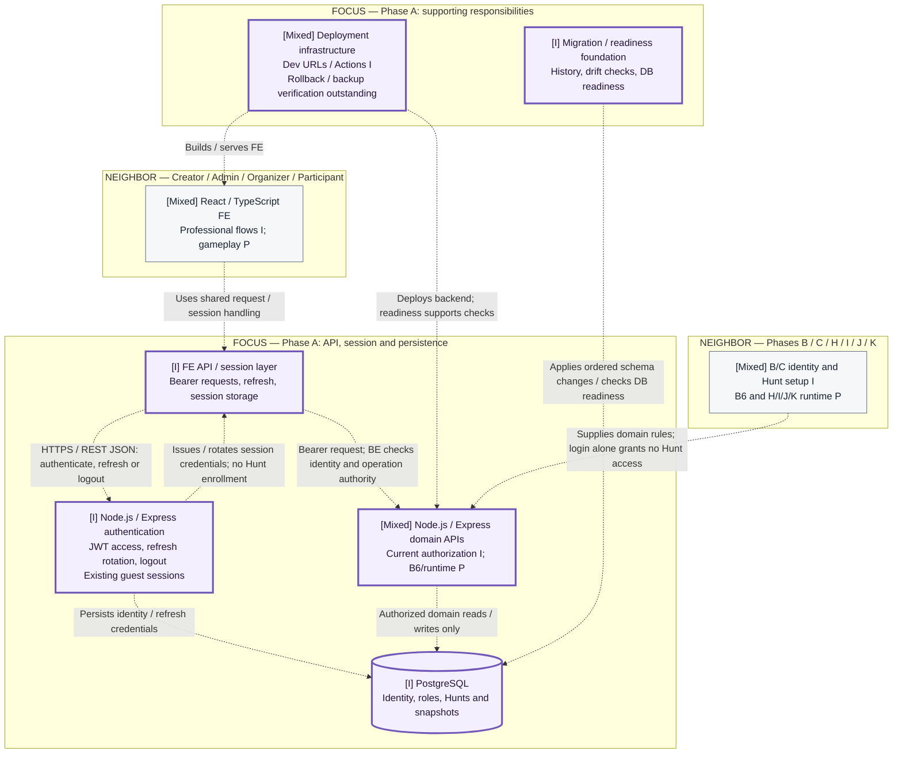

**What this diagram tells us:** React/TypeScript experiences use the FE API/session layer to call Node.js/Express; only the backend accesses PostgreSQL. Authentication establishes a session, while each protected domain action requires backend authorization. Existing guest authentication does not settle future guest enrollment eligibility. Node.js hosts the backend, not a separate wrapper around FE and BE; Swagger documents contracts and is not a runtime API implementation.

A1's development deployment foundation is implemented for its recorded scope, not proof of new deployed E2E, formal rollback readiness or verified backup/restore. A2 readiness/migrations support operation; they do not certify user journeys. Section 5.1's direct cross-origin HTTPS/CORS topology remains current; section 5.2's same-origin reverse proxy is intended production direction only.

Traceability: A1–A6; B1–B6; C1–C4; H2/I/J/K; sections 2, 3.1–3.2, 5–6, 17 and 20. Authentication, global capability and Hunt membership remain separate.

### A1. Deployment topology and verification
Status: ✅ Complete enough for prototype

Done:
- FE/BE development URLs established
- GitHub Actions deployment
- FE version/public bundle verification
- BE readiness endpoint
- direct FE→BE CORS architecture confirmed

Remaining:
- ⚠ formal rollback/release notes
- ⚠ documented server inventory
- ⚠ final backup/restore verification

### A2. PostgreSQL migration foundation
Status: ✅ Complete

- migration runner/history
- ordered migrations
- drift checking
- DB readiness
- clean shutdown

### A3. User normalization and compatibility
Status: ✅ Complete

- email normalization
- duplicate handling
- public serializer
- legacy role compatibility

### A4. Core authentication
Status: ✅ Complete

- JWT access
- opaque refresh tokens
- rotation
- logout
- guest sessions
- participant login/register
- creator login
- organizer login
- admin login

### A5. Frontend API/session layer
Status: ✅ Complete

### A6. Existing real login flows
Status: ✅ Complete

Complete:
- participant
- creator
- organizer
- admin

Admin authentication uses the real backend session flow. Fake Admin 2FA is no longer part of the active prototype login path.

---

## Phase B — Identity, organizations and authorization

Status: 🟡 Mostly complete

### Phase B context — Identity and effective authorization

One identity can hold several global capabilities and Hunt relationships. B1–B5 supply the current foundation; B6 extends effective authority and assignment contracts.

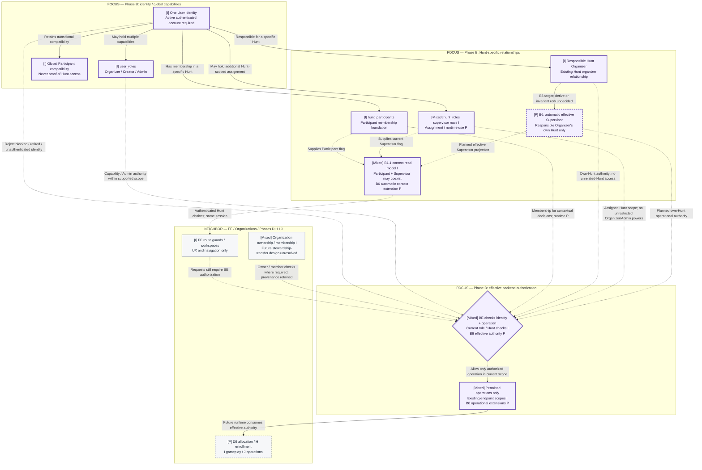

**What this diagram tells us:** Organizer, Creator and Admin are authoritative global professional capabilities; global Participant is compatibility-only. Participant Hunt access comes from `hunt_participants`, additional Supervisor context from `hunt_roles(role='supervisor')`. The same identity can be both in one Hunt. Current B1.1 exposes those records, not automatic supervision. Global capability alone grants neither unrelated-Hunt access nor enrollment.

B6 is not implemented: responsible Organizer automatic effective supervision, consistent context projection, additional assignment list/add/remove and revocation contracts, and extended Admin operational enforcement/tests remain planned. Additional Supervisors receive only Hunt-scoped operational powers, with no Organizer configuration, Template editing or checkpoint suspension by default. Admin's target platform/domain authority remains subject to active authentication, secret protection, last-active-Admin safeguards, referential integrity and immutable provenance; corrections require explicit versions/overrides. Existing endpoint checks must not be presented as already implementing all B6 authority.

B4's `organizations.owner_id` currently mixes operational ownership with provenance. It provides operational authority only while its referenced owner is a normal active identity. Retirement preserves the Organization and owner UUID, denies the retired identity authentication, and leaves the narrow authoritative-Admin platform-management fallback without replacing `owner_id`. Future separation of origin attribution from current stewardship/ownership and any transfer schema/API remain unresolved.

Traceability: B1–B6; A4–A5; D9; H2; J4/J9; E/L1; sections 6, 11 and 20.2–20.3. FE guards support UX only. Neither public lookup nor the Independent Organizer prototype creates membership or an authorization exception.

### B1. Multi-role identity
Status: ✅ Complete for global capabilities

Authoritative global capabilities are Organizer, Creator and Admin. The global Participant role remains compatibility-only for the current prototype and must not be used as proof of access to a specific Hunt.

### B1.1 Workspace/context model
Status: ✅ Implemented for the existing workspace/context contract

Backend / DB: ✅ Context read model implemented

Frontend: ✅ Context wiring implemented; canonical response parsing fixed in merged FE PR #61

Deployed E2E: record deployment evidence separately; no fresh test claimed here.

Implemented foundation:
- FE PR #43 introduced the canonical /workspaces selector and same-session workspace switching for global capabilities.
- FE PR #45 separated public professional entry from authenticated switching:
  - /login-workspace is the public Organizer/Creator/Admin entry selector
  - /workspaces is authenticated-only
  - the generic Participant card was removed from /workspaces
  - professional headers expose Switch Workspace: <Current> →
  - /professional-access redirects to /login-workspace
- BE PR #35 added GET /api/me/hunt-contexts.
- The API returns one row per Hunt with huntId, huntName, huntStatus, participant and supervisor.
- Participant context is derived only from hunt_participants.
- Existing Supervisor context derives from hunt_roles(role='supervisor'); B6 adds automatic supervision for the responsible Organizer.
- One Hunt may expose both Participant and Supervisor access for the same User.

Implemented: /workspaces consumes GET /api/me/hunt-contexts using the canonical { contexts: [] } envelope and renders Hunt-specific choices. Empty contexts and malformed responses are handled.

Future: evolve contextual targets as runtime routes mature and extend effective Supervisor context through B6. This is new scope, not unfinished B1.1 wiring.

### B2. Backend role authorization
Status: ✅ Complete

### B3. Frontend role guards
Status: ✅ Complete for current prototype

Real:
- participant
- organizer
- creator
- admin

Admin:
- authoritative `user.roles` check merged in FE PR #28
- all current `/admin/*` routes are protected by `RequireAdmin`

### B4. Organizations and membership
Status: ✅ Complete for current prototype

Current `organizations.owner_id` participates in operational authority while the referenced owner is a normal active identity. If that identity is retired:
- the Organization is not deleted
- `owner_id` continues to reference the retired UUID as preserved provenance
- the retired identity cannot authenticate and therefore has no operational authority
- authoritative Admin capability provides the narrow platform-management fallback
- Admin does not become or replace `owner_id` merely because the owner retired

**Future architecture — Organization stewardship/ownership transfer:** the current `owner_id` mixes operational ownership with provenance. Future Organization stewardship should separate historical creator/origin attribution from current operational stewardship/ownership. The schema and transfer API are intentionally not designed in this plan.

### B5. Hunt-context roles
Status: 🟡 Context read model complete / runtime assignment-use pending

Participant membership is represented by hunt_participants.

Additional Supervisor assignment is represented by hunt_roles(role='supervisor'). Automatic Organizer supervision is the new B6 target.

GET /api/me/hunt-contexts is the authenticated read model used to expose those contextual relationships to workspace switching without converting them into global roles.

Supervisor assignment/use during live Hunt operations is still pending.

### B6. Effective Hunt authority — Mapbox M3 domain prerequisite
Status: ⬜ Not started
Backend / DB first; Frontend follows in D9.
- [ ] Grant the responsible Organizer effective Supervisor capabilities automatically for their own Hunt. Decide against the existing model whether to derive this or maintain an invariant row; do not require a separate identity.
- [ ] Keep additional Supervisors Hunt-scoped with operational powers only; no Organizer configuration, Template edits or checkpoint suspension by default.
- [ ] Permit Admin full platform/domain operations across Hunts, Templates, checkpoints and runtime objects, including edit, override, reassignment and suspension, subject only to security/technical invariants.
- [ ] Preserve authenticated active-account requirements, secret protection, last-active-Admin safeguards, referential integrity and immutable provenance. Admin corrections create explicit versions/overrides; they do not silently rewrite historical artifacts.
- [ ] Extend authorization tests and GET /api/me/hunt-contexts consistently. Test own-Hunt access, unrelated-Hunt denial, removed assignment denial and Admin authority.
- [ ] Define assignment list/add/remove APIs and revocation semantics before D9. Organizer's automatic effective supervision cannot be accidentally removed.

---

## Phase C — Hunt domain foundation

Status: ✅ Complete for current setup scope

### Phase C context — Hunt domain foundation

Phase C is complete for current setup scope. The Hunt record connects approved content and Organizer configuration to future enrollment, gameplay, operations and results.

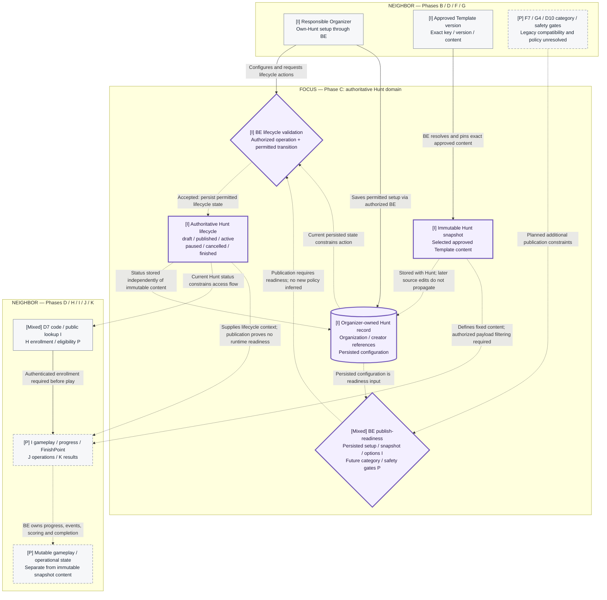

**What this diagram tells us:** the Organizer-owned Hunt persists configuration, an approved Template snapshot and an authoritative lifecycle. Backend checks authorize actions, validate allowed source states and evaluate persisted readiness before publication. The six lifecycle values are exactly `draft`, `published`, `active`, `paused`, `cancelled` and `finished`; the diagram is a context view, not additional transition or publication policy.

C4 currently checks saved General Setup, matching Template key/version/snapshot and supported pilot options. Future category, geographic safety/evidence, approval-availability and legacy rollout policies remain F7/G4/D10/20.2 decisions. Section 14 governs exact-version approval and immutable snapshots; later Template edits, classification changes or approval withdrawal never silently mutate existing Hunt content.

D7 code generation/minimal public lookup is not enrollment. H's membership/eligibility workflow and I/J/K authoritative runtime remain planned; existing lifecycle endpoints, including start/finish, do not prove Participant gameplay or terminal completion is implemented. Mutable lifecycle/progress/operational state is distinct from immutable Template/Hunt content. Future FinishPoint completion must follow I11's backend-validated required activities, never arrival alone or an inferred publication guarantee.

Traceability: C1–C4; B5/B6; D1–D7/D10; F2/F7; G2/G4; H1–H8; I11–I13; J/K; sections 6, 11, 14–15 and 20.1–20.3. No new state, transition, access permission or publication policy is introduced.

Foundation diagram-extension audit (24 October 2026): source baseline is FE main `68978c5e756568148e78cc3635ed7f486ca668bb` (merged #110) and BE main `4b45c2d8af15e39e049e2069c37b9e29b5ecfbf8`. Read the plan's conventions/master map, runtime/authority principles, A–C, neighboring D/G/H/I/J/K views, sections 11/14 and section 20 dependencies. Inspected FE `src/services/api/client.ts`, `session.ts`, `huntContexts.ts` and `src/features/auth/access.ts`; BE `src/routes/auth.ts`, `src/middleware/auth.ts`, `src/routes/me.ts`, `src/models/HuntContext.ts`, `HuntRole.ts`, `Organization.ts`, `Hunt.ts`, `src/routes/hunts.ts` and `src/domain/huntReadiness.ts`. These confirm session handling, authenticated contextual records, current scoped Hunt checks, lifecycle validation and persisted readiness. They do not establish B6 effective supervision/assignment APIs, broad Admin operational enforcement or Participant runtime.

Validation: only these three context views, their captions/traceability, this audit and the brief revision note are added; version 3.5, all existing requirements/statuses, historical evidence and unresolved decisions remain intact. Source checks cover fences/subgraphs, defined nodes, labeled arrows, status/focus classes and planned-node styling. Architecture review checks authentication versus membership, unrelated-Hunt denial, limited Supervisor scope, immutable provenance, FE/BE authority, public lookup versus enrollment and publication versus gameplay. Mermaid parser/rendering and GitHub desktop/mobile readability remain unverified: no installed Mermaid renderer was found and shell network access fails at the environment proxy. No application tests, deployment or deployed E2E were run for this Markdown-only extension.

### C1. Core Hunt records
Status: ✅ Complete

### C2. Hunt lifecycle
Status: ✅ Complete

Supported states:
- draft
- published
- active
- paused
- cancelled
- finished

### C3. Organizer Hunt list
Status: ✅ Complete

### C4. Publish-readiness authority
Status: ✅ Complete

Backend validates persisted configuration before publication.

---

## Phase D — Organizer Hunt setup

Status: ✅ Existing setup baseline and D8 implementation complete; D9/D10 remain planned; D8 deployed E2E unverified

### Phase D context — Organizer within the platform

The two conceptual paths share backend authority and the same downstream gameplay engine. Path A extends the implemented generic setup; Path B remains deferred. Status/focus and arrow conventions follow section 3.1.

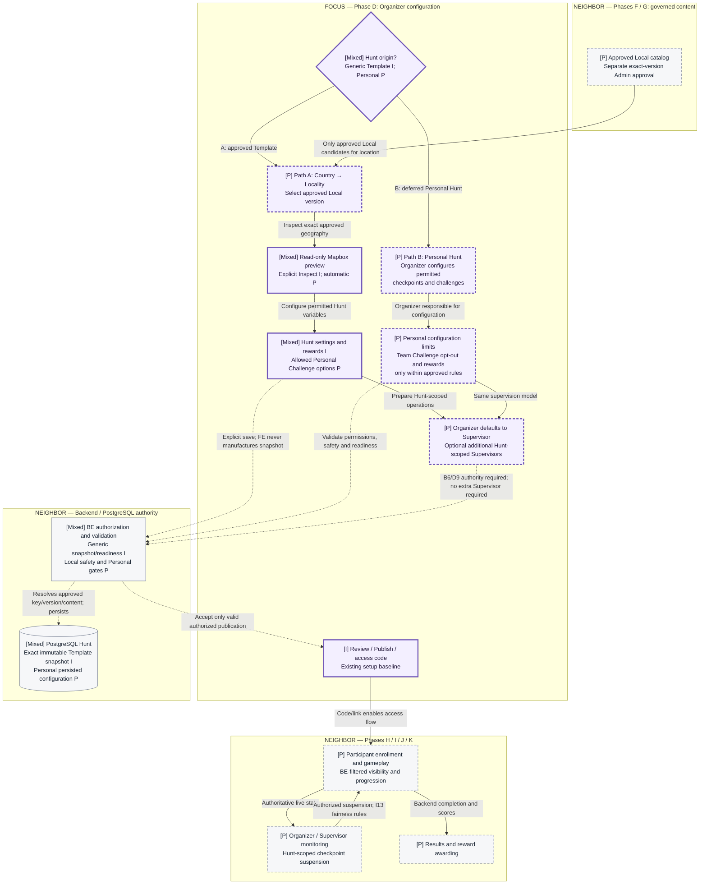

**What this diagram tells us:** approved-Template selection and future Personal authoring converge on backend validation, persistence and publication. Path A's backend creates the exact immutable Template snapshot; later Template edits/approvals cannot replace it. Organizer may configure only supported Hunt variables and allowed Personal Challenges; fixed Template geography/content stays read-only. Path B assigns configuration responsibility to Organizer without granting a safety or authorization bypass, and reuses the shared checkpoint/FinishPoint engine.

**Status and policy boundaries:** D1–D7 implement generic setup, supported pilot options, reward configuration and publication; D8 implements explicit read-only inspection, not D10's location selectors or automatic preview. Personal Hunt authoring, Personal Challenge configuration and Team Challenge opt-out are conceptual planned capabilities, not claims of current support or new permission to disable required activities. Their precise permitted scope and safety/readiness contracts still require decisions; opt-out and rewards must stay within approved rules. Reward configuration never implies implemented awarding (section 16 / Phase K). Personal Hunt is not the unresolved Independent Organizer authorization model (section 11).

B6/D9's target makes the responsible Organizer the automatic Supervisor and allows additional eligible Hunt-scoped allocations; neither allocation UI nor effective-authority extension is claimed implemented. H/I/J remain planned authoritative access, gameplay and live operations. Full setup preview does not become a Participant payload: hidden checkpoint positions and undiscovered routes must remain undisclosed under I12. I13/J9 suspension requires backend authorization and agreed bypass/fairness rules; terminal suspension/completion policy remains unresolved.

Traceability: D2–D4, D6–D10; B6; F1/F7; G2/G4; H; I11–I13; J2/J4/J9; K; sections 6, 11, 14, 16 and 20.1–20.3. Generic catalog legacy compatibility remains governed by section 14; no automatic Local classification or premature catalog filtering is implied.

### D1. General Setup
Status: ✅ Existing baseline complete; future map-first ordering is D10, not yet implemented

### D2. Template selection + snapshot
Status: ✅ Complete

### D3. Supported pilot options
Status: ✅ Complete

### D4. Rewards configuration
Status: ✅ Complete

Persisted:
- leaderboard rewards
- predefined Special Awards
- provider
- physical/virtual distinction
- quantities

Rewards are optional for publish readiness.

### D5. Review
Status: ✅ Complete

### D6. Publish
Status: ✅ Complete

### D7. Access code/link
Status: ✅ Complete

Important boundary:

Phase D completes Hunt configuration/publication, not the full Organizer product.

Still pending:
- live monitor
- supervisors
- PANIC/help
- custom Hunt requests
- live operational controls
- final results/reward awarding

---

### D8. Organizer geographic preview — Mapbox M2
Status: ✅ FE implementation complete; deployed authenticated/Mapbox E2E unverified
- [x] Pre-creation approved-version geography uses authenticated `GET /api/hunt-templates/:key/geography` (merged BE #63). Independent inspection compares exact catalog key/version before rendering; mismatches require explicit catalog refresh/reinspection, never silent version substitution.
- [x] Loading, retry, 401/404/409, missing/partial legacy geography, rapid switching, stale responses and close/reopen are covered; close/switch/unmount cancel requests and clean up Mapbox resources.
- [x] Reuse HuntMapPreview from G3 for the exact persisted Hunt snapshot after creation, through existing Hunt GET/save responses; never substitute a newer catalog version.
- [x] Show normal checkpoints, separate FinishPoint, radii and optional explicit walking estimates for valid snapshots; handle absent/invalid legacy geography explicitly.
- [x] Keep fixed Template geography read-only in inspection. Portable/repositionable Templates require a separate future product rule.
Validation: `npm test` passed (30 Node test files; 8 Vitest files / 138 tests), `npm run typecheck`, `npm run build` and `git diff --check` passed. Build retains the existing large-chunk warning. Existing Admin G3 and Organizer Quick Setup regressions pass. Deployed E2E verification remains separate from implementation completion.
See [Organizer geographic preview](Organizer_Geographic_Preview.md) for authority sources and verification limits.

#### Personal Hunt — deferred
Organizer may eventually create a Hunt without selecting an approved Template. Reuse the existing checkpoint engine, FinishPoint, navigation and rewards; no second gameplay engine. Participant runtime must consume the persisted Hunt configuration without depending on its Template origin. Organizer-created content must pass backend publish-readiness validation. This is a future architecture note only; no Personal Hunt implementation is included.

### D9. Allocate Supervisors — Mapbox M3 frontend
Status: ⬜ Not started; depends on B6 backend deployment
- [ ] Add Allocate Supervisors after Hunt configuration and before Review/Publish readiness.
- [ ] List Organizer by default as Organizer · Supervisor · Automatic; allow allocation/removal of additional eligible identities through B6 APIs.
- [ ] Show authoritative supervision readiness; do not require an extra Supervisor or create a fake professional Supervisor account.
- [ ] E2E: Organizer appears automatically, allocated Supervisor gains only that Hunt's operational access, removal revokes access, self-removal cannot remove automatic supervision.

### D10. Organizer map-first General Setup — planned workstream
Status: ⬜ Not started; depends on F7/G4 location, review and approved-catalog contracts.

Target order within General Setup:

1. Country.
2. Locality, restricted to the selected Country.
3. Approved Local Template, restricted to that Country/Locality and exact approved version.
4. Automatic read-only real Mapbox route preview immediately on Template selection.
5. Hunt details.
6. Participants/access.
7. Experience defaults.

- [ ] Reuse D8 approved geography, HuntMapPreview and TedixMap. Selection automatically fetches and displays valid saved geography; no extra Inspect click. This is a deliberate future change from merged FE #84's independent, explicitly opened inspection.
- [ ] Show saved ordered normal checkpoints and terminal FinishPoint, names/radii and a clearly labelled route overview. A straight-line connection is not a walkable route. Mapbox walking geometry/distance/time remains a provider estimate; define request/cost/cancellation behavior in the scoped FE step and never invent metrics on failure.
- [ ] Changing Country clears Locality/Template/preview; changing Locality clears Template/preview. Cancel stale requests; reject key/version mismatches and require fresh approval selection. Loading, no approved Local Templates, withdrawn approval, incomplete legacy geography and provider failure need explicit states; never show the previous route as the new choice.
- [ ] Preview is visual confirmation, not a save/create/publish action. Keep explicit persistence and backend publish-readiness. After creation, read only the exact saved Hunt snapshot; newer catalog content must not replace it.
- [ ] For fixed Templates, remove the simulated checkpoint editor from the **future Organizer UX plan**: no dragging, coordinate/radius/gameplay edits, fake placement or local geography overrides. Authoring stays with Creator and Admin governance. This documentation change removes no existing implementation.
- [ ] Preserve Hunt details, access/Participants, supported Experience defaults, rewards, Review and Publish. Editable defaults cannot override immutable Template content or backend rules.
- [ ] E2E: Country → Locality → approved Local Template automatically shows its actual route; switch locations rapidly; handle missing data; save/reopen and verify exact snapshot stability after later Template approval changes.

## Phase E — Professional account lifecycle

Status: ✅ Implemented and deployed/verified for E1–E17

The professional-account lifecycle is completed foundation; it is no longer the immediate implementation phase.

### Phase E context — Professional identity and capability lifecycle

E1–E17 are implemented for the scopes and deployed evidence recorded below. Self-registration and Admin provisioning establish credentials at different points; approval is an authorization decision.

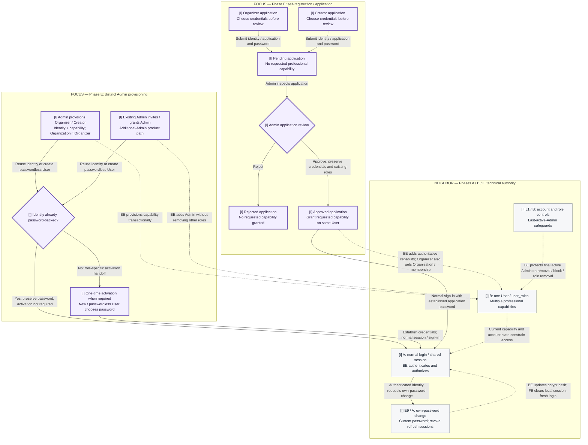

**What this diagram tells us:** Organizer and Creator applications establish credentials before review and remain Pending without the requested capability. Approval adds only the authoritative capability to the same User; existing password-backed identities keep their password and other roles, while passwordless applicants establish credentials on that identity. Self-registration has no post-approval activation. Direct Organizer/Creator provisioning and additional-Admin invitations instead use one-time activation for new/passwordless identities; existing password-backed identities need none. Provisioning preserves identity/roles and cannot promote guests or revive retired accounts.

A/B provide authentication, sessions and authoritative capabilities; L1 provides ongoing account controls. E9's shared authenticated self-service password change verifies the current password, stores a bcrypt hash and atomically revokes refresh sessions without replacement tokens; the FE clears its local session and requires fresh login. L1's distinct non-Admin password replacement is shown in Phase L. Blocking denies authenticated access and revokes refresh sessions; final-active-Admin safeguards apply to role removal, blocking and permanent removal. Trusted E6 bootstrap is first-Admin/recovery only (section 13), with no public Register as Admin path. E7/E8 use real login/guards, not fake 2FA. E10's historical “no Admin-removal UI yet” note predates L1's later implemented controls.

Traceability: E1–E17 (E1–E4/E11–E13 Organizer application; E5–E8 login/bootstrap/guards; E9 security; E10 additional Admin; E14–E17 Creator paths), A4–A6, B1–B4, L1.2–L1.5 and sections 6, 12–13/20. Existing deployed verification is retained below; this extension claims no new E2E.

### E1. Registered Organizer application
Status: ✅ Complete

The applicant provides profile/application information, chooses and confirms a password, and submits the application. The backend stores only a bcrypt password hash on the one User identity. The application remains Pending and the identity has no Organizer authorization while Pending.

### E2. Organizer login
Status: ✅ Complete

### E3. Organizer approval backend
Status: ✅ Complete

Admin approval transaction:
- reuses the one User identity and preserves its established password
- grants authoritative Organizer capability in `user_roles`
- creates Organization
- adds membership
- creates no application activation token or credential handoff

### E4. Organizer credential and authorization boundary
Status: ✅ Complete

- credentials are established on the User identity during self-registration
- approval grants authorization without replacing credentials
- existing password-backed identities retain their password and all existing roles
- passwordless identities may establish credentials on that same identity during self-registration
- no duplicate User, post-approval password setup, activation token or activation expiry is created for an Organizer application

### E5. Real Admin backend login
Status: ✅ Complete

### E6. Bootstrap first Admin
Status: ✅ Complete

No public Admin registration.

Implemented trusted server-side bootstrap:
- creates the first Admin safely against PostgreSQL
- normalizes email
- stores only a bcrypt password hash
- assigns authoritative `admin` in `user_roles`
- preserves existing user passwords and roles when promoting an existing password-backed identity
- rejects passwordless existing identities rather than silently setting credentials
- serializes the first-Admin safety check
- refuses additional Admin creation by default
- supports `--allow-additional-admin` only as an explicit recovery/maintenance escape hatch
- supports `TEDIX_BOOTSTRAP_ADMIN_PASSWORD` so production operators do not need to place the password in normal CLI arguments

The bootstrap is an operational first/recovery mechanism, not the normal product workflow for creating Admin accounts.

### E7. Real Admin frontend login
Status: ✅ Complete

Implemented:
- `POST /api/auth/admin/login`
- shared access/refresh-token session handling
- real AuthProvider Admin login
- successful login enters `/admin`
- fake Continue to 2FA behavior removed
- legacy `/admin/verify` redirects to Admin sign-in
- no fake 2FA is represented as real security

### E8. Protect Admin routes
Status: ✅ Complete

Merged in FE PR #28:
- `canAccessAdmin()` uses authoritative `user.roles`
- authenticated Admins can enter the Admin Console
- unauthenticated users are redirected to `/admin/sign-in`
- authenticated non-Admins are denied
- all current `/admin/*` routes use the Admin guard
- existing Admin sessions opening the sign-in page are redirected to `/admin`
- Admin logout returns to Admin sign-in
- misleading `2FA verified` UI is removed

### E9. Admin account security
Status: ✅ Complete

The first bootstrapped Admin can maintain their own credentials without server intervention.

#### E9.1 Change own password
Status: ✅ Complete

Implemented shared authenticated endpoint:

`POST /api/auth/change-password`

Behavior:
- authenticated non-guest account
- verifies the current password with bcrypt
- validates the new password policy
- stores only a new bcrypt hash
- never returns password material
- scoped to the current authenticated identity

This is a shared account-security capability and is not Admin-specific.

#### E9.2 Session revocation after password change
Status: ✅ Complete

A successful password change:
- revokes the user's existing refresh sessions atomically with the password update
- does not issue replacement tokens
- requires a fresh login afterward

#### E9.3 Account-security frontend
Status: ✅ Complete

Implemented Admin Account Security UI:
- Current password
- New password
- Confirm new password
- safe validation/error handling
- local session is cleared after success
- redirect to Admin sign-in for fresh authentication

Password management remains an authentication/account-security function, not arbitrary Users & Roles editing.

### E10. Additional Admin provisioning
Status: ✅ Complete

Normal additional-Admin creation must move into the product. Do not use the bootstrap command as the routine Admin-management workflow.

Target flow:

Existing Admin
→ invite/provision Admin
→ existing identity is reused or a new credential-less identity is created
→ authoritative `admin` role is assigned
→ new identity receives one-time activation when a password is required
→ new Admin chooses their own password
→ Admin login works

#### E10.1 Admin list
Status: ✅ Complete

Admin can list current Admin identities and their activation/account state through the real backend and Admin UI.

#### E10.2 Grant Admin to an existing user
Status: ✅ Complete

If the normalized email already belongs to a password-backed User:
- existing password is preserved
- all existing roles are preserved
- `admin` is added idempotently

#### E10.3 Invite/provision a new Admin
Status: ✅ Complete

If no User exists:
- a credential-less professional identity is created
- `admin` is assigned authoritatively
- a hashed, one-time, expiring activation token is created
- plaintext activation token is returned only once for the current prototype handoff
- the inviting Admin never chooses the new Admin's permanent password

#### E10.4 New Admin activation
Status: ✅ Complete

The invited Admin follows the public activation link, chooses their own password and receives the normal authenticated session on success.

#### E10.5 Last-Admin protection
Status: ✅ Complete for current backend capability

Backend role-removal logic protects the final active Admin using a serialized check.

The platform must not allow removal/deactivation of the final active Admin or accidental self-lockout when only one active Admin capability remains.

There is no Admin-removal UI yet; full role-management UI belongs to Phase L.

#### E10.6 Two-Admin lifecycle verification
Status: ✅ Complete

Verified on the deployed development environment:
First Admin login
→ provision second Admin
→ second Admin activation
→ second Admin login
→ both Admin identities appear active
→ existing roles/credentials remain preserved by the implementation
→ last-Admin protection remains enforced in backend logic/tests

The bootstrap `--allow-additional-admin` path remains recovery/maintenance only.

### E11. Organizer Applications Admin UI
Status: ✅ Complete

Implemented:
- pending/approved/rejected/all filtering
- application detail
- approve
- reject
- safe already-decided handling
- approval completes without an activation-token handoff
- pending-attention indicator in Admin navigation

The Organizer Applications UI is backed by the real application/approval API.

### E12. Organizer self-registration credential lifecycle
Status: ✅ Implemented

- Organizer chooses and confirms a password during application.
- Password is securely established on the one User identity.
- Application remains Pending with no Organizer authorization.
- Admin approval grants the authoritative Organizer capability and establishes Organization/membership.
- No application activation token or second password setup exists.
- After approval, the applicant uses normal Organizer sign-in with the original application password.

Implementation references:
- BE PR #42 — “Add self-registration credentials to Organizer applications” (backend merge status cannot be verified from this frontend repository).
- FE PR #55 — “Correct self-registered Organizer credential lifecycle” (confirmed merged in this repository).

### E13. Verify Organizer self-registration onboarding end-to-end
Status: ✅ Implemented and deployed/verified

Verified chain:
Apply with password
→ Pending
→ Admin sees application
→ Admin Approves
→ Organizer capability granted
→ Organization/membership present
→ applicant signs in normally with the original application password
→ Organizer workspace accessible

### E14. Creator provisioning
Status: ✅ Implemented

The separate Admin-provisioned Creator flow remains:
Admin provisions a passwordless Creator
→ one-time activation
→ Creator establishes a password
→ normal sign-in.

Existing password-backed identities are reused without changing their credentials, and authoritative `creator` capability is added in `user_roles`.

### E15. Creator activation/account lifecycle
Status: ✅ Implemented

For Admin-provisioned Creators only, the one-time expiring `creator_activation` token lets a new/passwordless identity establish credentials. This activation lifecycle is not used by self-registered Creator applicants.

### E16. Admin-provisioned Creator onboarding verification
Status: ✅ Implemented and deployed/verified

Verified chain:
Admin provisions Creator
→ activation if required
→ Creator session/login
→ authoritative Creator access
→ Creator Studio.

### E17. Creator self-registration/application lifecycle
Status: ✅ Implemented and deployed/verified

### Backend / DB
Status: ✅ Implemented

Responsibilities / implemented work:
- accepts Creator identity/application data and password and stores credentials on the one User identity
- keeps the application Pending without Creator capability
- makes Admin approval/rejection an authorization decision
- grants authoritative Creator capability on approval without changing the original password
- creates no post-approval activation token

### Frontend
Status: ✅ Implemented

Responsibilities / implemented work:
- Creator application and password-entry UX
- Admin application review controls
- pending state and normal sign-in UX after approval

### Deployed E2E verification
Status: ✅ Verified

Acceptance flow:
Creator application
→ identity data + password
→ Pending without Creator capability
→ Admin Approve
→ Creator capability active
→ normal sign-in using original password.

This credential lifecycle remains distinct from E14–E16 Admin provisioning.

## Phase F — Creator Template system

Status: ✅ Creator baseline and F4–F6 implementation merged; geographic deployed E2E remains unverified; F7 is planned

### Phase F context — Creator within the platform

Phase F's baseline persistence, submission and geographic authoring are implemented; the emphasized Universal/Local paths and Mechanics Library entry are planned F7 work. G1/G2's generic exact-version review/catalog/snapshot foundations are implemented, while their category-specific gates are planned G4/D10 extensions.

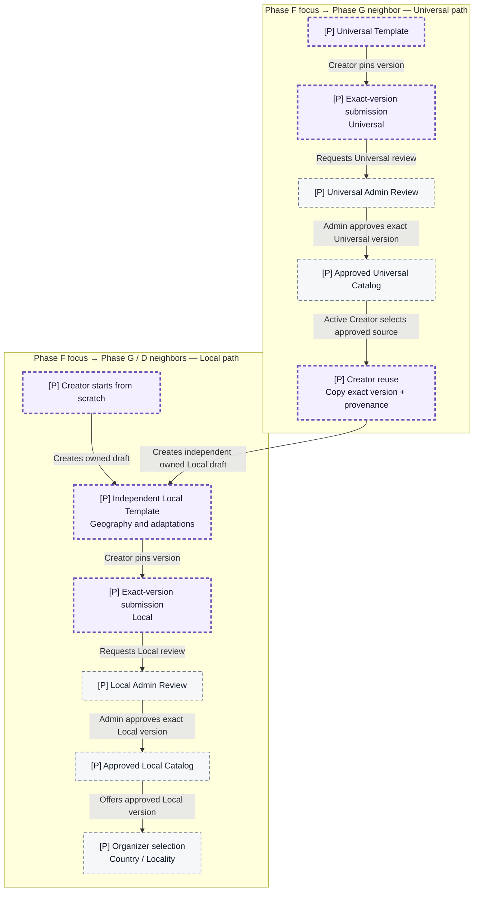

**What this diagram tells us:** Universal and Local have separate exact-version submission, Admin review and approved-catalog paths. Approved Universal reuse creates independent Local content; it never routes a Universal submission into Local approval. An active, approved Creator capability permits both authoring paths, including cross-Creator approved-source reuse (F1/F7).

Both paths use the same authoritative BE/DB foundation: draft/version persistence and exact review are implemented (F2/G1/G2); category validation, community discovery, atomic copying and Local-only selection remain planned (F7/G4/D10, 20.2). Technical edges are omitted to keep the two business paths distinct. Organizer selection uses BE resolution and the existing generic snapshot mechanism, never FE-written snapshots. Copy retains source identity, exact version and provenance; drafts remain owner-scoped and no live inheritance is introduced.

Approval arrows show successful decisions only; request-changes behavior and the current Creator resubmission UI limitation remain in F2/G1/section 14. No Creator approval/publication right or private-draft access is implied. Backend authorization governs every handoff, including cross-Creator copy and both review decisions. Category storage, copy transaction, catalog authorization, evidence/withdrawal gates, combined-capability self-review enforcement and legacy rollout remain **unresolved BE contract outputs** (20.2), not newly specified APIs.

### Universal-to-Local lifecycle — focused target process

This is the **planned F7/G4/D10 category workflow**, built on the implemented generic lifecycle and snapshot baseline. All category steps are planned; `[I]` at the end identifies only today's generic Hunt snapshot mechanism. Approval of Universal content does not certify geography or approve a derived Local.

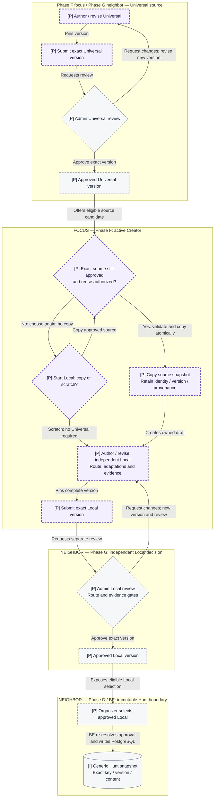

**What this diagram tells us:** copy requires an eligible, approved exact Universal source; scratch requires none. Both produce independent Local content that must pass its own Admin review before Organizer selection. Request changes preserves the reviewed artifact; revision means a new immutable version and renewed submission. These loops describe the target, not an implemented Creator resubmission UI (F2/G1). The final cylinder marks the existing generic snapshot mechanism; the preceding Local-specific gates are planned (F7/G4/D10, section 14, 20.2).

**No live inheritance:** later Universal changes never automatically modify Local drafts, approved Local versions or Hunt snapshots. Local edits produce new immutable versions requiring their own submission and Admin review; later approvals never replace an existing Hunt snapshot. Explicit update-from-Universal is outside V1. The independent path joins the same Local validation/review gates and provides no approval bypass.

### F1. Authoritative Template hierarchy

1. **Creator Framework / Component Catalog** — the general authoring system defining what Creators can build. Its Creator-facing entry is the **Mechanics Library**, where Creators explore platform-supported components and their capabilities. It is not copied wholesale into every Template version.
2. **Competition Template** — a concrete reusable implementation/configuration produced with the Creator Framework. The planned Universal and Local categories below remain within this hierarchy. A Template version records **what was built**.
3. **Hunt instance** — an Organizer instantiates an approved Template and configures permitted Hunt-level variables.
4. **Hunt runtime/results** — Participant progress, answers, scores, awards, and history.

**Governing rule:** Creator Framework defines what can be built. Template version records what was built. Hunt records what was instantiated. Adding Creator Studio options later must not mutate existing Template versions.

Canonical Signal v1 is persisted platform Template content and is one concrete Competition Template implementation; it is not the Creator Framework. Legacy `eventData` is not canonical Template authority. This plan intentionally does not duplicate the complete Signal dataset.

#### Universal and Local categories — agreed target, not implemented

| Category | Content and validation boundary | Approval and consumption |
| --- | --- | --- |
| Universal Template | Reusable story/narrative progression, Personal Challenges, Team Challenge content/mechanics, scoring/penalties, settings/defaults, discovery/navigation mechanics and supported Shadows/Shields or other framework elements. Requires neither fixed coordinates nor a city. Distinguish reusable mechanics from challenge content that needs local adaptation. | Admin reviews structure, narrative/challenges, allowed mechanics, reusability, content consistency, required gameplay components and Creator Framework compliance. Approval does not certify geographic safety. Approved versions may be reused by other Creators. |
| Local Template | Country/Locality, real checkpoint/FinishPoint positions, ordered route, local clues/directions, local challenge content/adaptations, applicable settings/supported overrides, geographic review evidence and access conditions. Geographic completeness validation differs from Universal validation. | Admin separately reviews exact route/positions, clues, adaptations, geographic access/safety evidence and operational restrictions. Only approved Local versions are selectable for ordinary location-based Hunts in V1, following the explicit legacy transition in section 14. |

Every Creator with an approved, active Creator capability may create and submit both categories, reuse approved Universal Templates from other Creators, or create Local Templates independently. The proposed dashboard exposes **Mechanics Library**, **My Templates**, **Create Universal Template** and **Create Local Template** as visible, clearly labeled entry points; Local creation offers **Start from an approved Universal Template / Start from scratch**. No Universal source is required for a Local Template. Preserve owner-scoped drafts, backend authorization, immutable versions and exact submission. A Creator cannot directly approve or publish their own Template; Admin governs approval and Organizer configures/publishes Hunts.

**V1: copy on creation, not live inheritance.** Selecting an approved Universal version creates an independent Creator-owned Local draft containing a snapshot of that exact source version. Retain source Template identity, exact version and provenance. Validate source approval and copy atomically under the future BE contract; no access to another Creator's private drafts or editing rights is implied. Local adaptations belong to new immutable Local versions and require their own submission/review.

Later Universal changes never automatically change Local drafts, approved Local versions, published Hunts or immutable Hunt snapshots. Explicit update-from-Universal is a possible future workflow, outside V1. The shipped starter registry (BE #68) is not yet a community Universal catalog or an implemented Universal/Local classifier.

#### Creator Studio information architecture and editor UX — planned F7 guidance

Creators must be able to distinguish three concepts throughout Studio:

- **Mechanics Library** — reusable platform-supported components: Personal Challenges, Team Challenges, scoring, hints, progression, discovery, GPS arrival and FinishPoint mechanics. Explain each component's capabilities, supported configuration and availability. Distinguish implemented support from planned components; the Library does not make a planned runtime capability available.
- **Universal Templates** — reusable competition experiences assembled from supported mechanics and reusable content, without fixed geography.
- **Local Templates** — location-bound implementations using the same mechanics, created independently or adapted from an approved Universal version.

Universal and Local Templates share the checkpoint/gameplay engine, including Personal/Team Challenges and terminal FinishPoint. Geographic content and configuration differ; do not introduce separate Universal and Local gameplay engines. Creators configure existing platform-supported mechanics and author content within their contracts; they cannot create arbitrary executable gameplay mechanics, upload gameplay code or define a new engine through the editor.

The Creator dashboard must show these clearly labeled entry points:

| Entry point | Purpose and destination |
| --- | --- |
| **Mechanics Library** | Explore supported components, capabilities and configuration limits, with contextual explanations of where each can be used. Browsing does not create or approve a Template. |
| **My Templates** | Manage owned drafts, submitted and approved Templates, showing type where explicitly classified, lifecycle status and version. Preserve owner-scoped access and the current lifecycle actions/limitations; submitted or approved content is not directly editable. Historical unclassified content remains readable without inferred classification. |
| **Create Universal Template** | Start an experience with reusable content and supported mechanics, without Country/Locality or a fixed-route requirement. |
| **Create Local Template** | Offer **Start from an approved Universal Template** and **Start from scratch**. The first opens approved Universal discovery, shows the selected exact source version/provenance and creates an independent Local draft; the second requires no Universal source. |

The Template editor visibly identifies the selected type and separates these sections:

| Editor area | Sections | Visibility and explanation |
| --- | --- | --- |
| **Universal / Reusable** | Story and narrative; challenge mechanics and reusable content; scoring and progression; discovery rules and general settings. | Available for both types where supported. For Universal authoring, explain that mechanics/content can be reused without geography. For Local authoring, explain which copied content can be adapted in this independent draft. This label describes reusable concerns, not a live link to a Universal source. |
| **Local / Location-specific** | Country and Locality; map, route and checkpoints; geographic clues and adaptations; access conditions and geographic review evidence. | Shown only for Local authoring. Explain how geography implements shared discovery/arrival mechanics and how local adaptations and evidence affect the exact Local version's separate review. A Local created from scratch still has both relevant editor areas. |

Use progressive disclosure: show relevant sections for the selected Template type and reveal component settings, geographic exception evidence and advanced options only in context. Universal authoring must not present irrelevant map/location requirements; Local authoring must make its geographic requirements discoverable without forcing every exception field into ordinary authoring. Provide short contextual explanations beside type choice, reusable mechanics/content, source provenance and location/evidence controls. Separate reusable discovery rules from local clues/positions, and explain that inspecting the full authoring route does not reveal it to Participants. Progressive disclosure must not hide missing required fields or bypass backend validation.

This UX is planned, not a claim that the dashboard, Mechanics Library or type-specific editors are implemented. Reuse existing draft/version persistence, explicit save/submit, separate Admin approval, compatibility rules and immutable snapshots. F7 and section 20.2 stage delivery after the necessary BE contracts; no new mechanics runtime is part of this UX work.

### F2. Creator Template persistence and immutable versioning

### Backend / DB
Status: ✅ Implemented

Responsibilities / implemented work:
- `hunt_templates` identity and `hunt_template_versions` immutable versions
- Creator/platform provenance and Creator ownership
- draft/submitted/changes_requested/approved lifecycle
- immutable version numbering
- Creator owner-scoped list/read
- create Creator Template with v1 and create the next immutable draft version
- exact `submitted_version` pin and submission of the exact latest version
- Admin read of the exact submitted artifact, approval, and request changes
- approved Creator catalog resolves the exact pinned submitted version
- Hunt Template selection resolves an approved persisted Template
- Hunt stores the exact Template key/version/content snapshot
- [BE #66](https://github.com/tedixdev-arch/Tedix_Hunt_BE/pull/66): owner-scoped deletion of unused draft/changes_requested Templates and their versions is transactional; submitted/approved or Hunt-dependent content is protected. This lifecycle exception deletes unused drafts, never rewrites immutable content.

Template-version content is immutable JSONB. As an accepted current limitation, rows are treated as immutable through model/API behavior; the schema does not currently use a database trigger that prohibits direct `UPDATE` of version content.

### Frontend
Status: ✅ Implemented (FE PR #68)

Responsibilities / implemented work:
- consumes `GET /api/creator/templates`, `GET /api/creator/templates/:key`, `POST /api/creator/templates`, `POST /api/creator/templates/:key/versions`, and `POST /api/creator/templates/:key/submit`
- lists Creator-owned Templates and reopens persisted drafts
- hydrates Creator Studio from backend content
- uses **Complete Hunt Features** as the explicit persistence boundary
- first persistence creates the Template and immutable v1
- changed persisted content creates the next immutable version; unchanged content creates no duplicate
- stabilizes the Template key after creation
- submits the real persisted version and shows success only after backend success
- treats backend status/version/content as authoritative
- preserves BE #59 geographic configuration through persistence
- does not manufacture verification or safety state from persisted coordinates

Revision/resubmission after `changes_requested` is not yet implemented in Creator Studio and is not claimed here.

### Deployed E2E verification
Status: 🟡 Deployed evidence to record; FE integration is implemented in merged FE #70 and is no longer a blocker

Acceptance flow:
Creator persists and submits an exact immutable Template version → Admin reviews the same artifact → approval exposes that pinned version to Organizer setup → Hunt stores its exact snapshot.

### F3. Geographic checkpoint architecture

Normal checkpoints and FinishPoint remain separately configured and persisted geographically, while sharing one checkpoint gameplay model. Template content preserves `configuration.normalCheckpointCount`, `configuration.checkpointPositions[]` and `configuration.finishPoint`. Each normal checkpoint position contains `checkpointNumber`, `name`, `latitude`, `longitude`, and `radiusMeters`.

Contract rules:
- `normalCheckpointCount` is 1..20
- `checkpointPositions` represents only normal checkpoints
- normal checkpoint geography remains in Creator Studio Feature 2; FinishPoint geography remains in Feature 6 and is not N+1 in `checkpointPositions`
- separate geographic persistence does not imply separate gameplay: FinishPoint has the terminal checkpoint role and the same applicable capabilities
- preserve compatibility without an immediate database migration or rewriting existing immutable Template versions/snapshots
- checkpoint numbers are unique and within 1..N
- latitude is -90..90 and longitude is -180..180
- Current merged contract: integer `radiusMeters` is 5..500 (BE #60/#61); FE #76/#77 default new positions to 5 m and preserve existing stored values
- name is non-empty and at most 100 characters
- incomplete geography is allowed while drafting
- submission requires complete N-position geography for Templates using this contract
- legacy persisted content without geographic fields remains compatible
- old mock-map x/y percentages are never converted to latitude/longitude
- Signal coordinates are never invented

### Backend / DB
Status: ✅ Implemented

Responsibilities / implemented work:
- validates the geographic contract
- persists it inside immutable Template-version JSONB
- validates submission completeness
- carries the exact content through approval and the Hunt snapshot

### Frontend
Status: ✅ Implemented

Responsibilities / implemented work:
- Shared TedixMap/Mapbox Creator editor (FE #74–#77), superseding the earlier Leaflet/React-Leaflet prototype
- real pan/zoom, map-click placement/repositioning, and radius visualization
- Creator verification and safety-checklist UX
- no invented coordinates

Coordinate persistence does not establish checkpoint verification or route-safety approval. Those facts are not currently persisted, so the FE intentionally reopens persisted coordinates as unverified and safety unchecked.

---

### F4. Radius contract compatibility — Mapbox M1a
Status: ✅ Backend implementation merged in [BE #60](https://github.com/tedixdev-arch/Tedix_Hunt_BE/pull/60); deployed E2E unverified.
- [x] Accept 5..500 m; preserve historical radii, immutable versions, snapshots and legacy content; update Swagger without a migration.
- [x] PR reports 613 tests with PostgreSQL, none skipped, including 5 m lifecycle and 30 m historical preservation.
- [ ] Record deployed contract/lifecycle evidence. F4 is no longer the next implementation step.

### F5. Shared TedixMap and Creator Hunt Map Editor — Mapbox M1b
Status: ✅ FE implementation merged in [#74](https://github.com/tedixdev-arch/Tedix_Hunt_FE/pull/74), [#75](https://github.com/tedixdev-arch/Tedix_Hunt_FE/pull/75), [#76](https://github.com/tedixdev-arch/Tedix_Hunt_FE/pull/76); deployed Mapbox E2E unverified.
- [x] Shared Mapbox foundation, temporary location/POI search, camera-only search selection and explicit checkpoint placement.
- [x] Numbered markers, discovery circles, the historical 5 m new-position default in this initial slice, saved-value preservation and provider lifecycle/error handling. FE #103 later changes new-draft initialization to 15 m; saved values and 5–500 m validation remain unchanged.
- [ ] Verify live token/search/placement/save/reopen/submit and mobile behavior. Mocked provider tests do not establish live behavior.

Recent merged authoring evolution (see section 20.1): FE #86–#104 adds starter/research workflows and map-first positioning. FE #102 fixes confirmation/deselection and search retrieval after blur, preserving camera-only search and one Map/Satellite instance. FE #103 adds focus/overview and a 15 m new-draft radius while preserving stored radii and 5–500 m validation. FE #104 supersedes authored-only camera eligibility: selection and Show all resolve authored coordinates first, then sourced references, including FinishPoint. Repeated actions and pending map/style readiness are handled without authoring, confirmation or persistence. Amber reference pins remain provisional. Live provider/deployed authoring E2E is still unverified.

### F6. FinishPoint configuration, route validation and Participant Preview — Mapbox M1c
Status: ✅ Scoped BE/FE authoring and preview implementation merged; deployed E2E unverified.
- [x] FinishPoint geography: [BE #61](https://github.com/tedixdev-arch/Tedix_Hunt_BE/pull/61), [FE #77](https://github.com/tedixdev-arch/Tedix_Hunt_FE/pull/77). Preserve separate configuration.finishPoint; no N+1 in checkpointPositions.
- [x] Shared terminal gameplay contract: [BE #62](https://github.com/tedixdev-arch/Tedix_Hunt_BE/pull/62), [FE #79](https://github.com/tedixdev-arch/Tedix_Hunt_FE/pull/79). Existing Personal/Team/navigation vocabulary; no new challenge engine.
- [x] Explicit walking-route inspection: [FE #80](https://github.com/tedixdev-arch/Tedix_Hunt_FE/pull/80). CP1 → CPn → FinishPoint, provider geometry/estimates, cancellation and errors; no safety certification.
- [x] Creator Participant simulation: [FE #81](https://github.com/tedixdev-arch/Tedix_Hunt_FE/pull/81). Preserves unsaved work and one mounted map; manual arrival/activity resolution with no real GPS, scoring, answers or gameplay mutations.
- [ ] Deployed search → placement → save/reopen → route inspection → preview → submit verification, including immutable history.
- [ ] Authoritative visibility, navigation, Arrival Engine, actual challenge interactions and completion remain Phase I. The Creator simulation does not complete I12 or the planned popup UX.
Validation limits: BE #62 reported 21 database tests skipped; later BE #63 reports a full PostgreSQL suite of 712 passing tests, zero skipped. Neither is deployed E2E evidence. FE provider tests are mocked; FE #81's mobile smoke used the missing-token fallback. Temporary custom challenge controls in FE #79 are not persisted authoring support.

### F7. Universal/Local creation, reuse and Country/Locality — planned workstreams
Status: ⬜ Universal/Local classification, community reuse, hybrid location identity and approval-evidence contracts are not implemented. Existing Signal starters/research tools are merged baseline capabilities (section 20.1), not completion of F7.

- [ ] BE contract/design first: define classification, exact Universal-source provenance/copy semantics, per-category versioned validation, separate approval gates, location identity and legacy adaptation (sections F1, G4 and 14). Specify schemas/API contracts in that step; no new endpoint is asserted here.
- [ ] BE implementation follows as narrow tracked migrations, model/validation, authorized reuse, location lookup/persistence and review/catalog PRs; dependencies and acceptance are in section 20.2.
- [ ] Creator FE follows F1 information architecture: first expose the four labeled dashboard entries and Mechanics Library capability explanations; then integrate My Templates type/status/version context, the reusable editor and approved community Universal copying or independent Local creation in separate reviewable slices. Depend on agreed supported-mechanic configuration/availability and category/reuse contracts; do not add a second gameplay engine or arbitrary executable mechanics. Follow with a separate Country/Locality and Local-geography integration slice, preserving progressive drafts, explicit persistence and exact submission.
- [ ] Retain AI-assisted proposals as optional Creator assistance. AI may propose candidates, order, narrative fit, content, sources and uncertainties; responsible Creators review/edit ordinary drafts. No AI approval/publication, invented verification, provider secrets in FE, or mutation of approved content/snapshots.
- [ ] Preserve canonical Signal v1 and Signal Overload Cluj-Napoca, their story, puzzles, Personal/Team Challenges and seven-stop journey: six normal checkpoints plus terminal FinishPoint. Three routes per locality remains an optional curation target, never a database cardinality or approval quota. Existing starter provenance is not Universal-source provenance.

#### Hybrid Country/Locality catalog

Do not import a worldwide city database into PostgreSQL for V1. Search an external geographic provider, reuse TedixHunt records when available, and persist newly selected locations only when needed. The domain term is **Locality**, with friendly City / Town / Village labels and support for other valid localities. Country-wide imports are only an optional future optimization.

Intended identity principles: TedixHunt-owned stable internal UUID, ISO country code, provider identity when available, canonical display name, administrative region/context, geographic coordinates and provider provenance. Free-text names alone are not identity; same-name localities in different regions must remain distinguishable. Provider identity is a reference, not the platform primary key.

Resolve known internal/provider matches before creating a record; check country/administrative context and coordinates for potential duplicates. Ambiguous matches require explicit selection or manual review, not automatic merging by name or proximity. Provider changes/aliases must preserve stable internal references and provenance. Final uniqueness, reconciliation and merge rules belong to the BE contract.

On provider failure, retain usable existing locations, show lookup failure/retry and do not invent results or silently substitute another location. Missing localities require a documented manual proposal/review path with country, context, coordinates and evidence before authoritative acceptance. Unresolved proposals cannot bypass Local submission/approval gates. Legacy country/region/city strings remain readable until explicitly mapped and reviewed; do not treat them as canonical UUID identities or mutate snapshots. Provider choice, coverage/licensing, request/caching/failure behavior and exact APIs are unresolved BE design outputs.

#### Geographic safety and review evidence

Avoid blanket rejection of every checkpoint classified as a road. Automated classifications can be uncertain; Mapbox, AI and automated checks cannot certify route safety. Keep ordinary-location review simple and make exception details conditional.

| Category | Examples | Required action |
| --- | --- | --- |
| Advisory | Potential traffic proximity, uncertain map classification or other non-blocking concerns | Creator may acknowledge the warning; preserve the concern for human review. |
| Evidence required | Temporary pedestrian streets, festivals/events, conditional access, temporary closures or other exceptions | Creator supplies explanation, supporting evidence and applicable dates/conditions. Admin reviews whether the exception actually resolves the concern. |
| Blocking | Known prohibited access, unacceptable traffic exposure or another established unresolved hazard | Correct the location or demonstrably resolve the restriction before approval. Acknowledgment alone cannot clear it. |

Human review covers every checkpoint and FinishPoint, connecting pedestrian segments, crossings/traffic, legal/public access, opening hours/closures, terrain/accessibility limitations and step-free alternatives where applicable. Record evidence source, reviewer, review date, validity dates/conditions and unresolved concerns against the exact version. Use local/on-site checks where desk evidence is insufficient. Prior walking research may describe an earlier order; review the actual submitted route.

Backend-authoritative submission/approval requirements must distinguish acknowledged advisories, required reviewed evidence and unresolved blockers; client checkboxes are not authoritative certification. Approval must respect applicable operating dates/conditions. Define evidence invalidation, expiry/re-review, withdrawal and Hunt publish-readiness behavior in the BE contract without retroactively changing approved content or saved snapshots. Universal approval carries no geographic certification.

Acceptance: Creators can distinguish Mechanics Library, Universal Templates and Local Templates, reach all four dashboard entries, and find both Local creation options. Verify type-relevant editor sections, visible reusable/location separation, contextual explanations and progressive disclosure without hidden validation failures; only supported mechanic configuration is offered. Then prove both standalone Local creation and cross-Creator approved Universal reuse, followed by one reviewed locality pilot through exact Local submission → separate Admin approval → filtered catalog → immutable Hunt snapshot. Backend rejects unauthorized copying, invalid country/locality, missing required evidence and unresolved blockers; prior versions remain unchanged.

## Phase G — Admin Template governance and approved authority

Status: ✅ Backend/DB, Admin FE review, Organizer integration and G3 preview implemented; G4 location/review evolution planned

### Phase G context — Admin within the platform

Generic exact-version review is implemented; the two category decisions below are planned G4 extensions. Admin is responsible for human review, with separate downstream catalogs and no Creator self-approval.

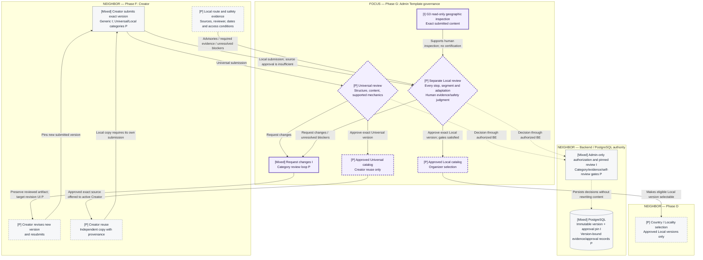

**What this diagram tells us:** Universal approval enables Creator reuse; Local approval independently enables Organizer selection. Universal approval never approves Local geography. Request changes preserves the exact reviewed artifact, while the target revision/resubmission path creates a new immutable version. Creator cannot approve their own submissions; combined Creator/Admin identity enforcement is an unresolved BE contract output, not an implemented guard asserted here.

G1/G2 implement generic review, approve/request-changes, pinned Creator catalog resolution and immutable Hunt snapshots. G3 supplies inspection, not safety certification. G4/F7 must add version-bound human evidence and category-specific gates: acknowledgment may address an advisory, required evidence needs review, and unresolved blocking hazards prevent approval. Mapbox, AI and automated checks cannot certify geographic safety; responsible Creators supply evidence and Admin reviews the actual route, including local/on-site checks where desk evidence is insufficient.

**Technical and secondary authority:** every business arrow is subject to backend authorization. Existing immutable content and the submitted-version approval pin are not a completed immutable approval audit log. Evidence representation, reviewer/decision history, validity, expiry/re-review, withdrawal, combined-capability self-review enforcement and publish-readiness remain planned contract decisions (20.2); L6 audit remains unimplemented. No new API or schema is specified.

Account governance is a separate, secondary context: Admin → Creator/Organizer application approval, provisioning and account controls (Phases E/L1, implemented named scopes) → backend authorization and PostgreSQL. Account actions govern identity/capability access, not Template approval; blocking/removal preserves durable Template versions, Hunt snapshots and required provenance (section 6). This relationship is kept outside the Template graph for readability.

Traceability: F1/F2/F7; G1–G4; D2/D8/D10; E3/E14/E17 and L1/L6; sections 6, 14 and 20.1–20.2. Preserve section 14's explicit legacy/unclassified transition; the planned catalogs do not silently reclassify or remove today's approved content.

### G1. Admin Template review

### Backend / DB
Status: ✅ Implemented

Responsibilities / implemented work:
- submitted Creator Template review list/detail
- review of the exact `submitted_version`
- approval and request changes
- approved catalog pins the exact submitted version

### Frontend
Status: ✅ Implemented in merged FE PR #70

Responsibilities / implemented work:
- real review list/detail for the exact submittedVersion
- real approve and request-changes API calls
- backend-authoritative decisions with loading/error/retry/empty states and duplicate-action protection

### Deployed E2E verification
Status: 🟡 Deployed evidence to record; FE integration is implemented in merged FE #70 and is no longer a blocker

Acceptance flow:
Admin receives the submitted artifact → reviews that exact version → approval makes that pinned version available in the approved catalog.

### G2. Organizer approved Template authority

### Backend / DB
Status: ✅ Implemented

Responsibilities / implemented work:
- `GET /api/hunt-templates` returns approved persisted Templates
- approved Creator Templates resolve the exact `submitted_version`
- Hunt draft creation resolves an approved Template
- Hunt stores an immutable key/version/content snapshot
- existing Hunt snapshots remain stable

### Frontend
Status: ✅ Implemented

Responsibilities / implemented work:
- Organizer Quick Setup fetches authoritative `GET /api/hunt-templates`
- selectable Templates come from the backend
- only the Template key is sent during Hunt creation/update as appropriate
- the FE does not manufacture Template snapshots
- missing/loading/error/empty states are handled

### Deployed E2E verification
Status: 🟡 Deployed evidence to record; FE integration is implemented in merged FE #70 and is no longer a blocker

Acceptance flow:
Approved exact version appears in Quick Setup → Organizer selects its key → backend resolves and snapshots the approved key/version/content.

### G3. Shared Admin geographic preview — Mapbox M2
Status: ✅ FE implementation merged in [FE #82](https://github.com/tedixdev-arch/Tedix_Hunt_FE/pull/82); deployed authenticated/Mapbox E2E unverified.
- [x] Read-only shared HuntMapPreview of exact submitted immutable content, saved checkpoints/FinishPoint/radii and explicit walking estimates.
- [x] Reused in D8, with loading/error/legacy-data handling and resource cleanup; inspection does not approve, edit or mutate content.
This read-only review mode does not restrict Admin platform authority; any explicit edit/override must preserve versions and provenance.

- [ ] Record deployed exact-version review → approve → Organizer selection verification and real Mapbox/mobile checks.

### G4. Separate Universal/Local governance — planned extension
Status: ⬜ Not started; depends on F7 BE contracts/implementation and Creator integration.

- [ ] Implement separate Universal and Local review using F1's criteria in the existing Admin workflow. Both decisions apply only to the exact submitted immutable version; approved Universal provenance never grants automatic Local approval.
- [ ] Local review exposes Country/Locality identity, complete route, local adaptations, AI/provider provenance where applicable, safety category, evidence and validity/access conditions. Inspect every stop and connecting segment; a rendered map or AI score cannot replace human review.
- [ ] Backend enforces category-specific validation and evidence requirements, including unresolved blocking hazards. Edited routes/adaptations require a new version and renewed review. Creator cannot directly approve/publish their own content.
- [ ] Approved Universal discovery is for Creator reuse; Organizer's ordinary V1 location-based catalog exposes only approved Local versions for the selected Country/Locality. Preserve exact-version selection, withdrawal handling and BE #63's allowlisted geographic projection/key/version checks. Final API/filter shapes remain unresolved.
- [ ] Define and test explicit legacy/unclassified behavior before activating filtering. No inference from names/coordinates, automatic Signal conversion or mutation of old approval states/snapshots (section 14).
- [ ] Acceptance: Universal approval without geography succeeds under its own contract; derived Local still requires independent review; invalid/expired required Local evidence or unresolved blockers prevent approval; approval/withdrawal and stale-version handling preserve immutable history.

## Phase H — Participant enrollment and team formation

Status: 🟡 Partial

Backend / DB: 🟡 Structural foundation only; enrollment/team runtime pending

Frontend: ⬜ Runtime integration not started

### Phase H context — Participant entry within the platform

Public entry and identity/session foundations are implemented; the protected enrollment-to-play path below is planned. A resolved code identifies a Hunt, not membership or permission to play.

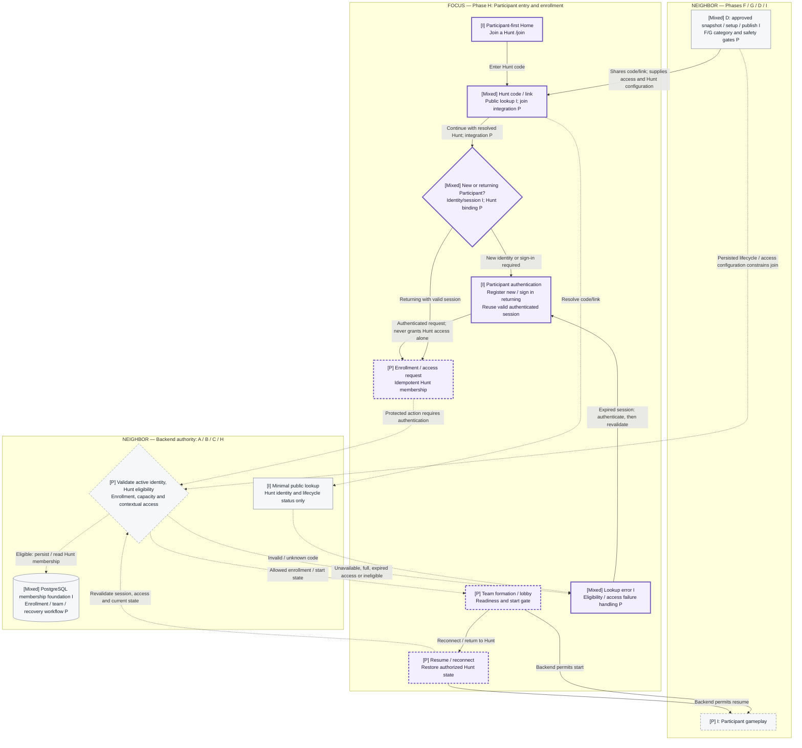

**What this diagram tells us:** H connects Organizer publication/configuration to Participant gameplay through backend-owned eligibility and Hunt membership. New Participants establish identity; returning Participants reuse a valid session or sign in again. Neither authentication nor a public code lookup enrolls a Participant. H4–H7 team/lobby/readiness/start and H8/I9 runtime recovery remain planned; existing token persistence/refresh and B1.1 context switching are foundations, not evidence of saved gameplay.

H3 must handle unknown code, closed enrollment, cancelled/finished Hunt and full capacity. Expired authentication returns through authentication and access revalidation; expired Hunt access, where an agreed contract defines it, must fail without inventing a code-expiry duration or credential policy. Existing guest-session authentication is real (A4), but H2's participant/guest enrollment eligibility and access-mode rules still need a BE contract. This diagram grants no anonymous protected action or universal guest entitlement. Section 11's unresolved Independent Organizer flow grants no Participant authorization exception.

Traceability: sections 6, 11, 14–15 and 20.1–20.3; A4–A5, B1.1/B5/B6, C4, D2/D6/D7/D10, F7/G4, H1–H8 and I2/I9/I12. Generic publication and snapshots are implemented; future category/safety readiness gates and deployed supply-chain verification remain separate prerequisites.

### H1. Resolve Hunt access code
Status: ✅ Complete

### H2. Participant enrollment
Status: ⬜ Not started

Requirements:
- real participant/guest identity
- save Hunt membership
- idempotent repeated join
- capacity enforcement

### H3. Enrollment availability rules
Status: ⬜ Not started

Handle:
- unknown code
- closed enrollment
- cancelled Hunt
- finished Hunt
- full capacity

### H4. Team creation/assignment
Status: ⬜ Not started

### H5. Team lobby
Status: ⬜ Not started

### H6. Readiness
Status: ⬜ Not started

### H7. Start gate
Status: ⬜ Not started

### H8. Session recovery/reconnect
Status: ⬜ Not started

---

## Phase I — Checkpoint runtime

Status: 🟣 Prototype only

Implement one complete checkpoint before scaling to the full mission.

### Phase I context — Participant gameplay within the platform

This is the planned authoritative runtime, using existing authoring/map foundations. The two challenge branches describe supported activity types, not a fixed Personal-before-Team order.

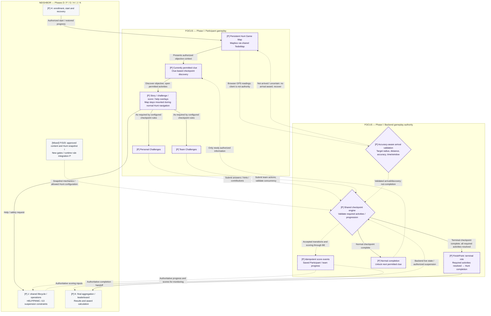

**What this diagram tells us:** H authorizes entry, F/G/D supply approved immutable content and permitted configuration, and I executes one shared checkpoint engine. Backend rules validate GPS evidence and activities, persist progress and score events, reveal the next allowed clue and complete the Hunt through FinishPoint's terminal role. Mapbox presents the map; it never decides arrival, progression, scoring or completion. Client GPS alone cannot complete a checkpoint or Hunt. Arrival mathematics and poor-accuracy fallback still require BE design and real-phone validation.

Personal/Team requirements, availability and ordering follow supported snapshot mechanics and permitted Hunt configuration; arrows do not impose a new fixed activity order or new opt-out policy. FinishPoint uses the same discovery, arrival, challenges and scoring engine. K results/awards are planned consumers of authoritative completion and scores; implemented reward configuration is not awarding.

I13/J9 safety and fairness remain constraints: suspend runtime checkpoint state without rewriting snapshots, bypass suspended normal checkpoints atomically without penalty/blocking, preserve history/earned scores, and do not mark bypass as solved. Score eligibility, timers, all-normal-suspended behavior and terminal suspension/completion policy remain unresolved. Additional Supervisors may report/request suspension only by default. No new suspension or safety policy is decided by these arrows.

Traceability: section 6 discovery/shared-engine rules, F3–F7, D3/D10, G3–G4, H7–H8, I1–I13, J1/J5–J9, K1–K6 and sections 14–16/20.3. Prove one checkpoint across independent sessions, idempotent retries and recovery before I10/I11 expansion. I14 advanced mechanics remain deferred.

### Participant information visibility — payload and authority boundary

This focused technical view applies across H/I and neighboring authoring/operations phases. Full-route inspection is a role-scoped capability, never a Participant payload permission.

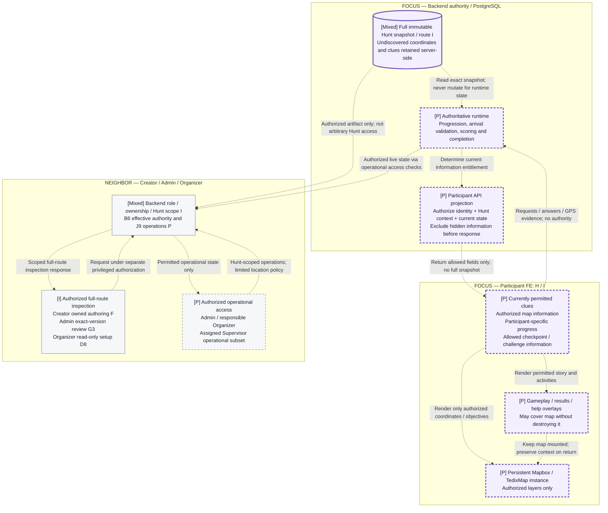

**What this diagram tells us:** Participant visibility is enforced before serialization, not by hiding markers after downloading the route. Full undiscovered coordinates/clues and locked route geometry must be excluded from Participant responses and client map layers. No automatic turn-by-turn directions, hidden destination markers or distances to undiscovered objectives are authorized. Deliberately permitted hints follow explicit backend mechanics. Persistent mounting preserves presentation state without exposing hidden objectives or route lines.

Creator ownership, Admin review/platform authority and Organizer read-only setup inspection have distinct scopes; Creator access does not imply access to every live Hunt, and global Organizer capability grants no arbitrary Hunt access. Planned J9 operational access reuses B6/D9 context authority and minimal, expiring location data; GPS TTL, consent/audience/deletion and incident retention decisions remain open. A privileged view must not become the Participant API projection.

All Participant projection/runtime nodes are planned. Existing full-content persistence, inspection, token/session and contextual-membership foundations do not prove hidden-data-safe gameplay. Refresh/reopen/recovery may create a new map and must re-fetch authorized backend state (H8/I9/I12). Traceability: sections 6, 14–15 and 20; B1.1/B5/B6, D8/D9, F5/F6, G3, H2/H8, I2–I4/I7–I9/I12–I13, J9 and K.

Diagram-extension audit (24 October 2026): read the complete current plan on FE main `5c1d580d8b11444989a1b880ecc269cb1af5c6de`, including merged D/G diagram PR #108. Checked FE `HomePage.tsx`, `routes/router.tsx`, `ParticipantJoinFlow.tsx`, `PublicHuntAccessPage.tsx`, `services/api/huntAccess.ts` and `services/api/session.ts`; BE main `routes/huntAccess.ts`, `routes/auth.ts` and `models/Hunt.ts`. Public lookup returns only Hunt identity/code/name/status and does not enroll; the current join form authenticates but does not bind its code to Hunt membership. Guest authentication issues a short-lived token without refresh, not a guaranteed recoverable enrollment. Existing Hunt setup/snapshot persistence and contextual foundations remain distinct from planned H2–H8 and Phase I authority.

Validation: additions preserve existing phase text/statuses and version 3.5. Source checks cover balanced fences/subgraphs, defined nodes, labeled relationships and planned-node styling; architecture review covers authentication, hidden payloads, map authority, configurable activities, terminal completion and suspension fairness. No Mermaid renderer is installed and shell network access fails at the environment proxy, so parser/render validation and GitHub desktop/mobile readability remain unverified. No application tests, deployment or deployed E2E were run for this Markdown-only extension.

### I1. Checkpoint runtime model
Status: ⬜ Not started

Implement one shared checkpoint gameplay engine with `normal | terminal` roles. Separate geographic persistence must map into that shared runtime without duplicating navigation, arrival, Personal/Team Challenges, scoring or completion logic. BE owns required-activity validation and authoritative progression/completion; FE consumes that state.

### I2. Participant progress state
Status: ⬜ Not started

### I3. Answer submission
Status: ⬜ Not started

### I4. Backend validation
Status: ⬜ Not started

### I5. Hint use
Status: ⬜ Not started

### I6. Personal/team contribution
Status: ⬜ Not started

Replace simulated teammates/readiness.

### I7. Score events
Status: ⬜ Not started

Use auditable score events rather than opaque browser-only totals.

### I8. Idempotency
Status: ⬜ Not started

Prevent duplicate scoring on retries/double taps/concurrent team actions.

### I9. Restore progress
Status: ⬜ Not started

### I10. Extend to all Signal checkpoints
Status: ⬜ Not started

Only after one checkpoint works across independent sessions.

### I11. FinishPoint terminal checkpoint completion
Status: ⬜ Not started

- [ ] Extend the proven shared checkpoint runtime to FinishPoint, including navigation, GPS discovery, required Personal/Team Challenges, scoring and penalties. Reuse existing challenge types and the I1–I9/I12 engine; do not implement an independent final-puzzle engine.
- [ ] Normal checkpoint completion advances to the next checkpoint. FinishPoint completion triggers Hunt completion only after BE confirms all required terminal activities are successfully resolved; GPS arrival alone never finishes the Hunt.
- [ ] Prove idempotent terminal completion, concurrent Personal/Team Challenge resolution and reconnect/recovery against authoritative BE state before Phase K results consume completion.

Intended Participant sequence:

Checkpoint 1 → required activities → Checkpoint 2 → required activities → … → FinishPoint → required Personal/Team Challenges → backend-authoritative Hunt completion.

The terminal suspension/fairness policy remains explicitly unresolved under I13; this completion rule does not decide how a suspended FinishPoint is resolved.

---

### I12. Participant geographic runtime — Mapbox M4
Status: ⬜ Not started; depends on H enrollment/start/recovery and B6
Backend / DB first, then separate FE integration slices.
- [ ] Enforce the clue-based discovery boundary in section 6: no automatic walking guidance, locked route lines, hidden coordinates, destination markers or distances to undiscovered objectives. Define authorized objective projections, discovery and progression APIs, navigation rules, FinishPoint unlock and idempotent transitions using the shared checkpoint model. FinishPoint uses the same navigation and Arrival Engine; arrival/discovery is distinct from checkpoint completion and never independently completes the Hunt.
- [ ] Build one persistent Hunt Game Map per active Participant Hunt session. Persistent means the map remains mounted during normal in-Hunt navigation; it does not mean the map is always visible. Challenges, Score / Results, Mission History, Help and other Hunt interfaces may cover or hide the map without destroying it. When the map becomes visible again, preserve its camera, zoom, location, objective, navigation and Hunt context as appropriate. Refresh, close/reopen or session recovery may create a new map instance and must restore authoritative Hunt state from the backend.
- [ ] Preserve Signal story and Personal/Team Challenges over the persistent route-map background. Use popups/overlays for story, checkpoint activities, scores and help without remounting the map; support focus return, keyboard access, mobile sheets and reduced motion. Show the seven-stop journey only as authorized by runtime visibility; do not expose locked coordinates/answers. Basic game-state map styling belongs here; advanced geographic mechanics remain I14.
- [ ] Browser Geolocation API supplies latitude, longitude, accuracy and timestamp; TedixHunt interprets readings and Mapbox renders them. Handle denied/unavailable/stale location and reconnect.
- [ ] Design and field-test the accuracy-aware Arrival Engine using target radius, distance, accuracy, timestamps and a bounded recent-reading window. Output not-arrived/approaching/arrived; do not use distance <= 5 m as the complete algorithm or claim spoof-proof browser GPS.
- [ ] Define poor-accuracy recovery/fallback and backend validation before enabling arrival awards; do not reward repeated GPS events twice.
- [ ] Implement Map, Compass, Signal Strength, Landmark, Decoded Route and Hidden navigation progressively under explicit domain rules. Hidden/locked targets must not leak through payloads, routes or client layers; direction/distance hints must be deliberately authorized.
- [ ] Derive visual hidden/locked/available/approaching/discovered/active/completed states from authoritative rules without persisting every presentation state.
- [ ] Validate one checkpoint with real phones and independent sessions, uncertain GPS, denial, refresh and network loss before I10 expands the mission.

### I13. Runtime checkpoint suspension — prerequisite for Mapbox M5
Status: ⬜ Not started
Backend / DB first, then Participant handling and J9 controls in separate FE steps.
- [ ] Add Hunt/runtime-level active/suspended state referencing snapshot checkpoint identity, with actor, time and reason; never mutate approved Template content or the immutable Hunt snapshot.
- [ ] Authorize Admin and the responsible Organizer only by default. Additional Supervisors may report/request suspension; later delegation requires an explicit new rule.
- [ ] Atomically bypass suspended normal checkpoints without penalty or blocking, including current and future objectives; preserve completed history and prior earned scores. Terminal behavior requires the unresolved policy below and must not infer Hunt completion from this bypass rule.
- [ ] Define score eligibility, timers and all-normal-checkpoints-suspended behavior before coding. Apply the same checkpoint suspension/fairness model when considering terminal checkpoints. Unresolved policy: how a suspended FinishPoint's required activities, bypass, scoring/timers and Hunt completion interact. Resolve explicitly before terminal suspension implementation; this revision introduces no new terminal suspension policy. Do not silently mark bypassed checkpoints as solved or invent completion rewards.
- [ ] Test concurrent answer/suspension requests, retries, stale clients and reconnect; refresh authoritative targets across sessions. Any reactivation rule must prevent retroactive penalties or progression rollback.

### I14. Geographic gamification — Mapbox M6
Status: ⬜ Deferred until core gameplay and J9 operate reliably
- [ ] Define Shadow/Event, Discovery/Easter Egg, Zone and Secret Location rules individually: lifecycle, visibility, trigger, eligibility, scoring and persistence.
- [ ] For each mechanic, ship BE contract/security first and then shared map presentation; add focused domain fields only when rules are clear.
- [ ] Tie reveal/pulse/completion effects to actual Hunt events with reduced-motion support. No giant generic mapObjects schema in advance.
- [ ] Test hidden-data protection and idempotent awards. Geographic Zones do not imply background geofencing.

## Phase J — Live Hunt operations

Status: 🟣 Prototype only

### Phase J context — Live Hunt operations within the platform

The active-Hunt view below is planned runtime, not the current Monitor prototype. Business authority and backend execution are separate; B6/D9 authority/allocation must precede J4/J9.

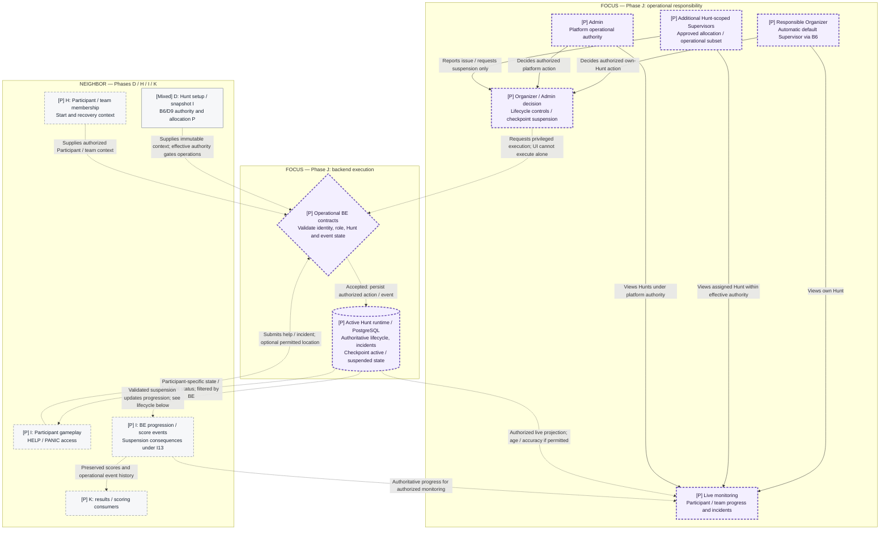

**What this diagram tells us:** the responsible Organizer is the target default Supervisor for their own Hunt, additional Supervisors receive only the approved Hunt-scoped operational subset, and Admin retains platform operational authority. Viewing progress, reporting/requesting suspension and deciding an authorized action are distinct from backend execution. Generic contextual records exist, but B6/D9 automatic supervision, allocation/revocation and effective-authority enforcement remain planned; J4's reuse requirement is not evidence of completed assignment APIs.

All live actions, including acknowledge/resolve and lifecycle controls, require backend authorization and current-state validation. Participant HELP/PANIC records feed planned incident handling; neither replaces emergency services nor promises emergency response, continuous tracking or disconnected safety coverage. J8 fallback remains to be defined. An operational end/finish control must not fabricate successful Participant FinishPoint completion.

J9 location collection is gated on explicit TTL, consent/permission, audience and deletion rules; incident evidence needs separate minimal retention. Use only authorized latest location/age/accuracy, mark stale/missing data, expire it on TTL/Hunt end and avoid permanent trails, analytics copies and raw GPS logs. Participant-specific responses must not expose other Participants' sensitive locations or hidden route data. Mapbox renders permitted information; it owns no operational authority.

Traceability: B5/B6, D7/D9, H2–H8, I2/I7–I9/I11–I13, J1–J9, K1–K3 and sections 6, 11, 14–16 and 20.3. Global Organizer capability and the unresolved Independent Organizer prototype grant no arbitrary-Hunt access or authorization exception.

### Cross-phase operational event lifecycle — checkpoint suspension

This logical lifecycle focuses on an authorized normal-checkpoint suspension. It describes required behavior, not an implemented API, schema or transport.

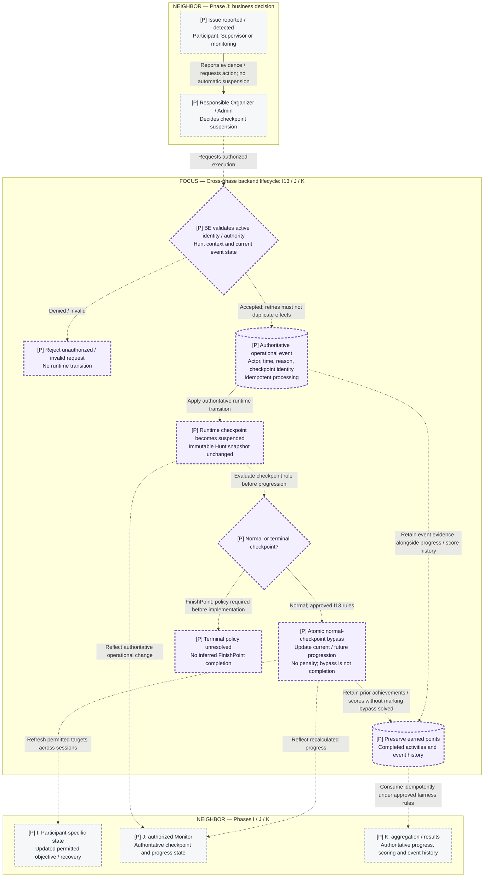

**What this diagram tells us:** a report is evidence for a decision, not authority to suspend. Only the backend validates and applies the authorized runtime change; approved Template versions and the immutable Hunt snapshot remain unchanged. Normal-checkpoint suspension bypasses current/future objectives atomically without blocking or automatic penalty, preserves earned points and completed activities, and never counts bypass as successful completion.

Fairness must cover Participants who already completed, are currently attempting or have not yet reached the checkpoint. Serialize/validate concurrent answer and suspension transitions, make retries and downstream scoring idempotent, and refresh stale clients/reconnects from authoritative state. The diagram specifies responsibilities, not a transaction/event-delivery implementation. Reactivation, if later permitted, must not cause retroactive penalties or progression rollback.

Still unresolved before implementation: score eligibility and timers after suspension; behavior when **all normal checkpoints are suspended**; and suspended terminal FinishPoint required activities, bypass, scoring/timers and Hunt completion. No branch settles those policies, invents completion rewards or infers completion from GPS arrival or a terminal bypass. Results must use authoritative history under explicitly approved rules, not browser totals or an invented fairness formula.

Traceability: B6/D9, H8, I7–I9/I11–I13, J1–J4/J9, K1–K6 and sections 6, 14–16 and 20.3. I13 BE rules and Participant handling precede J9 controls; terminal policy resolution precedes terminal suspension implementation.

### J1. Shared Hunt live state
Status: ⬜ Not started

Participant and Organizer read the same start/pause/resume/cancel/finish state.

### J2. Real Organizer Monitor
Status: ⬜ Not started

Replace mock:
- teams
- scores
- checkpoint position/progress
- status

### J3. Live lifecycle controls
Status: ⬜ Not started

### J4. Supervisor operational access
Status: ⬜ Not started

Assignment is implemented once through B6/D9 (M3). Reuse that authority for live operations; Organizer is automatically Supervisor and additional Supervisors receive only the operational subset.

### J5. Help request
Status: ⬜ Not started

### J6. PANIC / safety incident
Status: ⬜ Not started

Persist:
- team
- Hunt step
- optional location with permission
- incident state

### J7. Acknowledge/resolve
Status: ⬜ Not started

### J8. Network-loss fallback
Status: ⬜ Not started

---

### J9. Shared Live Hunt Operations Map — Mapbox M5
Status: ⬜ Not started; follows I12–I13
- [ ] BE: authorize Hunt-scoped live state and minimal location updates from active Participants; validate timestamps/payloads and throttle updates.
- [ ] Decide a short latest-location TTL, consent/permission UX, audience and deletion rules before collecting live GPS. Expire on TTL/Hunt end; avoid permanent trails, analytics copies and raw GPS logs.
- [ ] Use a bounded recent-reading buffer for arrival only where needed. Any incident-location evidence has a separate explicit minimum retention policy.
- [ ] FE: Organizer/Supervisor share LiveHuntMap with checkpoints, FinishPoint, progress, last permitted location/age/accuracy, HELP/PANIC and operational state.
- [ ] Mark stale/missing positions accurately; never imply continuous real-time tracking or safety coverage when disconnected.
- [ ] Add Organizer/Admin suspension controls backed by I13; additional Supervisors get report/request controls only.
- [ ] E2E: phone → browser → TedixHunt backend → authorized operations view; unrelated users denied, removal revokes access, expired location disappears, suspension bypass and HELP/PANIC work.

## Phase K — Results and rewards runtime

Status: 🟡 Reward configuration complete / runtime pending

### Phase K context — Results and rewards within the platform

Configured rewards are implemented; every results, eligibility and awarding step below remains planned. Competition scoring and long-term Participant achievements are separate responsibilities.

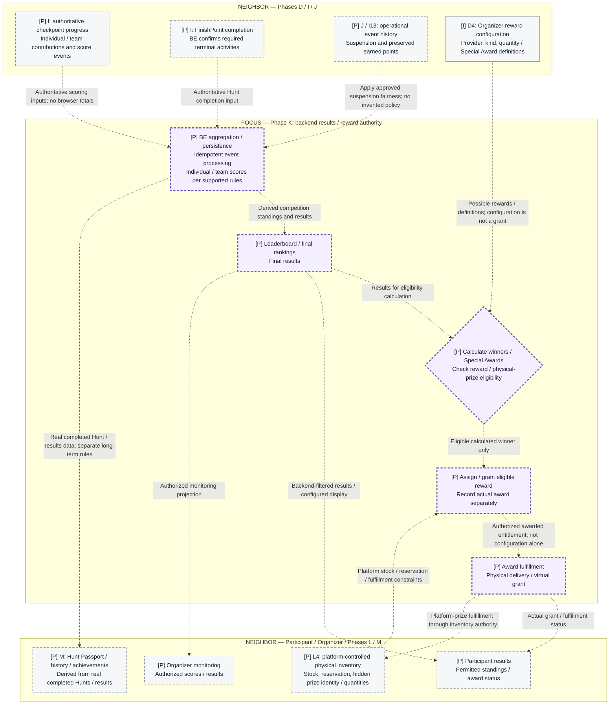

**What this diagram tells us:** backend-owned checkpoint progress, score events, FinishPoint completion and operational history feed idempotent aggregation. Individual/team contributions and scores follow supported rules; the diagram introduces no scoring formula, ranking tie-break, eligibility threshold or new competition mode. Arrival alone never completes a Hunt. Suspension must preserve earned points and completed activities, apply no automatic penalty, and keep bypass distinct from successful completion; unresolved I13 policies cannot be silently resolved by aggregation.

A configured reward, calculated winner, actually granted reward and fulfilled award are separate states/responsibilities. D4 persists possible leaderboard rewards and predefined personal/team Special Awards; existing definition metadata does not implement calculation or eligibility enforcement. K4–K6 must validate eligibility before assignment, including physical-prize eligibility. Rewards remain optional; results are not conditional on configuring a prize.

Organizer-provided rewards remain distinct from Tedix/platform-controlled physical inventory. Selecting the inventory provider or a quantity does not reserve stock, reveal a hidden prize, grant an award or prove fulfillment. L4 stock/reservation/quantity and fulfillment controls are planned, and the diagram does not invent their API or allocation policy. FE presents authorized results; it cannot calculate authoritative scores or grant prizes.

M1–M5 Passport, history, achievements and collectibles derive from real completed Hunt/results data under their own planned rules. Competition-level score is not a long-term achievement balance, and selecting a virtual reward category does not create an achievement or Passport record. Traceability: D4, I6–I9/I11–I13, J2/J9, K1–K6, L4, M1–M5 and sections 6, 14–16 and 20.3.

Diagram-extension audit (24 October 2026): based on FE main `f7cacb7d135e5da42f2d3b2ad1ddbec7403fe8fe`, including merged PR #109; read the complete plan, especially D/H/I/J/K and sections 6, 11, 14–16 and 20. Inspected FE `src/pages/OrganizerMonitor.tsx` (mock teams/local controls), `src/data/competitionResults.ts` (prototype results) and `src/services/api/rewards.ts` (configuration CRUD). Inspected BE main `4b45c2d8af15e39e049e2069c37b9e29b5ecfbf8`: `src/models/HuntRole.ts`, `src/models/HuntReward.ts`, `src/routes/huntRewards.ts` and `src/domain/rewards.ts`. Contextual role storage and draft-only reward configuration exist; these do not establish B6 effective supervision, live operations, authoritative runtime scoring, eligibility calculation or fulfillment. Existing reward-route authorization must not be mistaken for implemented B6 Admin operational authority.

Validation: the three added diagrams preserve version 3.5 and existing phase requirements/statuses, historical evidence and unresolved contracts. Source checks cover fences/subgraphs, defined nodes, labeled relationships, implementation markers and planned styling; architecture review covers backend authority, privacy, immutable snapshots, suspension fairness and configuration-versus-awarding. Mermaid parser/rendering and actual GitHub desktop/mobile readability remain unverified: no installed renderer and shell network access fails at the environment proxy. GitHub connector supplies current-source access. No application tests, deployment or deployed E2E were run for this Markdown-only extension.

### K1. Final score aggregation
Status: ⬜ Not started

### K2. Leaderboard
Status: ⬜ Not started

### K3. Final results
Status: ⬜ Not started

### K4. Special Award calculation
Status: ⬜ Not started

### K5. Reward assignment
Status: ⬜ Not started

Distinguish:
- configured reward
- calculated winner
- actually granted reward

### K6. Physical-prize eligibility
Status: ⬜ Not started

---

## Phase L — Admin operational systems

Status: 🟣 Prototype only

Implement each subsystem only when the underlying domain exists.

### Phase L context — Distinct Admin operational responsibilities

L1's core account-management integration is implemented, with deployed end-to-end verification pending. The other subsystems remain planned or prototype-only; an Admin navigation entry does not establish a real operational system.

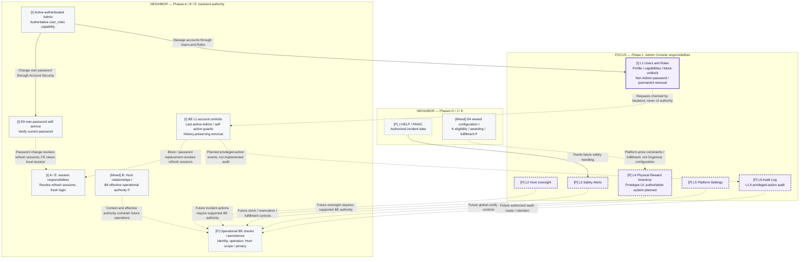

**What this diagram tells us:** L1 manages identity/profile, global professional capabilities, block/unblock, non-Admin password replacement and permanent account removal. Admin cannot replace another Admin-capable identity's password through Users & Roles, even when that identity also has other roles; their own password changes through E9's authenticated self-service path. Both password paths revoke refresh sessions. Blocking also denies current authenticated requests and refresh; unblocking does not restore revoked sessions. Removal transactionally hard-deletes an unused account or retires/anonymizes a history-bearing identity, retaining required UUID references and platform history. Last-active-Admin and self-action safeguards remain backend responsibilities.

Global Organizer/Creator/Admin capabilities differ from Hunt-scoped Participant membership and Supervisor relationships. L2's planned oversight depends on B6/backend operational authorization, not an unrestricted-access inference from the console or existing L1 authority. L3 depends on J HELP/PANIC. L4's physical stock/reservation/hidden-prize/fulfillment responsibility is separate from Organizer reward configuration and K's eligibility/actual awards. L5 contains only global settings; L6/L1.6 audit remains planned. Operational payloads must preserve Participant privacy; live-location policy remains unresolved under J9.

Traceability: L1.1–L1.6/L2–L6; E9/E10; A4/B1/B5/B6; D4; J5–J9; K4–K6; sections 6, 16 and 20.3. The implemented L1 node covers core actions only, not future auditability, broader L subsystems or a new deployed-verification claim.

### L1. Users & Roles
Status: 🟡 Core implementation complete / deployed end-to-end verification pending

Phase E now implements the minimum real Users & Roles provisioning surface needed to operate the prototype:
- list/filter Admin, Organizer and Creator identities
- direct provision/grant Admin capability
- direct provision/grant Organizer capability
- direct provision/grant Creator capability
- role-specific activation/account state
- Organizer Organization requirement
- last-Admin protection in backend logic

Participant and Supervisor are intentionally absent from global professional provisioning because they are Hunt-contextual.

FE PR #52 connects the core user-management actions below to backend-authorized endpoints. Deployed end-to-end verification and the future audit subsystem remain outstanding.

#### L1.1 View and edit user
Status: ✅ Implemented

Admin can inspect an identity and edit safe account/profile fields.

The implemented editable scope is explicit and conservative:
- name
- email only with uniqueness/normalization safeguards
- professional organization/membership data where the domain rules permit it

Do not expose password hashes, tokens or internal authentication secrets.

#### L1.2 Global role/capability administration
Status: ✅ Implemented

Admin can:
- grant Organizer capability
- grant Creator capability
- grant Admin capability
- remove Organizer capability
- remove Creator capability
- remove Admin capability

`user_roles` remains authoritative.

Participant and Supervisor continue to use Hunt-context records rather than global role administration.

Removing/blocking/permanently removing the last active Admin must be rejected.

#### L1.3 Block / unblock account
Status: ✅ Implemented

Blocking is the primary reversible operational control.

Implemented behavior:
- account has an authoritative `active | blocked | retired` status
- `active` is a normal account
- `blocked` is a reversible operational suspension
- `retired` is a permanently removed/anonymized account retained only for provenance/history
- blocked user cannot authenticate or refresh sessions
- blocking immediately revokes existing refresh sessions
- unblock restores eligibility to authenticate but does not recreate revoked sessions
- historical Hunts, templates, memberships, results and audit references remain intact

Retired identities cannot be unblocked, restored or unretired through normal account-management flows.

#### L1.4 Admin password authority
Status: ✅ Implemented

Admin is the higher platform authority for non-Admin identities and may directly replace their passwords from Users & Roles.

Target flow:

Admin selects Set password
→ Admin enters and confirms a new password
→ backend verifies the caller's authoritative Admin capability
→ backend verifies the target identity does not hold authoritative Admin capability
→ backend validates and bcrypt-hashes the new password
→ backend atomically replaces the target password hash and revokes all target refresh sessions
→ target must authenticate again using the new password

Architecture rules:
- Admin can replace passwords for Participant, Supervisor, Organizer and Creator identities
- Admin cannot read or recover the current password or password hash
- Admin cannot replace the password of another identity that holds the authoritative Admin capability
- the protection follows the identity's Admin capability, regardless of which workspace or other capabilities that identity also has
- an Admin changes their own password only through the existing authenticated own-password flow
- direct Admin password replacement is identity-level and does not alter roles/capabilities
- account status is preserved; a blocked target remains blocked
- organizations, memberships, Hunt contexts, templates, results and other business history are preserved
- successful replacement revokes all refresh sessions for the target identity
- no reset token or reset-link handoff is required for this Admin action

This direct password-replacement authority is distinct from any future public self-service “forgot password” recovery flow.

#### L1.5 Permanent account removal
Status: ✅ Implemented

Admin selects Remove account
→ backend validates self-removal and last-active-Admin safety invariants
→ backend checks durable platform references within the transaction
→ an unused identity hard-deletes with disposable account/onboarding artifacts
OR
→ a history-bearing identity retires/anonymizes while retaining its UUID as required provenance
→ platform/domain records survive without destructive cascading
→ FE reports `Account removed.`

The backend is authoritative and the entire decision is transactional. Both hard deletion and retirement are successful permanent-removal outcomes; the FE deliberately does not expose that implementation distinction. Platform history is a reason to **RETIRE** the identity, not a reason to reject account removal.

Safety rules remain:
- an Admin cannot remove their own account through this flow
- the last active Admin cannot be removed
- referential integrity and platform history must be preserved
- no account removal may destructively cascade Hunts, Organizations, templates, results, awards, reviewed applications, audit records or other platform/domain records

For retirement, `users.role` remains inert transitional compatibility data and must not be rewritten to `participant`. Retirement removes authoritative `user_roles`, does not create Participant capability or `hunt_participants`, and leaves Participant authority Hunt-contextual.

#### L1.6 Auditability
Status: ⬜ Not started

Privileged user-management actions should become audit events when the audit subsystem exists:
- profile edits
- role grants/removals
- block/unblock
- Admin password replacement
- account removal request
- hard-delete vs retirement outcome
- privileged retirement/anonymization event

The current prototype may implement the user-management behavior before the full audit-log UI, but the API/domain design must not make future auditability difficult.

### L2. Hunt oversight
Status: ⬜ Not started

### L3. Safety Alerts
Status: ⬜ Not started

Depends on Phase J help/PANIC.

### L4. Physical Reward Inventory
Status: 🟣 Prototype only

Need:
- stock
- reservation
- hidden prize identity
- fulfillment
- quantity controls

### L5. Platform Settings
Status: ⬜ Not started

Only true global configuration belongs here.

### L6. Audit Log
Status: ⬜ Not started

Audit important privileged actions:
- role changes
- approvals
- template decisions
- inventory changes
- safety actions
- sensitive settings

---

## Phase M — Participant long-term systems

Status: 🟣 Prototype only

### Phase M context — Long-term Participant value from real results

All M1–M5 remain planned. The Passport preview and sample achievement are prototype presentation, not persisted completion or long-term progression.

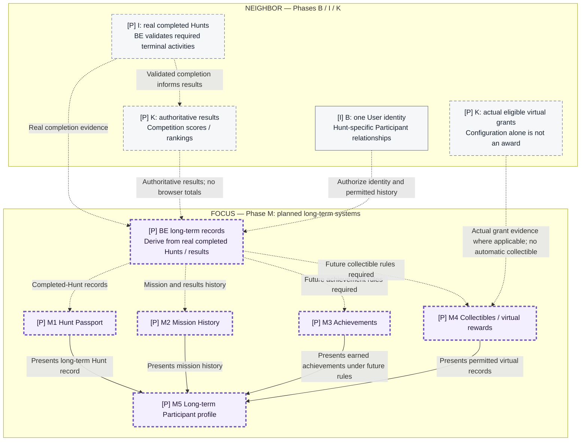

**What this diagram tells us:** Passport, Mission History, Achievements, collectibles/virtual rewards and the long-term Participant profile depend on real backend-validated completed Hunts and authoritative results. Competition-level scoring/ranking belongs to I/K; it is not a long-term progression balance or an achievement award. The arrows identify inputs and presentation responsibilities, not automatic awards, achievement thresholds, new currencies or an inventory mechanic. M3/M4 rules and persistence contracts remain future design work; K reward eligibility, actual grants and fulfillment remain distinct from M records and D4 configuration.

Long-term responses require backend authorization for the identity and permitted history. A profile or Passport must not expose hidden objectives, other Participants' sensitive information or live GPS trails. Existing identity/Hunt membership and preview screens do not implement M1–M5; the Mapbox M1–M6 aliases in section 20.3 are unrelated item IDs.

Traceability: M1–M5; B1/B5; I7–I11; K1–K6; L4; sections 6, 15–16 and 20.3. Completion and authoritative results are still upstream dependencies, with suspension fairness/terminal policy unresolved under I13.

### M1. Hunt Passport
Status: ⬜ Not started

### M2. Mission History
Status: ⬜ Not started

### M3. Achievements
Status: ⬜ Not started

### M4. Collectibles / virtual rewards
Status: ⬜ Not started

### M5. Long-term participant profile
Status: ⬜ Not started

All long-term records derive from real completed Hunt/results data.

---

## Phase N — Custom Hunt request workflow

Status: 🟣 Prototype only

Mockup flow:

Organizer
→ Ask for a new Hunt
→ Admin review
→ Creator assignment
→ Creator builds template
→ Admin approves
→ Organizer receives it

Implement after Creator/Admin template lifecycle exists.

### Phase N context — Requested content through the existing supply chain

N1–N6 remain planned. Custom-request persistence, triage and assignment will use the existing F/G/D boundaries; the current form's local “received” screen is not an implemented workflow.

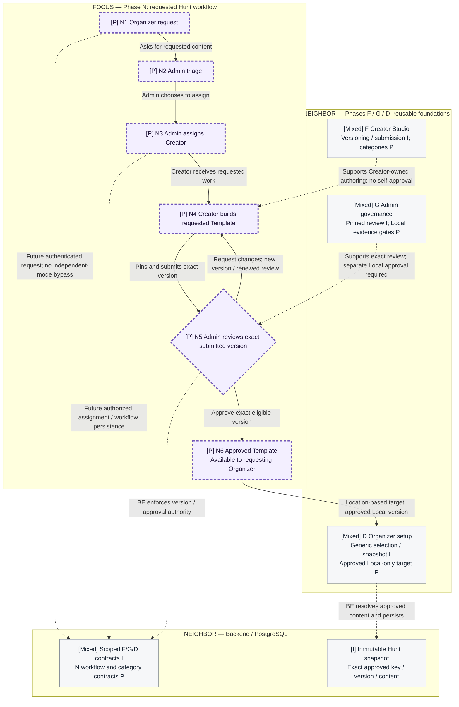

**What this diagram tells us:** Organizer requests, Admin triages and assigns, Creator authors through F, Admin reviews the exact submitted version through G, and approved content returns to Organizer setup in D. The requested workflow remains planned even though generic authoring/review/catalog/snapshot foundations exist. A Creator cannot approve their own work; enforcement for identities holding both Creator and Admin capabilities remains an unresolved BE contract output (20.2), not an implemented self-review guard.

For an ordinary location-based Hunt, the target requires an independently approved Local Template. Universal approval alone enables Creator reuse, never Organizer location-based selection or automatic Local approval. A Local may be created independently or copied from an exact approved Universal source with provenance; either path requires its own submission/review. These details reuse F7/G4 and do not invent request pricing, deadlines, automatic approval, assignment algorithms, statuses or APIs.

Section 14's explicit legacy/unclassified compatibility transition still applies: canonical Signal v1, Signal Overload, historical versions/approvals and existing snapshots remain intact; no Local classification is inferred from names or coordinates. New edits/adaptations create separately reviewed immutable versions, and later source edits/approvals never rewrite saved Hunt snapshots. Participant payload privacy remains governed by Phase I, independently of privileged authoring/review inspection.

Traceability: N1–N6; F1/F2/F7; G1–G4; D2/D8/D10; sections 6, 11–14 and 20.1–20.3. N workflow contracts and F7/G4 category, copy, evidence, combined-capability review and legacy-rollout decisions remain dependencies.

Remaining-phase diagram audit (24 October 2026): read the full plan on FE main `2c486928b044863228d27af5a3c9c9a6fc028d97` (merged #111), including A–N, sections 11–16 and 20. BE main is `4b45c2d8af15e39e049e2069c37b9e29b5ecfbf8`. Inspected FE `AdminUsers.tsx`, `AdminAccountSecurity.tsx`, `AdminConsole.tsx`, `DiscoveryFlow.tsx`, `OrganizerSetupFlow.tsx` and `services/api/adminUsers.ts`; BE `OrganizerApplication.ts`, `CreatorApplication.ts`, `AdminProvisioning.ts`, `ProfessionalProvisioning.ts`, `User.ts`, `UserRole.ts`, `HuntTemplate.ts`, `middleware/auth.ts`, `routes/auth.ts`, `routes/adminUsers.ts`, `routes/adminTemplateReviews.ts`, app route registration and migrations 015–016. These support the named account/lifecycle foundations and prototype-versus-planned boundaries, not new deployed E2E or blanket operational completeness. Source/plan discrepancies are reported in the accompanying PR rather than changing historical requirements/statuses.

Validation: four context views follow section 3.1; source checks cover Mermaid fences/subgraphs, node definitions, labeled relationships, focus/neighbor classes and planned-node styling. Cross-phase review covers one identity, authentication versus authorization, Hunt scope, Creator/Admin separation, exact approved versions, immutable snapshots, legacy Signal compatibility, Participant privacy and results versus reward eligibility/fulfillment. Mermaid parser/rendering and actual GitHub desktop/mobile readability remain unverified: no installed renderer was found and shell network access fails at the environment proxy. Use expanded diagrams where needed. No application tests, deployment or deployed E2E were run for this Markdown-only extension.

### N1. Persist custom request
Status: ⬜ Not started

### N2. Admin triage
Status: ⬜ Not started

### N3. Assign Creator
Status: ⬜ Not started

### N4. Creator builds requested template
Status: ⬜ Not started

### N5. Admin review
Status: ⬜ Not started

### N6. Return approved template to Organizer
Status: ⬜ Not started

---

## 11. Independent Organizer — unresolved architecture

Status: ⚠ Explicitly unresolved

The FE currently has prototype behavior using ?mode=independent, allowing selected setup routes to bypass normal registered Organizer flow.

This must not silently become permanent production architecture.

Possible future models:
- temporary local-only Hunt
- guest/restricted Organizer identity
- lightweight account
- require registration before publish
- another approved product rule

Until decided:
- keep it isolated
- do not expand privileges
- do not weaken backend authorization

---

## 12. Professional provisioning policy

For the current prototype:

- Organizer and Creator self-registration/application establish credentials before review; approval grants capability only
- Organizer / Creator / Admin are global professional capabilities in authoritative `user_roles`
- Participant and Supervisor remain Hunt-contextual and are not provisioned from Users & Roles
- Admin can directly provision Organizer and Creator through a distinct activation-based lifecycle
- existing identities keep their password and existing roles
- Admin-provisioned new/passwordless professional identities receive one-time activation rather than an Admin-chosen password
- guest identities cannot be promoted directly

Direct Organizer provisioning does not create an `organizer_applications` row. It creates/reuses the Organization and membership transactionally and uses `/organizer/activate-direct` when credentials must be established.

The two Creator credential lifecycles must remain separate:

**Self-registered Creator:** application → identity data + password → Pending without Creator capability → Admin Approve → Creator capability active → normal sign-in with the original password. There is no post-approval activation token.

**Admin-provisioned Creator:** Admin provisions a passwordless Creator → one-time activation → Creator establishes password → normal sign-in.

## 13. Admin bootstrap policy

There must never be a public Register as Admin flow.

The first Admin account is created through a trusted operational mechanism.

Bootstrap is for the first Admin and recovery/maintenance only.

Normal additional Admin creation is handled through the product flow:

Existing Admin
→ provision/invite Admin
→ activation when required
→ normal Admin login

The bootstrap `--allow-additional-admin` option remains an explicit recovery/maintenance escape hatch, not the routine Admin-management workflow.

---

## 14. Template lifecycle contract

Implemented Creator/Admin Template lifecycle:

Template Draft
→ exact Submitted Version pinned
→ Admin reviews that exact version
→ Approved Version
→ Organizer selects the approved persisted version
→ Hunt stores an immutable key/version/content snapshot.

Request changes returns the submitted Template to `changes_requested` while preserving the reviewed artifact and submitted-version invariant. Creator Studio revision/resubmission UI is not yet claimed as implemented.

Never let an edited Template retroactively change a published/active Hunt.

Planned v3.4 extension: Universal Draft → exact submission → Admin Universal approval → another active Creator copies that exact approved version into an independent Local Draft (or creates Local from scratch) → exact Local submission → separate Admin Local approval → Organizer selects approved Local → backend snapshots exact key/version/content. Universal approval alone never authorizes Organizer location-based selection or Local approval.

Compatibility gate: canonical Signal v1, Signal Overload Cluj-Napoca, all existing Template versions/approval states, Hunt snapshots and geographic contracts remain intact. Historical Templates without classification remain readable. Never infer Local status from a name, a city label or coordinates. Inventory legacy records and consumers, define explicit unclassified read/catalog behavior and a controlled reviewed classification/adaptation process before enforcing the new catalog rules. New Local-only filtering must not strand existing Hunts or silently remove the existing catalog before that transition is approved.

Where new category/provenance or location metadata affects immutable content, create an explicitly reviewed new version/adapted artifact; do not backfill old immutable JSONB or retrospectively alter its approval. Decide storage, mapping and rollout in the BE contract. Existing `country`/`region`/`city` Hunt fields need explicit compatibility mapping; they do not already establish canonical Locality identity.

Preserve `configuration.normalCheckpointCount`, `checkpointPositions[]` and separate `finishPoint` for Local geography. Universal validation must allow reusable structure without fixed geographic completeness. Current geographic submission rules and their pre-contract compatibility branch are existing behavior, not an implemented category distinction. Preserve existing snapshots independently of later classification, source edits, catalog changes or approval withdrawal; changes to future availability/readiness require explicit policy, never snapshot mutation.

## 15. Participant runtime implementation rule

Do not implement all seven checkpoints at once.

First prove one checkpoint end-to-end with:
- multiple real participant sessions
- saved state
- backend answer validation
- team contribution
- backend scoring
- reconnect/recovery
- Organizer visibility

Then extend the pattern.

Extend it to FinishPoint through the same engine and the terminal role in I11/I12. Configuration work in F6 must not pull the entire Participant runtime forward. Arrival alone is never the Hunt-completion condition.

---

## 16. Rewards architecture boundary

Already implemented:

Organizer configures possible rewards.

Not yet implemented:

Gameplay produces results
→ winners calculated
→ Special Awards calculated
→ reward assignment
→ physical fulfillment

Reward configuration is not reward awarding.

---

## 17. Operational / technical debt

### ⚠ Backup and restore

Confirm:
- regular PostgreSQL backup
- tested restore
- owner
- retention

### ⚠ Server access

Preferred governance:
- read-only SSH diagnostic access may be useful
- dev team remains server-change checkpoint
- infrastructure changes documented
- GitHub remains source of truth for application code

### ⚠ Legacy schema duplication

Backend still contains transitional schema definitions outside migrations. Migration history remains authoritative. Avoid expanding duplicated schema ownership.

### ⚠ Dependency/security maintenance

Address dependency/audit issues in dedicated maintenance work, not inside unrelated product PRs.

### ⚠ Real 2FA

Current Admin mockup contains fake 2FA. Do not represent it as real security.

For prototype:
- remove/bypass fake 2FA cleanly
- implement real 2FA later as a dedicated security feature if required

---

## 18. Standard implementation workflow

ChatGPT Web / Architect
→ define ONE implementation step
→ exact Codex task for ONE repository
→ Codex implements + tests
→ Draft PR
→ Architect reviews diff/tests/acceptance criteria
→ User merges
→ GitHub Actions
→ deploy
→ run new migration if required
→ restart/reload if required
→ verify deployed behavior
→ NEXT STEP

User controls final merge.

Never make untracked manual DB schema changes.

---

## 19. Definition of a good implementation step

Every step should:

- solve one clear product/architecture objective
- fit current repository structure
- preserve approved UX where practical
- define API contract before FE wiring
- use tracked DB migration for schema changes
- enforce permissions in backend
- include tests
- avoid unrelated refactors
- be deployable
- have an explicit deployed verification action

Codex guardrail:

Implement only this step. Keep the existing structure, avoid unnecessary abstractions, and use short, readable code. Add comments for business rules, permission checks and important database behavior. Do not refactor unrelated modules.

---

# 20. Implementation order and checklist

Completed foundation: A–E baseline, B1.1 contextual workspace integration, F Creator baseline, G1 real Admin review and G2 approved catalog/snapshot integration. FE #61 and #70 correct stale v3.0 status. Preserve those accepted baselines.

## 20.1 Merged implementation audit — 24 October 2026

Historical 10 October baseline (retained):

Audit source: GitHub PR merge metadata and PR scope/validation reports, checked against FE main `e3a6668bde6e55a8e7392d608a413a1586067a72` (includes #84). “Merged” below is repository evidence, not a deployed E2E result.

| Plan scope | Merged evidence | Remaining verification / boundary |
| --- | --- | --- |
| F4, radius 5..500 | [BE #60](https://github.com/tedixdev-arch/Tedix_Hunt_BE/pull/60) | Deployed contract/lifecycle evidence; no repeat implementation prompt |
| F5, Mapbox foundation/search/placement | [FE #74](https://github.com/tedixdev-arch/Tedix_Hunt_FE/pull/74), [#75](https://github.com/tedixdev-arch/Tedix_Hunt_FE/pull/75), [#76](https://github.com/tedixdev-arch/Tedix_Hunt_FE/pull/76) | Live provider/mobile and persisted authoring E2E |
| F6, FinishPoint geography | [BE #61](https://github.com/tedixdev-arch/Tedix_Hunt_BE/pull/61), [FE #77](https://github.com/tedixdev-arch/Tedix_Hunt_FE/pull/77) | Deployed save/reopen/submit |
| F6, terminal gameplay authoring | [BE #62](https://github.com/tedixdev-arch/Tedix_Hunt_BE/pull/62), [FE #79](https://github.com/tedixdev-arch/Tedix_Hunt_FE/pull/79) | Runtime/completion still Phase I; prototype custom controls not persisted |
| F6, walking route + Creator preview | [FE #80](https://github.com/tedixdev-arch/Tedix_Hunt_FE/pull/80), [#81](https://github.com/tedixdev-arch/Tedix_Hunt_FE/pull/81) | Explicit provider estimates + local simulation; no real arrival/scoring or safety certification |
| G3, Admin map preview | [FE #82](https://github.com/tedixdev-arch/Tedix_Hunt_FE/pull/82) | Exact-version deployed review/approval + real provider verification |
| D8, saved snapshot + approved Template preview | [FE #83](https://github.com/tedixdev-arch/Tedix_Hunt_FE/pull/83), [BE #63](https://github.com/tedixdev-arch/Tedix_Hunt_BE/pull/63), [FE #84](https://github.com/tedixdev-arch/Tedix_Hunt_FE/pull/84) | Explicit Inspect action is implemented; Country/City and automatic selection preview are future D10 |

Current audit checked GitHub main refs on 24 October 2026: FE `398287f8aa4aeae0824f7c022c7b59513f9669bb` (#104), BE `4b45c2d8af15e39e049e2069c37b9e29b5ecfbf8` (#68). Recent merged PR lists and the six named PR merge metadata/diffs were inspected. Source inspection covered FE `RouteEditor.tsx`, `TedixMap.tsx`, `MapboxLocationSearch.tsx`, search/camera verification reports and existing integration documentation; BE `HuntTemplate.ts`, `Hunt.ts`, `creatorTemplates.ts` domain/routes, `adminTemplateReviews.ts`, `huntTemplates.ts`, starter factory/registry and Overload review documentation. These confirm implementation beyond PR descriptions; no deployment was performed or independently verified here.

| Plan scope | Implemented and merged evidence | Deployment / independent E2E boundary |
| --- | --- | --- |
| F5 interaction/search | [FE #102](https://github.com/tedixdev-arch/Tedix_Hunt_FE/pull/102), merge `3f23d51` | Confirm/deselect, camera-only search retrieval survives blur, one Map/Satellite instance. Reported real Chromium/GL tests use mocked HTTP styles/search; live search/token/imagery and deployed fixes remain unverified. |
| F5 focus/overview/default | [FE #103](https://github.com/tedixdev-arch/Tedix_Hunt_FE/pull/103), merge `54993f3` | Focus/Show all and 15 m new positions implemented; stored radii unchanged, bounds remain 5–500 m. Original authored-only camera behavior is superseded by #104. Local browser reports are not deployed E2E. |
| F5 reference/authored camera | [FE #104](https://github.com/tedixdev-arch/Tedix_Hunt_FE/pull/104), merge `398287f` | Authored-first/reference-fallback selection/overview includes FinishPoint; repeated/readiness-safe actions do not save or confirm. [Current verification report](https://github.com/tedixdev-arch/Tedix_Hunt_FE/blob/398287f8aa4aeae0824f7c022c7b59513f9669bb/docs/reference-checkpoint-camera/README.md) records fixture-based GL/browser evidence, not live imagery/deployed data verification. |
| F2 unused-draft deletion | [BE #66](https://github.com/tedixdev-arch/Tedix_Hunt_BE/pull/66), merge `c34a66e` | Creator owner/status/dependency guards, transactional cascade and rollback are implemented; Hunt key and snapshot references block deletion. PR reports nine real PostgreSQL deletion tests and 773 full-suite passes, zero skips. Tests were not rerun here; deployment/E2E not established. |
| F2/F6 Overload starter | [BE #67](https://github.com/tedixdev-arch/Tedix_Hunt_BE/pull/67), merge `82c7a6b` | Separate seven-scene Creator-owned draft source preserves puzzles/scoring; empty authored GPS, no geographic finishPoint, walking disabled, research/physical checks pending. Not an approved or geographically certified Local Template. Reported 770 passes/33 skips; no deployed/physical E2E established. |
| F2 Creator starter discovery | [BE #68](https://github.com/tedixdev-arch/Tedix_Hunt_BE/pull/68), merge `4b45c2d` | Creator-authorized read-only fixed registry, not community reuse. Known creation dates newest-first, unknown last, stable-key tie-break; both shipped dates null. No migration/approval/publication. Reported 786 passes/33 DB-dependent skips; deployment/E2E unverified. |
| Supporting post-v3.3 work | BE #64–#65; FE #86–#101 (merged history) | Signal Cluj starter/research, deletion/starter UI, Overload and map-first positioning/search evolution. Current source/verification docs are the baseline; none establishes Universal/Local classification, canonical worldwide location identity or the full deployed supply chain. |
| F7/G4/D10 target | Architecture agreed in v3.4; not implemented | Separate BE/FE slices and recorded deployed E2E remain required. |

The existing BE approved-catalog model pins Creator `submitted_version`; platform lookup retains its current latest-version behavior. The approved-geography projection allowlists fields and re-resolves approval; current models expose no Universal/Local distinction or canonical Locality UUID. The fixed starters must not be described as an already implemented community Universal catalog.

All named six PRs have `merged = true`; their descriptions may retain historical “draft only” instructions. Those descriptions are scope/test evidence, while merge metadata establishes status. No new deployment or browser E2E was run for this documentation change. A deployed Swagger response, passing CI or a successful deployment job alone does not verify the user journey.

Step 7A is implemented (FE #70), not the next task. Preserve Step 7 supply-chain E2E as a release gate: Creator persists/submits → Admin reviews exact version/approves → catalog resolves it → Organizer selects → exact Hunt snapshot persists. Record environment, deployed FE/BE revisions, date, cases and results; do not relabel absent evidence as passed.

## 20.2 Staged workstreams before Participant runtime

These are planned workstreams, each split into small reviewable tasks, not single large implementation PRs. Keep one repository and one scoped slice per Draft PR. Review and merge BE contract decisions before dependent implementation; record deployment separately from verification.

| Order / workstream | Dependencies and small tasks | Acceptance criteria |
| --- | --- | --- |
| 1. BE contract/design — F7/G4 | First BE-only step: document category/provenance and copy semantics; then location identity/provider and failure/manual-review decisions; then validation/approval/evidence gates and legacy rollout. Review API/schema proposals before implementation. | Contract examples cover Universal without GPS, standalone Local, approved cross-Creator copy, exact source version, separate Local approval, invalid locations, unresolved blockers, immutable legacy/snapshots and authorization. Explicitly settle API/schema questions without deploying code. |
| 2. BE implementation — F7/G4 | After agreed contract: separate tracked migration/model PRs where needed; per-category draft/submission validation; authorized approved-Universal discovery/copy; hybrid location resolution/persistence; review/evidence and Local-only catalog/selection gates with controlled legacy rollout. Split further as needed. | Test ownership/capabilities, source approval races, provenance, duplicate/manual/provider failure, category gates, approval withdrawal/expiry, exact versions and snapshot stability. No world import, automatic classification or live inheritance. |
| 3. Creator FE categories/reuse — F7 | After supported-mechanic configuration/availability contracts are agreed and relevant BE APIs are available: four labeled dashboard entries and Mechanics Library guidance; My Templates type/status/version context; reusable editor; approved Universal chooser/copy and independent Local creation; normal save/submit in separate slices (F1). | Creators distinguish all three concepts, reach every dashboard entry and both Local start options, configure only supported mechanics and see only type-relevant sections with contextual explanations. Active Creators can create/submit both; cross-Creator reuse preserves exact source version/privacy and independent Local review. No separate engines or executable-mechanic authoring. |
| 4. Creator FE locations/geography — F7 | After identity/evidence APIs and category flow: Country/Locality lookup; existing/new/manual-location states; Local route authoring/adaptation; the distinct Local / Location-specific editor area with progressive disclosure and proportional evidence input, sharing mechanics with the reusable area. | Universal editors have no fixed-geography requirements; Local editors expose Country/Locality, map/route/checkpoints, local clues/adaptations and access/review evidence. Required validation remains discoverable. Cities/towns/villages/other valid localities retain UUID/context; failures/duplicates explicit; save/reopen geography using existing boundary; advisories, exceptions and blockers handled without false certification. |
| 5. Admin FE review — G4 | After BE gates and representative Creator submissions: separate category review; exact-version route/evidence inspection; approve/request changes with validity/operational conditions. | Universal approval requires no route; Local approval checks its own route/adaptations/evidence. Missing required evidence/blockers cannot bypass BE; edits require renewed version review. |
| 6. Organizer FE — D10 | After reviewed Local catalog, compatibility rollout and geography contracts: dependent location selectors; automatic preview; setup/save/reopen checks as small slices. | Country → Locality → approved Local Template → automatic read-only Mapbox preview → Hunt setup. Clear stale selections, handle missing/withdrawn data/provider errors, preserve permitted setup options and exact immutable snapshot. |
| 7. Deployed supply-chain E2E | After BE/FE deployment with recorded revisions: test both Local-from-Universal and standalone Local, cross-Creator reuse, separate Admin approvals, catalog/preview and Hunt persistence. | Record environment/date/revisions/cases/results; source edits, new approvals, withdrawal and legacy transition never mutate existing Local versions or Hunt snapshots. Verify failure states, real provider/mobile behavior and review conditions. No claim of passed E2E from merge/CI alone. |
| 8. Continue existing phases | After the content supply-chain gate, follow section 20.3: B6/D9, H, I, J, K and subsequent L–N work in scoped steps. | Prove authoritative enrollment and one checkpoint before expansion; no Participant runtime implementation pulled into F7/G4/D10. |

Unresolved BE design outputs: classification storage/versioning, exact provenance/copy transaction, community catalog authorization, provider choice/coverage/licensing, identity deduplication/manual reconciliation, lookup/caching/error contracts, evidence representation/validity/re-review and publish-readiness, self-review enforcement for combined capabilities, approval withdrawal and staged legacy catalog compatibility. These are contract decisions, not invented existing endpoints.

## 20.3 Remaining existing-phase sequence

Mapbox aliases M1–M6 are not Phase M Passport/history item IDs. M1/F4–F6 and M2/G3/D8 implementation are merged as audited above; their deployed verification remains outstanding.

1. [ ] M3 / B6 then D9 — BE effective authority/assignment APIs, then Allocate Supervisors FE.
2. [ ] H / Step 8 — Participant enrollment/team formation/start/recovery; Step 7 deployed verification gates this phase.
3. [ ] M4 / I1–I9 + I12 — one authoritative checkpoint first, with persistent map background, popup/overlay interactions, Signal story and Personal/Team Challenges, GPS/navigation/Arrival Engine. BE contracts before FE; Creator simulation is not runtime completion.
4. [ ] I13 — BE suspension/bypass rules, then Participant handling; prove before live suspension controls.
5. [ ] I10–I11 — expand proven shared gameplay to Signal's seven stops, including terminal FinishPoint; BE completes Hunt only after required terminal activities resolve. Resolve terminal suspension/fairness policy first.
6. [ ] M5 / J — backend live state/minimal GPS, then shared Operations Map, suspension controls and HELP/PANIC.
7. [ ] K — results and reward awarding; retain suspension fairness.
8. [ ] M6 / I14 — advanced geographic gamification after core rules and operations are proven; this does not defer I12's basic gamified map presentation.
9. [ ] Outstanding L Admin operations/audit, M long-term records and N custom requests as scoped steps; resolve Independent Organizer separately.

Each entry is a sequence container, not one large PR. Follow review → user merge → deployment → explicit verification, keeping implementation status and E2E status separate.

# 21. Next-step planning gate — no implementation prompt yet

The obsolete “implement F4 / 5 m radius” prompt is retired: BE #60 already merged, followed by the dependent FE work. Do not reissue it.

First review this v3.4 documentation-only FE Draft PR in the existing project workflow. After user merge, the next scoped planning target is the **F7/G4 Backend contract** in section 20.2, starting with a BE-only contract/design documentation slice for Universal/Local classification, exact-version copy provenance, category validation/approval and legacy compatibility. Follow with location/provider and evidence contracts as small reviewed tasks; no application code or migrations in that first contract slice. Only then write a separate implementation prompt for that one repository/slice.

No implementation prompts, AI-generated routes, application changes, automatic merge or deployment are included in this plan update. Preserve the existing architecture and verify deployed evidence independently.

# 22. Prototype success milestones

## Milestone 1 — Professional platform access

First Admin bootstrap/login works
→ ✅ Admin can maintain their own password
→ ✅ Admin can provision another Admin safely
→ ✅ Admin can directly provision Organizer and Creator capabilities
→ ✅ Admin can edit/block/manage roles/set non-Admin passwords and permanently remove accounts while required platform history/provenance survives
→ Organizer application/approve/normal-login works
→ Creator provision/activate/login works

## Milestone 2 — Real content supply chain

Creator creates template
→ Admin approves version
→ Organizer selects approved version
→ Hunt snapshot persists

## Milestone 3 — Real participant Hunt

Participant joins
→ team forms
→ Hunt starts
→ one checkpoint works
→ progress/scoring persists

## Milestone 4 — Complete Signal pilot

Full mission
→ live monitor
→ Help/PANIC
→ final results
→ rewards

## Milestone 5 — Long-term platform loop

Passport
→ history
→ achievements
→ repeat participation

---

# 23. Final governing rule

Account controls access. Roles control capabilities. Platform records survive accounts.

Creator creates
→ Admin governs
→ Organizer configures
→ Participant plays
→ Backend records truth

Every new implementation step should strengthen that chain without bypassing backend authority or replacing real persistence with frontend simulation.
