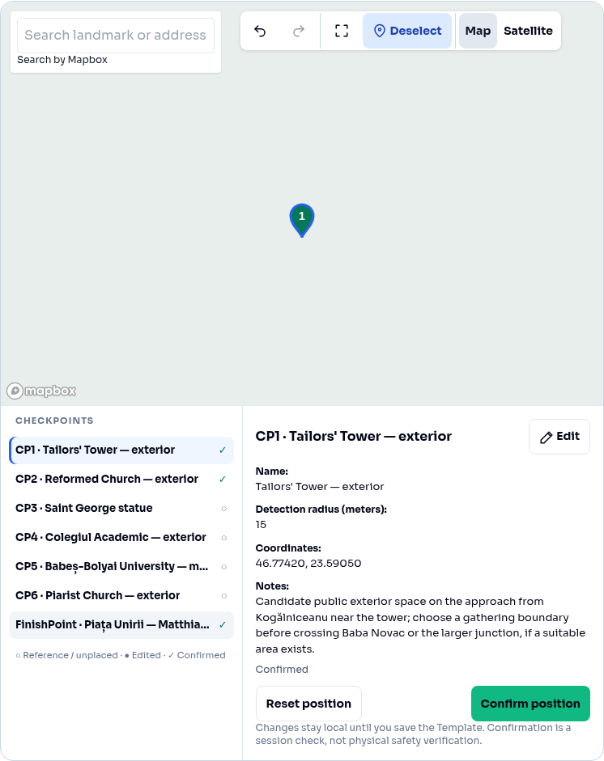
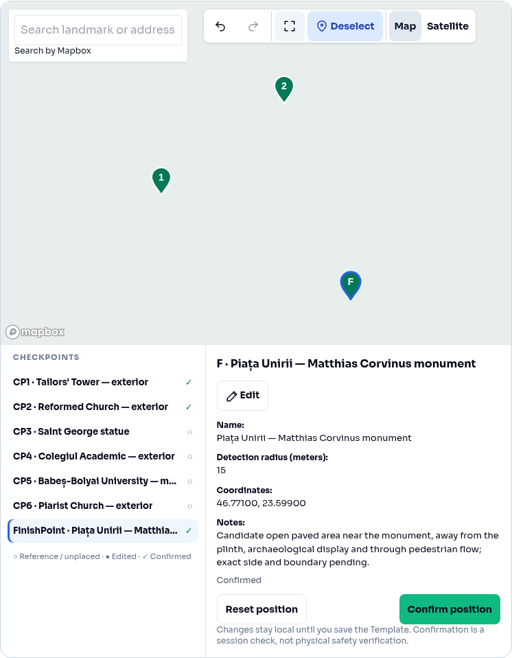
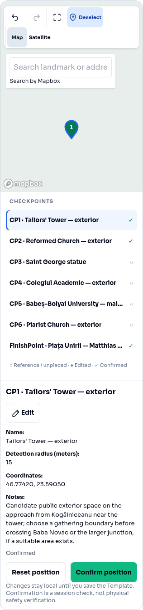
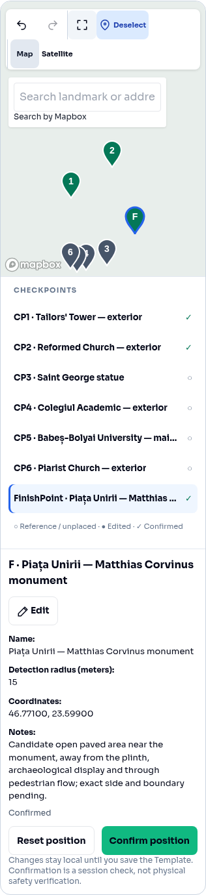
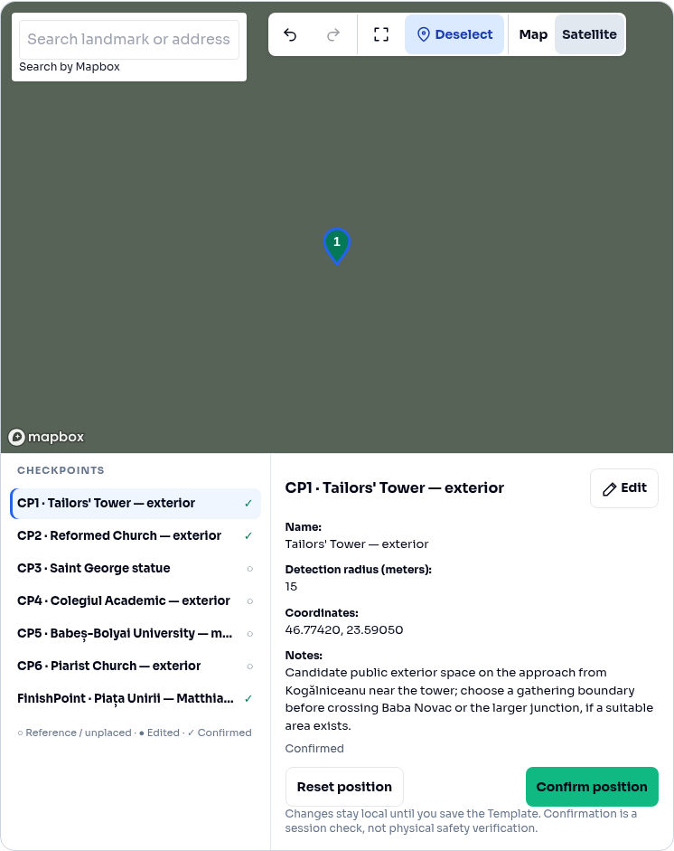
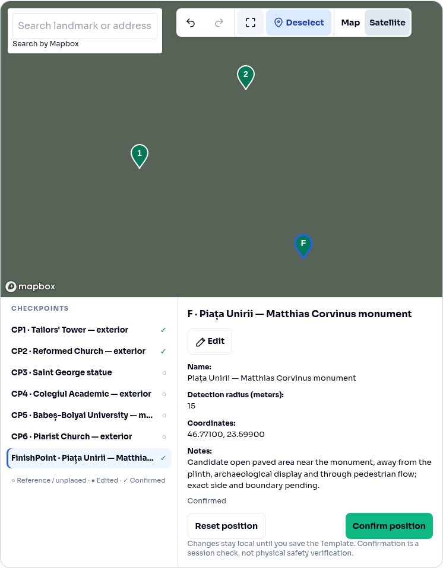
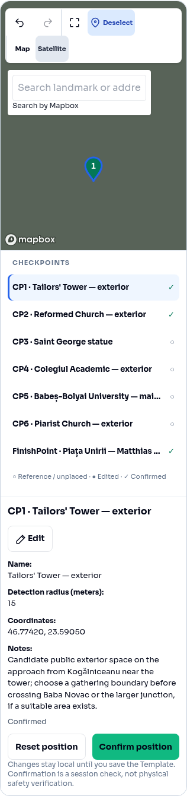
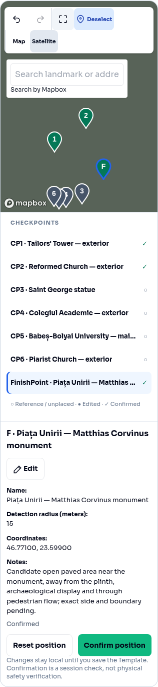

# Creator checkpoint focus and overview

Base: current `main` at `3f23d512e6765c4f091ead4e633fb2fbf9fecbbd` (PR #102).

New normal checkpoints, added checkpoint drafts and new FinishPoint drafts share a 15 m default. Existing values, including 5 m, remain unchanged through hydration, editing and serialization. The valid editing range remains 5–500 m. No existing Template or Hunt is rewritten.

Explicit list/pin selection requests camera focus only for valid authored coordinates. It uses zoom 16.5, keeps an existing zoom of 16–17 where practical, and avoids movement when the pin is comfortably visible at zoom 16–17.5. Ordinary editing, confirmation, history and style changes never trigger focus. Camera padding leaves room for toolbar/search, the pin's height and attribution. Reduced motion disables camera animation.

The 44 px Show all checkpoints icon fits valid authored coordinates, including FinishPoint, with padding and a 16.5 zoom cap. It ignores provisional research pins and invalid/missing coordinates. Zero points leave the camera unchanged; one point uses the capped fit. Neither camera action calls a geography/confirmation/persistence callback or records history. Confirmation still deselects and makes map clicks inert until explicit reselection. Search and Map/Satellite reuse the existing map.

The extra icon can wrap the existing mobile toolbar. Search is positioned beneath that toolbar, preserving the existing map/list/inspector arrangement and touch target sizes.

## API contract and backend dependency

FE sends explicit `configuration.checkpointPositions[].radiusMeters` and `configuration.finishPoint.radiusMeters` in Template content. Hydration copies stored positions; new drafts use the default only when there is no saved position. Unchanged Template content is not saved again.

Read-only inspection of `Tedix_Hunt_BE` found **no backend 5 m initialization default**. `src/domain/creatorTemplates.ts` defines `MIN_RADIUS_METERS = 5` (line 7) and validates supplied radii; `src/lib/swagger.ts` requires `radiusMeters` and declares minimum 5 / maximum 500 for FinishPoint and checkpoint positions (lines 268–287). These are validation bounds and must remain unchanged. The inspected Signal starter source files contain no radius initialization. No backend change is required for FE-created positions, and no BE files or migrations were modified.

## Verification

- `npm test`: 35 Node test files and 254 Vitest cases.
- `npm run typecheck` and `npm run build`.
- `git diff --check`.
- `tests/browser/checkpointCamera.verify.mjs`: real Chromium + real Mapbox GL camera, five widths (1280, 768, 390, 360, 320), both map modes. Checks positioned CP/FinishPoint focus, unpositioned/reference no-op, comfortable-visibility no-op, overview framing, state/history preservation, reduced motion, one map instance, no overflow/control overlap and pin clearance.
- `tests/browser/mapboxSearch.verify.mjs`: mouse/keyboard/touch/blur search, confirmation/deselection, undo/redo, intentional placement/dragging, style/camera/pin preservation and control spacing at 1280, 390 and 320 px.

Reproduce with:

```sh
VITE_MAPBOX_ACCESS_TOKEN=test-public-token npm run dev
PLAYWRIGHT_MODULE=/path/to/playwright/index.mjs node tests/browser/checkpointCamera.verify.mjs
PLAYWRIGHT_MODULE=/path/to/playwright/index.mjs node tests/browser/mapboxSearch.verify.mjs
```

Mapbox HTTP responses/styles are mocked. Screenshots show the real UI and markers over fixture backgrounds; Satellite screenshots are not aerial imagery. Live Mapbox network/token behavior remains unverified.

## Screenshots

| View | Focus selected CP1 | Show all authored CP1, CP2 and FinishPoint |
| --- | --- | --- |
| Desktop Map |  |  |
| Mobile Map |  |  |
| Desktop Satellite fixture |  |  |
| Mobile Satellite fixture |  |  |
