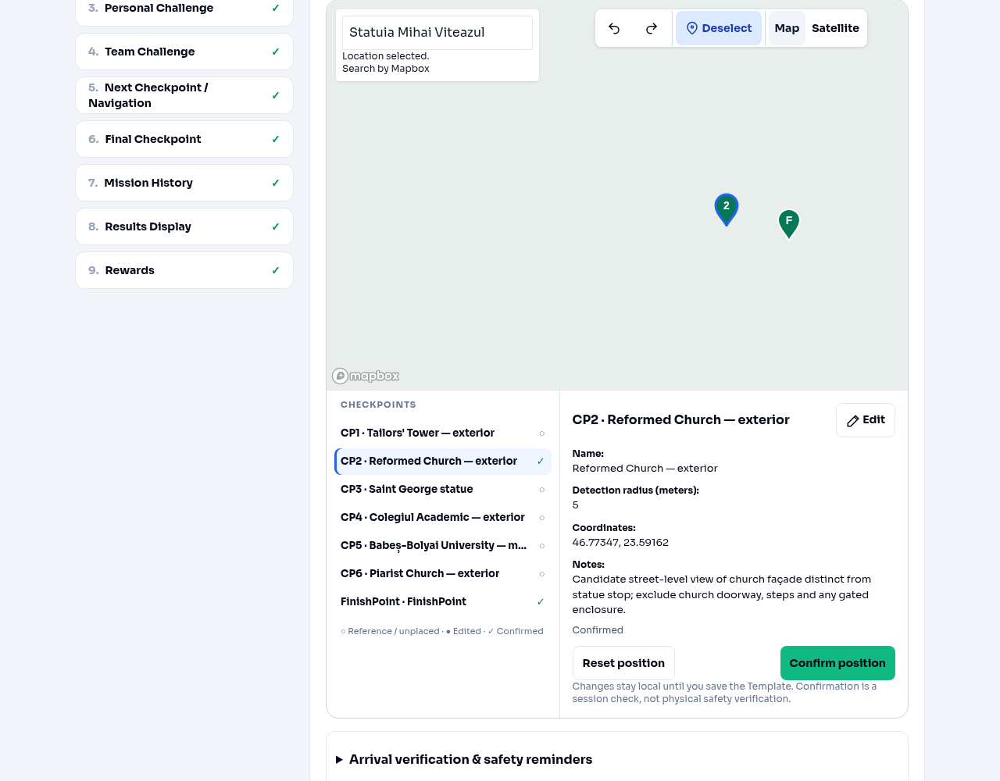
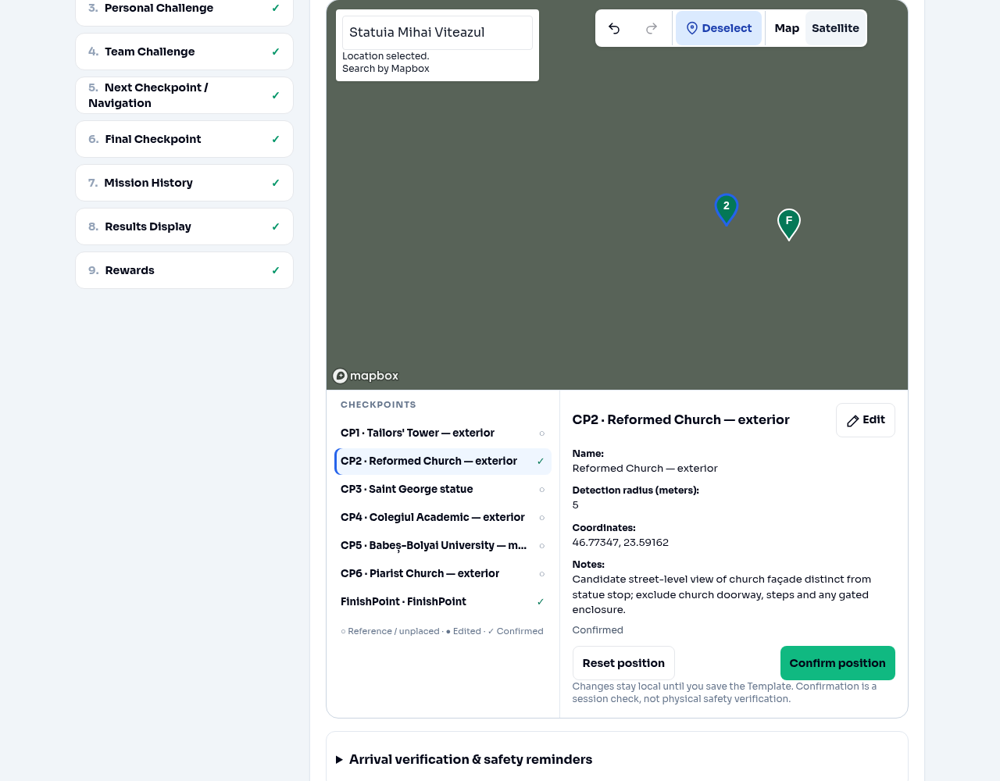
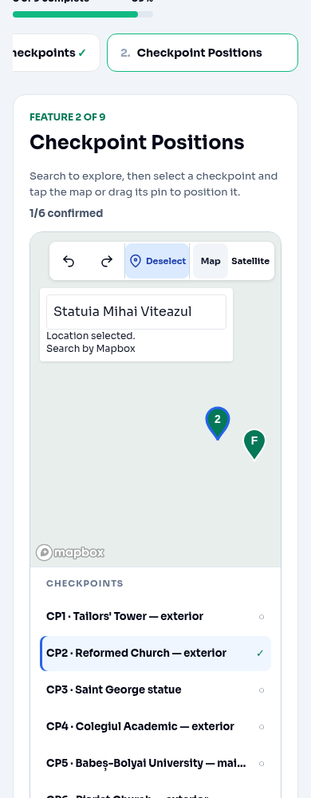
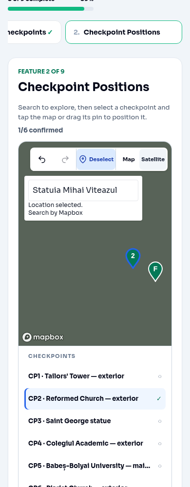

# Creator checkpoint map interaction verification

Base: current `main`, `f3918d8616506405ea0e8356932b11b6ee626a6a` (includes PR #101).

## Changes

- Confirm valid authored CP1–CPN or FinishPoint coordinates, then deselect. Keep the pin and all position history. Undo/Redo from a deselected editor keep it deselected; explicit selection enables positioning again. Moving a confirmed pin invalidates confirmation. Confirmation never saves the Template.
- Keep selected Search Box retrieval independent of suggestion requests and blur dismissal. Search remains camera-only.
- Add Map / Satellite beside Undo, Redo and Deselect. Use `streets-v12` / `satellite-streets-v12` on the same map with the same token. Existing `style.load` handlers restore custom layers/sources; DOM markers remain independent of styles.

## Search investigation

PR #101 changed the search input from disabled to read-only, but `dismiss()` still aborted a shared request controller and cleared the status. Both input and suggestion-button blur invoked it. Therefore a selected result could still be canceled by focus leaving the overlay while `/retrieve` was pending, with no visible error or camera command.

Reproduced in Chromium against the current-main search component: select the matching suggestion by keyboard, then focus an external control during the delayed retrieve response. The map stayed at the original route center (approximately `[23.5936604, 46.7685000]`), the loading status disappeared, and the expected success status never appeared. With separate request controllers and blur limited to suggestion dismissal, the same sequence navigated to `[23.5905, 46.7742]` at zoom 16. This is a demonstrated client cancellation bug; it does not establish the exact configuration or failure occurring in the deployed environment.

Trace after the fix: mouse/keyboard/touch selection → one retrieve using the suggestion session token → validated GeoJSON coordinates → existing map's `flyTo` / `fitBounds` → measured real Mapbox GL center/zoom. No authored-coordinate callback or history entry occurs. Explicit Escape and unmount still cancel retrieval; late canceled responses cannot navigate. Retrieval errors, including 401/403, remain visibly reported after blur.

The map instance exists before the user can select results. The browser test measures camera completion and stability, rather than merely spying on a camera command. Initial route fitting happens once in this editor; selection, confirmation, style changes and ordinary rerenders do not fit again. Search overlay pointer/click events stop propagation. Style changes reuse the existing map. No authentication failure was demonstrated with a real token; simulated 403 handling was verified.

## Automated checks

- `npm test`: 35 Node test files and 245 Vitest cases, all passing (280 total).
- `npm run typecheck`: passed.
- `npm run build`: passed; existing bundle-size warning remains.
- `git diff --check`: passed.

Regression tests include every CP1–CP6 and FinishPoint, confirmation/deselection/inert map clicks, reselect/edit/invalidation, history, pending retrieval with blur and proximity rerenders, HTTP and invalid-coordinate errors, explicit cancellation/unmount, style restoration, markers and listener cleanup.

## Browser checks and reproduction

```sh
VITE_MAPBOX_ACCESS_TOKEN=test-public-token npm run dev
PLAYWRIGHT_MODULE=/path/to/playwright/index.mjs node tests/browser/mapboxSearch.verify.mjs
```

The existing local Creator preview uses a fixture Template. The browser verifier uses real Chromium, real Mapbox GL and real mouse, keyboard and touch events, but intercepts Mapbox HTTP responses. The exact reported query is `Statuia Mihai Viteazul, Cluj-Napoca`; the matching suggestion is `Statuia Mihai Viteazul — Piața Mihai Viteazu, Cluj-Napoca` with a fixture retrieve coordinate `[23.5905, 46.7742]`. Each search starts far away at `[24, 47]` so unchanged cameras cannot pass.

Widths: 1280, 390 and 320 pixels. Checks include mouse click, arrow/Enter, tab-to-option/Enter, touch tap, pending-retrieve blur; stable searched center/zoom; unchanged pin geography, selection and history; CP2 and FinishPoint confirmation/deselection and history; Map/Satellite camera center/zoom/bearing/pitch and pin preservation; search while deselected, explicit map positioning and pointer dragging in both modes; visible retrieve failure; one map instance; toolbar overflow and search overlap. No browser page errors.

## Screenshots and live-verification limitation

**Live Mapbox Search API verification: unavailable.** No Mapbox public token is configured in the environment. Its network policy also does not list `api.mapbox.com`. Live landmark retrieval, deployed-origin token URL restrictions and actual aerial imagery remain unverified. Mocked tests do not prove the deployed issue is fixed.

The four screenshots below document the real UI, selected mode and markers at desktop/mobile widths using mocked background styles. The dark Satellite background is a test fixture, **not aerial imagery**. Production uses Mapbox's satellite-with-labels style URL; verify real imagery and the exact query with the deployment token before approving this draft.

| Width | Map | Satellite |
| --- | --- | --- |
| Desktop, 1280px |  |  |
| Mobile, 390px |  |  |
