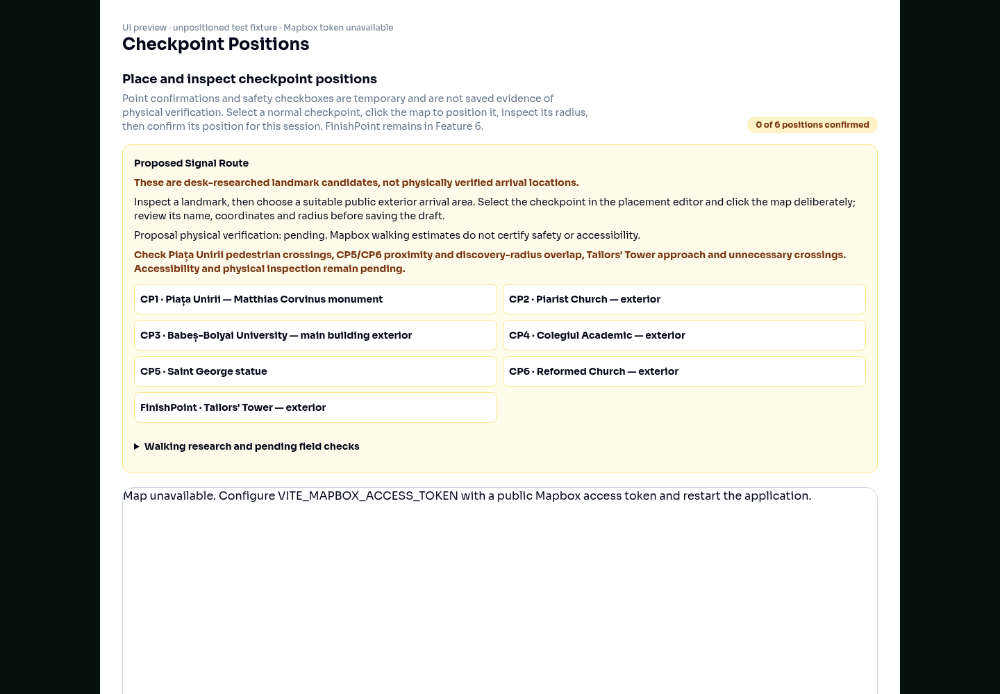
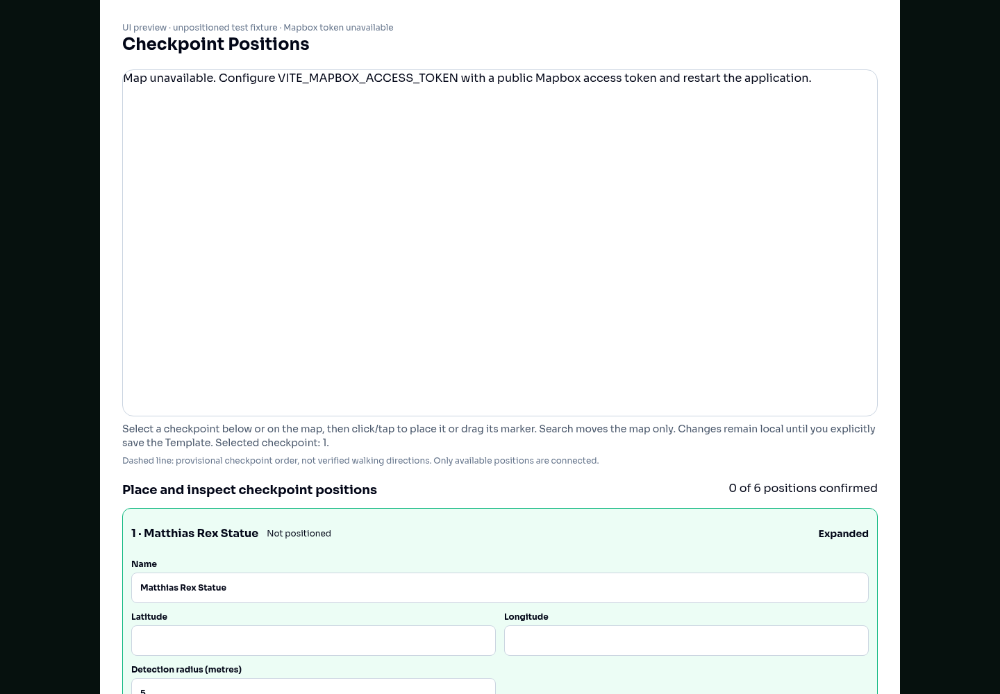
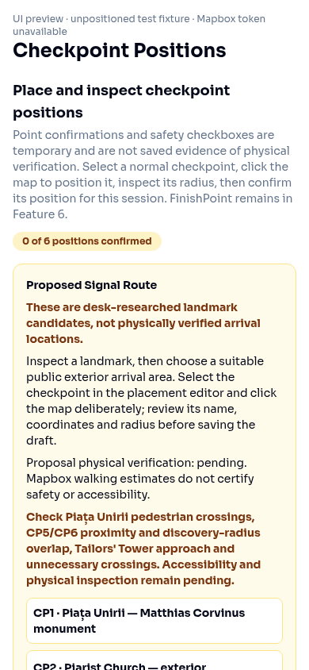
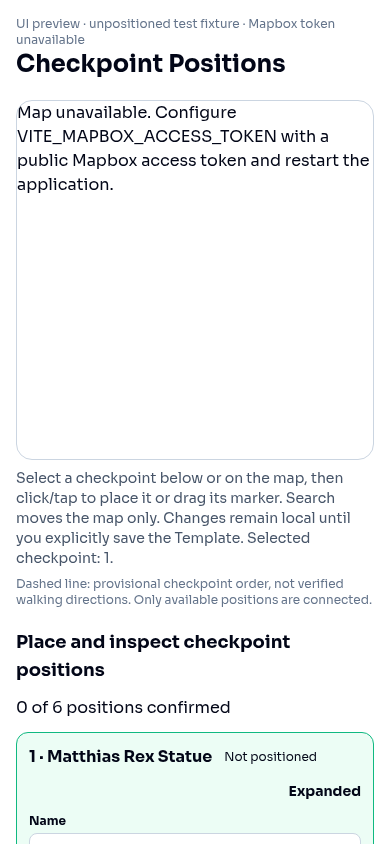

# Checkpoint positions visual review

Before/after captures use an isolated RouteEditor preview with six unpositioned normal checkpoints and the existing Signal research fixture. The after preview also exposes the separate terminal FinishPoint. No GPS locations were invented. This environment has no Mapbox access token, so screenshots show the real map-unavailable fallback; live basemap rendering and real Mapbox drag gestures still need a token-enabled browser review.

The browser check measured a 500 px desktop map at 1440 px viewport width and a 360 px mobile map at 390 px viewport width, with no horizontal overflow. It also checked list selection leaves one expanded form and that the research disclosure opens.

| | Before | After |
| --- | --- | --- |
| Desktop |  |  |
| Mobile |  |  |
