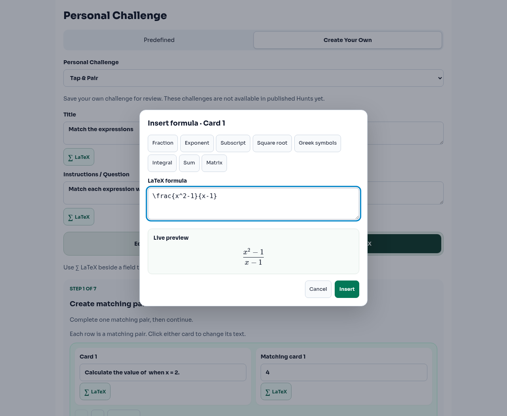
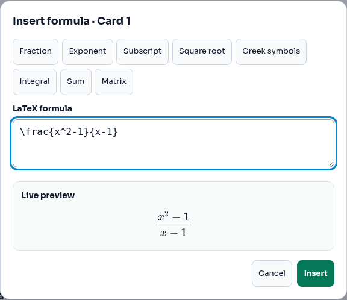
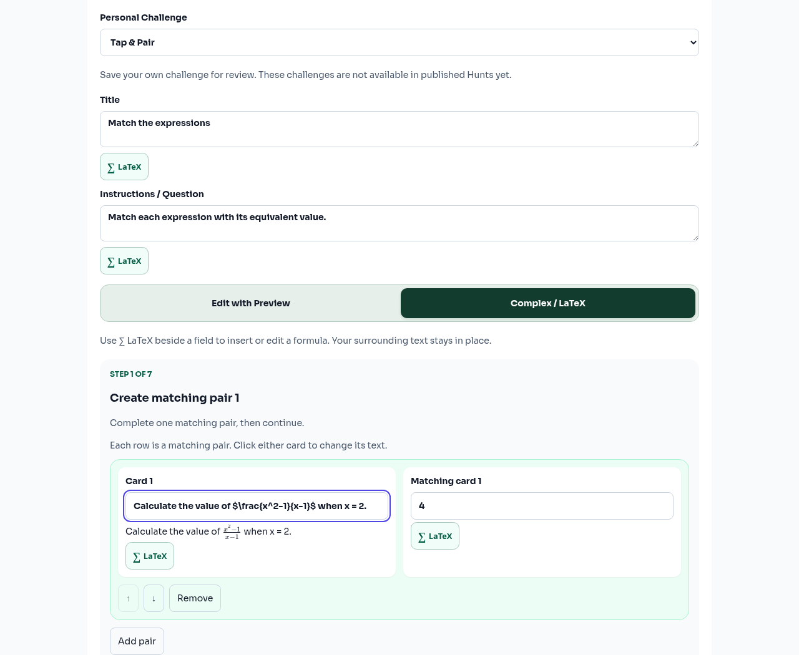
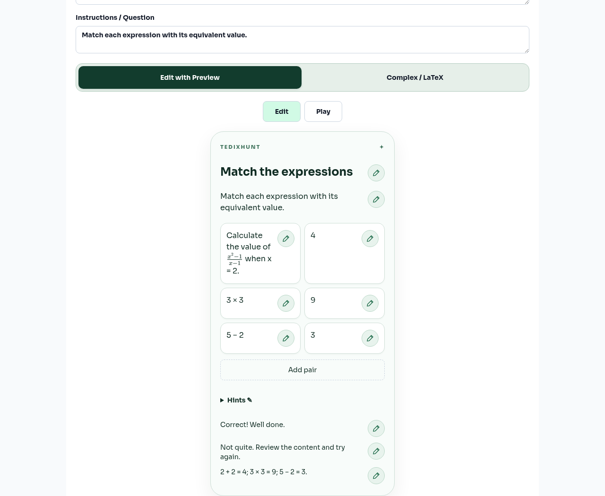
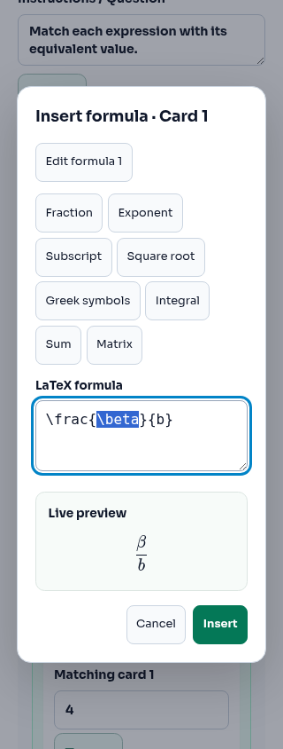

# Contextual formula authoring

Complex / LaTeX now offers a visible ∑ LaTeX control for each applicable text field. One native modal opens for the chosen field, with raw formula input, the shared safe KaTeX preview, eight shortcut categories and Insert/Apply/Cancel.

Insertion uses the field's selection/caret. Editing a formula replaces its original range, retaining inline/display delimiters and all surrounding text. Existing formulas can also be selected using the dialog's “Edit formula” buttons. Shortcuts insert templates at the formula cursor and select an editable placeholder. Greek symbols offers seven common symbols. Invalid commands/braces show the shared non-blocking error. Existing character limits apply to the entire resulting field.

The existing modes, step sequences, controls, schemas, IDs, validation, answer checking, assignment and persistence paths are retained. Edit with Preview remains the default. Numeric contract fields remain numeric.

## Verification

- `npm run typecheck`: passed.
- `npm run test -- --maxWorkers=2`: 43 Node test files and 863 Vitest tests across 40 files passed.
- `npm run build`: passed; existing large-chunk warning remains.
- Chromium: inserted `\frac{x^2-1}{x-1}` into mixed text in Card 1, verified immediate fraction preview, reopened/edited/restored it, checked native modal focus containment, Apply focus and Escape/Cancel focus, switched modes and revealed the formula in playable matching cards.
- Chromium: local save/reopen through the existing persistence adapter preserved the source string. No authenticated backend save request was made.
- Chromium: 1280px desktop and 390/320px mobile checks passed with no horizontal overflow or runtime errors.
- Focused tests also cover title/instructions, hints/feedback/solution, all 15 canonical types, existing matching IDs and validation, escaped dollars, display delimiters, shortcuts, cancellation and field-length limits.

Screenshots use the actual PersonalChallengeAuthoring component and application styles in an isolated local review harness. The harness supplies an example challenge and local save/reopen controls; it is not a new product route or workflow.

## Screenshots

Formula editor open:

Live fraction preview:

Formula inserted in a matching card:

Same formula in Edit with Preview:

Mobile at 320px:

Draft only. **STOP for ChatGPT PR review. Do not merge or deploy.**
