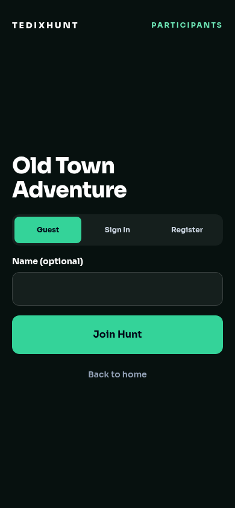
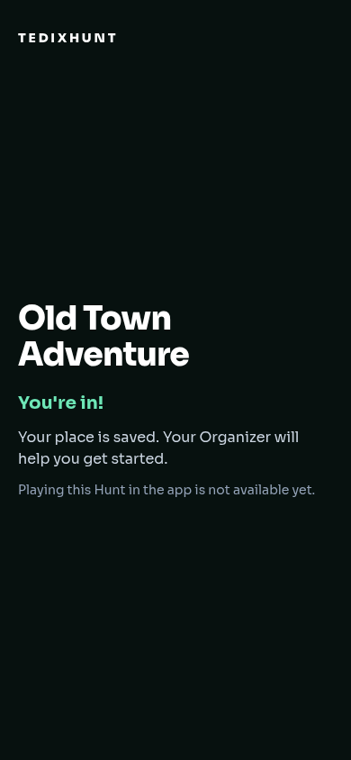

# Participant invitation join — Task 6.4

Both `/join` (manual code) and `/join/:code` (Organizer link) now use the existing JoinHuntPage. PublicHuntAccessPage delegates to it. Manual lookup reveals the Hunt name before authentication; links resolve automatically without another code field. The single primary action remains Join Hunt. Existing authenticated identities skip authentication; guest/account authentication stays inline and retains the resolved invitation.

The shared ApiClient posts only `{accessCode}` to `/api/hunts/{id}/participants/enroll`. Existing-member rejoin sends `{}` when the user returns with a retained Hunt hint. Enrollment must succeed before navigation to `/participant/setup?hunt=<backend Hunt ID>`. The complete returned stable context travels in navigation state; setup retrieves fresh caller-scoped context from `/participants/me`, including the authoritative membership and checkpoint IDs. Only the user-scoped Hunt ID/name hint is stored locally; no invitation, Team, GPS or progress is invented or persisted by this change.

The existing setup route/component now presents real membership and explains that playing is not available yet. The previous simulation is preserved as ParticipantReadinessPrototype for existing safety regression tests; it is not routed from real enrollment. All existing safety assertions remain intact.

Definitively expired access-only credentials leave a local expiry marker before clearing the session, so refreshing the join screen cannot silently create a replacement guest. Original valid credentials are required for guest continuity. Account sign-in remains available, without claiming recovery/linking. Shared client refresh and session concurrency protection are retained.

## Contract inspected

- Merged BE PR #113, merge `528b3a144d0cfaea91b9091083c98186f0a89153`, including route Swagger and ParticipantAccess model.
- Deployed Swagger: `https://tedixhunt-be-dev.anainfo.ai/api/docs.json`, retrieved 2026-11-02; public resolution, enrollment body/response and caller context match the integration.
- 404 deliberately cannot distinguish invalid, rotated and disabled codes: the UI uses a combined unavailable invitation message. Capacity and lifecycle errors have short specific messages; policy codes/raw errors are never rendered.

## Mobile UX

Single-column, max-width phone layout; full-width primary button with 64px minimum height, inputs at least 56px, authentication tabs at least 44px. Hunt names wrap. Manual code entry keeps capitalization and keyboard autocomplete. Submissions have a synchronous duplicate guard and a disabled primary action. Chromium checks at 320, 390 and 768px confirmed no horizontal overflow and 44px+ primary targets; mocked guest enrollment reached confirmed entry without browser errors. Real-device verification is not claimed. Mobile screenshots are attached below.

## Limitations

Real invitation admission and membership context only. Team formation, GPS grants, checkpoint gameplay, scoring and guest recovery/linking remain unavailable. No backend, Organizer controls, professional workspaces, Master Plan, merge or deployment changes. No live enrollment was performed against shared data; tests mock HTTP at the shared fetch boundary.

## Validation

Validated after rebasing on FE main `cdac4a6798a1498b226a831625e6211ec371370d` and installing its lockfile with npm ci:

- Full `npm test`: Node runner 43 passed, zero failed/skipped; Vitest 41 files / 877 tests passed (including 14 focused join tests).
- `npm run typecheck`: passed.
- `npm run build`: passed; existing large-chunk advisory remains.
- `git diff --check`: passed.
- Chromium phone/tablet checks and mocked guest enrollment: passed.

The setup route now accepts any authenticated identity and lets the backend verify Hunt membership; professional accounts that enroll are not sent back to join by a global-role guard. No professional workspace capabilities change.

