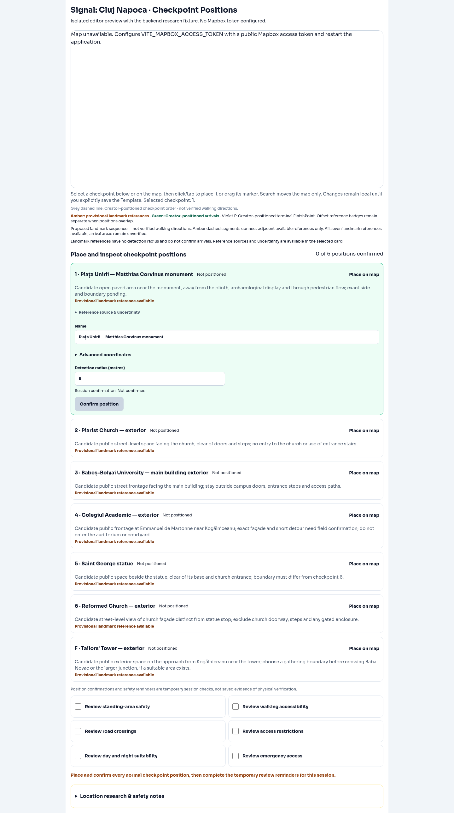
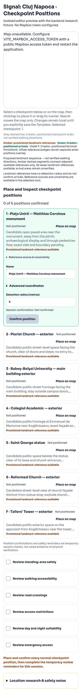

# Complete Signal Cluj provisional landmark sequence

Draft PR #93 extends the existing map-first editor from main `f141235`.
The existing backend proposal remains the authority for candidate names,
descriptions, gameplay order, uncertainties and its sourced CP6/F references.
A small five-entry FE supplement adds only landmark identifiers, reference
coordinates, sources, identification methods and uncertainty metadata. It is
provisional map-display data, never Template configuration or arrival geography.
No backend fields, APIs, mission content or gameplay were added or changed.

## Reference evidence (inspected 2026-10-12)

Coordinates below are latitude, longitude. CP1–CP5 are newly established in this
update; CP6 and F are unchanged existing backend research coordinates. Decimal
CP1–CP5 values are conversions of the object coordinates in the cited records,
not guessed map clicks, photo camera coordinates or approximate address matches.
Displayed decimal precision is not surveyed accuracy.

| Landmark | Coordinates | Source | Confidence | Remaining uncertainty |
| --- | --- | --- | --- | --- |
| CP1 Matthias Corvinus monument, Piața Unirii | 46.769500, 23.589806 | [Wikidata Q368963](https://www.wikidata.org/wiki/Q368963), [municipal identity](https://visitcluj.ro/tourist_spot/piata-unirii/) | Named monument identity supported | Monument geometry; standing area, crowds, access and square crossings unverified |
| CP2 Piarist Church | 46.767814, 23.590400 | [Wikidata Q578767](https://www.wikidata.org/wiki/Q578767), [municipal identity](https://visitcluj.ro/tourist_spot/biserica-romano-catolica-a-piaristilor/), [OSM church](https://www.openstreetmap.org/way/202393309) | Named building/address corroborated | Church reference may be indoors; OSM representative point differs slightly; exterior access/steps unverified |
| CP3 UBB main building | 46.767500, 23.591306 | [Wikidata Q42855318](https://www.wikidata.org/wiki/Q42855318), [university research](https://www.cs.ubbcluj.ro/files/orar/2026-1/sali/legenda.html) | Main-building heritage identity supported | Building reference, not entrance; unrelated Napoca UBB POI excluded; exterior suitability unverified |
| CP4 Colegiul Academic | 46.767694, 23.592500 | [Wikidata Q988141](https://www.wikidata.org/wiki/Q988141), [municipal identity](https://visitcluj.ro/tourist_spot/colegiul-academic/) | Academic College/Casa Universitarilor identity supported | Building reference; OSM representative point lies farther north; exact façade/access unverified |
| CP5 Saint George statue | 46.768061, 23.595281 | [Commons object location](https://commons.wikimedia.org/wiki/Category:Statue_of_Saint_George_and_the_Dragon_in_Cluj-Napoca), [OSM listing via Mapcarta](https://mapcarta.com/39154140), [municipal identity](https://visitcluj.ro/tourist_spot/statuia-sfantul-gheorghe-ucigand-balaurul-2/) | Named statue identity corroborated | Direct OSM node fetch unavailable; conflicting westward Wikidata point excluded; statue base and CP5/CP6 separation unverified |
| CP6 Reformed Church | 46.7683841, 23.5955112 | Existing backend `reformed` source: [VisitCluj](https://visitcluj.ro/tourist_spot/biserica-reformata-de-pe-strada-lupului/) | Existing sourced landmark reference | Building-centred pin; public frontage and separation from CP5 remain unverified |
| F Tailors' Tower | 46.768014, 23.5975153 | Existing backend `tower` source: [VisitCluj](https://visitcluj.ro/tourist_spot/turnul-croitorilor/) | Existing sourced landmark reference | Tower reference, not gathering point; approach, curb ramps, crossings and capacity unverified |

CP1/CP2 use named Wikidata object coordinates; CP3/CP4 use specific heritage
building records whose street addresses match the existing research (Mihail
Kogălniceanu 1 and Emmanuel de Martonne 1). The university's generic name also
returns other buildings, so the Napoca POI was rejected. CP5 uses the category's
statue location (46°46′05.02″N, 23°35′43.01″E), corroborated by the published
OSM node 963409421 listing and the municipal description beside the Reformed
Church entrance. Its category location is distinct from photo camera locations.
Source identifiers, identification methods, attribution and uncertainties are
available in the selected card's collapsed **Reference source & uncertainty**.
Wikidata structured data is CC0; OSM cross-checks credit OpenStreetMap contributors.

No current landmark remains unresolved in the supported seven-candidate proposal.
Unrecognized/replaced candidates, missing source-registry associations, other
cities or malformed backend coordinates remain explicitly unresolved. The FE
supplement requires the candidate's exact landmark identity, CP number, original
source ID and source URL; it never blindly attaches a coordinate by list index.
Valid backend coordinates take precedence over the supplement. CP6/F have no
copied fallback dataset and remain unresolved if their source evidence is invalid.

## Initial map and separation

All seven available references are delivered synchronously to the existing
TedixMap, without geocoding, a Resolve action or network lookup. The initial
camera fits the available references once with padding and a maximum zoom;
selection does not repeatedly reset the overview. This changes camera context
only, including when saved geography exists.

Amber numbered badges 1–6 and square provisional F have no drag callbacks,
confirmation or detection radii. Green authored arrivals remain separately
editable/draggable; authored terminal F stays violet and separate from normal
checkpoint count. Card, reference, arrival and research selection remain
synchronized. References remain visible alongside arrivals.

The amber dashed line connects consecutive available candidates only. The full
proposal has six segments, labelled **Proposed landmark sequence — not verified
walking directions.** An unavailable intermediate landmark breaks both adjacent
segments and displays an incomplete-sequence message; no gap is bridged. The
grey Creator arrival-order line remains separate. No Directions, travel times,
crossing-safety, accessibility or arrival-suitability claims were introduced.
All physical verification remains pending.

## Persistence and Mapbox investigation

Initial prefill changes only missing/default local geographic labels. Saved
positions, custom labels, radii and subsequent Creator edits remain authoritative.
Research descriptions remain read-only `arrivalArea` context. References and
source metadata never enter `buildGeographyConfiguration` or FinishPoint save
state. A name-only prefilled F remains local until deliberately edited/placed;
existing explicit authoring, validation, confirmation and immutable save flows
continue to apply. The approved backend proposal is never overwritten.

The previous address-resolution action and `landmarkGeocoding.ts` were removed:
Geocoding v6 does not establish POI identity. The existing manual Mapbox search
continues to move the map only. [Mapbox Search Box documentation](https://docs.mapbox.com/api/search/search-box/)
currently documents POI support and European coverage, but no token is configured
in this execution environment, so live landmark search/coverage was not tested.
The established static references do not depend on that runtime capability.

## Validation and browser limitations

- Focused Node reference/prefill/source/gap tests: 5 passed.
- Focused Creator Mapbox, Signal save/reload and research tests: 45 passed.
- Full suite: 219 Node tests and 195 Vitest tests passed (12 Vitest files), including
  existing Template creation/deletion and geography workflows.
- Typecheck, production build and `git diff --check`: passed.
- Existing large-bundle warning remains (main JS approximately 2.59 MB).
- Mocked Mapbox tests cover all seven initial markers, complete bounds, a single
  initial fit, non-draggable references, selectable pins, draggable arrivals,
  source metadata, unresolved gaps and absence of reference geography in saves.
- Chromium at desktop 1440 px/mobile 390 px: seven available-reference statuses,
  source disclosure, synchronized card/research selection, collapsed Advanced
  coordinates, 500/360 px map area, no horizontal overflow or browser exceptions.

Screenshots show the actual map-unavailable fallback in an isolated RouteEditor
with the existing backend fixture. Live basemap, actual Mapbox pin rendering,
interactive drag gestures and POI search were **not** validated. The UI layout
and mocked Mapbox behavior do not establish physical safety.

| Desktop | Mobile |
| --- | --- |
|  |  |
