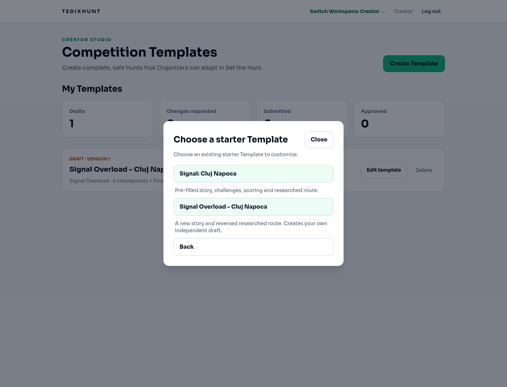
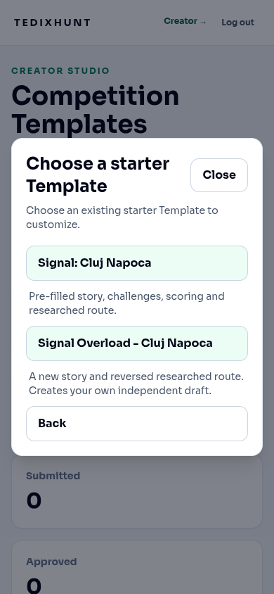
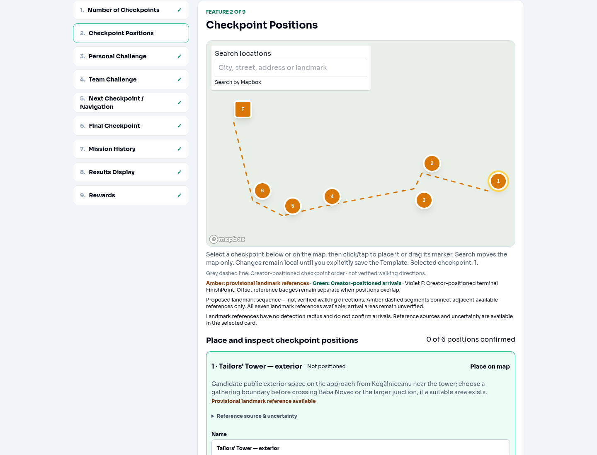
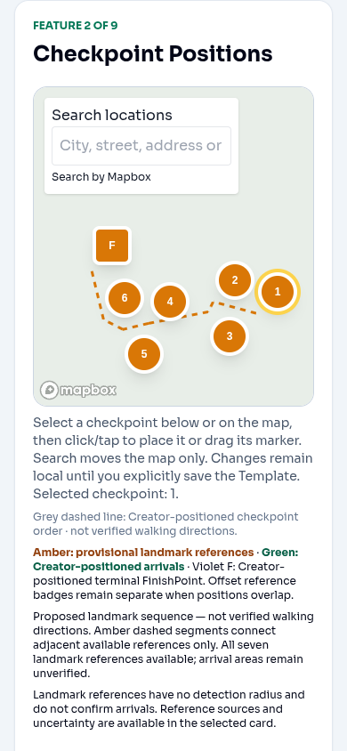

# Signal Overload in Creator Studio

Adds **Signal Overload - Cluj Napoca** alongside **Signal: Cluj Napoca** in the existing responsive starter chooser. It POSTs `/api/creator/templates/starters/signal-overload-cluj-napoca` with the existing authenticated client, creates a Creator-owned draft, and opens the returned key in the shared editor. Unavailable endpoints show an explicit error without falling back. No automatic submission, approval, publication, merge or deployment.

The backend proposal supplies the sequence; production FE never reverses it. PR #93's five coordinate supplements now match exact landmark identity and its registered source, independent of checkpoint number or normal/terminal role. Valid backend reference coordinates retain precedence; invalid/conflicting coordinates remain unresolved. No new coordinates were invented or duplicated.

| Original role | Landmark | Overload role |
| --- | --- | --- |
| F | Tailors' Tower | CP1 |
| CP6 | Reformed Church | CP2 |
| CP5 | Saint George statue | CP3 |
| CP4 | Colegiul Academic | CP4 |
| CP3 | Babeș-Bolyai University main building | CP5 |
| CP2 | Piarist Church | CP6 |
| CP1 | Matthias Corvinus monument, Piața Unirii | F |

Seven amber references and the dashed proposed sequence stay separate from green authored arrivals and violet authored F. Source metadata, uncertainty and attribution remain available. The initial reference fit reserves room for the map search overlay so it cannot hide F. Nearby reference badges separate in screen pixels without changing their sourced coordinates. Initial geographic-name prefill and the existing save/version/reopen workflow are reused; saved positions, names and radii remain authoritative. Reference coordinates do not enter gameplay configuration.

A compact read-only checkpoint story preview displays backend location, stage, problem, objective, plan, risk, success, team revelation and next destination, plus existing fictional navigation if present. Backend gameplay/story order is retained: ACCESS → TRACE → IDENTIFY → REPAIR → DECODE → LOCATE → RESTORE. Diagnostic-grid directions are explicitly puzzle content. The saved Overload theme remains selectable. Research warnings use the current backend checklist; retained original source numbering is identified as such.

## Verification

- Focused API/geography and Creator UI tests pass.
- Full suite: 34 Node test files and 200 Vitest tests pass (`npm test -- --maxWorkers=1`). The default unrestricted Vitest worker run exited after its startup banner in this environment; serial workers completed the full suite.
- `npm run typecheck`, `npm run build`, and `git diff --check` pass. Build retains the existing large-bundle warning.
- Save/reopen coverage runs for both starters: six authored coordinates, custom names/radii, separate F, unchanged mission/gameplay/scoring/research, and fresh confirmation state. API tests verify authentication, in-flight deduplication, explicit retries and no fallback.
- Real Chromium at 1440×1100 and 390×844 exercised chooser → Overload POST → returned editor → shared map. Both sizes rendered seven correctly labeled references with no page horizontal overflow.

## Capture limitations

The images use mocked Creator authentication and API responses based on the backend definitions inspected on 2026-10-12. The real shared Mapbox component renders its markers and route against a deliberately blank style with a dummy public token. Remote basemap tiles, real Creator credentials and deployed backend create/save were not tested. No walking route or physical verification is implied. Reference badges can be offset from their exact map anchor to keep neighboring labels visible; the dashed sequence and coordinates retain the backend reference geometry.

